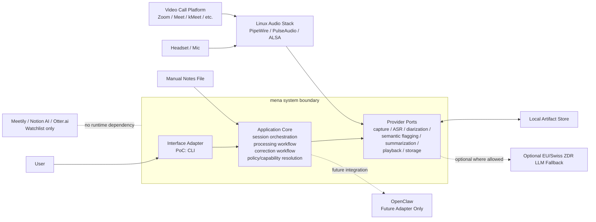
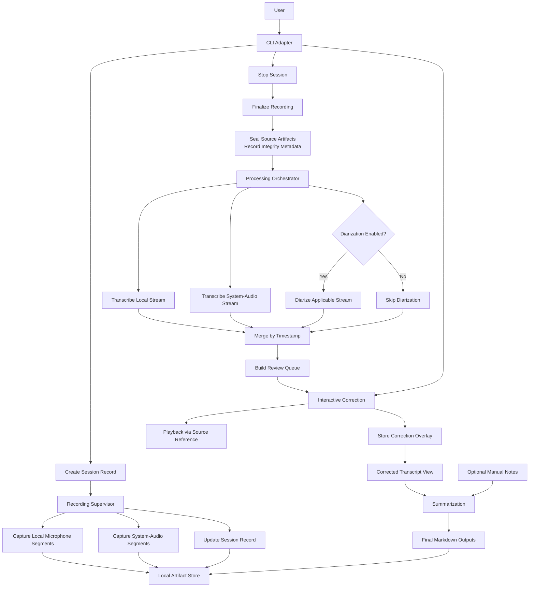
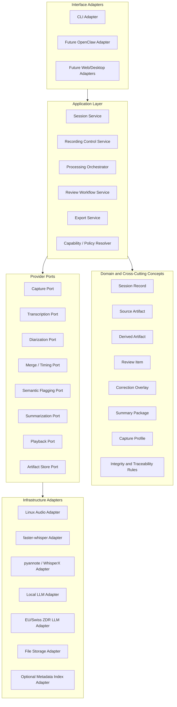

# mena Architecture Working Draft

Status: working draft for interactive architecture decisions

This document captures architecture decisions incrementally while they are being discussed.
Sections may be revised as later decisions sharpen earlier wording.

## 1. Introduction and Goals

### 1.1 Purpose

This document records the current architecture baseline for `mena` using an `arc42`-style structure.
It is deliberately iterative. The goal is to preserve decisions early without pretending that all details are final.

### 1.2 Scope of This Draft

This draft currently covers:

- current system context
- current runtime pipeline
- initial glossary
- building block view
- variability and substitution points
- deployment and runtime-data boundaries
- session model and persistence semantics
- architecture-derived research backlog

Later sections will be added as decisions are made.

### 1.3 Decision Status Convention

- `Confirmed`: accepted as current architecture baseline
- `Provisional`: accepted for now, but likely to be refined later
- `Deferred`: intentionally not decided yet

### 1.4 Current Quality Priorities

Status: Provisional

Current priority order:

1. `Recording robustness / recoverability`
2. `Sovereignty / privacy`
3. `Resumability / traceability`
4. `Local operability`
5. `Replaceability / evolvability`
6. `Output quality / user trust`
7. `Performance / processing time`
8. `Interface convenience`

Current interpretation:

- `Recording robustness / recoverability` outranks implementation simplicity and feature richness.
- `Sovereignty / privacy` outranks convenience in remote fallback configuration.
- `Local operability` and `replaceability / evolvability` are both important, but they must not undermine the first three priorities.
- `Performance / processing time` matters, but the current PoC does not have a strict latency target.
- `Interface convenience` is subordinate to correctness, safety, and future-proofing.

## 2. Glossary

- `CLI`: Command-Line Interface
- `ASR`: Automatic Speech Recognition, meaning speech-to-text transcription
- `ALSA`: Advanced Linux Sound Architecture, a Linux audio subsystem
- `Artifact`: a persisted file or data object produced by the pipeline
- `Diarization`: identifying who spoke when
- `Manifest` / `Session Record`: persisted metadata and checkpoints for a meeting session and its processing lifecycle
- `System audio`: audio captured from the operating system output path
- `ZDR`: Zero Data Retention

## 3. System Context

Status: Confirmed

### 3.1 Context Statement

`mena` is a standalone privacy-first meeting notes system.
For the PoC, the primary scenario is an online meeting on Linux using dual-stream capture:

- local microphone input
- system-audio capture, typically carrying remote participants from a conference tool

The core pipeline must remain independent from:

- the first user interface (`CLI`)
- future interfaces (`OpenClaw`, web UI, desktop UI, mobile UI)
- specific model providers
- specific execution backends

Existing products such as `Meetily`, `Notion AI Meeting Notes`, and `Otter.ai` are reference products to watch, not runtime dependencies and not part of the system boundary.

### 3.2 Context Diagram



### 3.3 Current Clarifications

- `OpenClaw` remains outside the PoC system boundary, even though its current integration path is expected to overlap heavily with the `CLI` command surface.
- `Local artifact storage` is a first-class subsystem from day one.
- `System audio` is a convenient PoC term, but architecturally the broader concern is controlled capture-source routing. This matters because future scenarios include both conference-tool output capture and in-person microphone capture.

## 4. Runtime Pipeline

Status: Provisional

### 4.1 Runtime Narrative

#### Phase 0: Session Start

The user starts a session through the current interface adapter, which is the `CLI` for the PoC.
The system creates a `session record`.

The session record is primarily system-managed, not user-authored.
User input should remain minimal.
Likely user-supplied fields include:

- meeting language
- capture mode where needed
- diarization enabled or disabled
- optional path to manual notes

Most other fields are generated by the system, for example:

- session identifier
- timestamps
- selected audio devices or routes
- list of source artifacts
- processing checkpoints
- integrity metadata

#### Phase 1: Recording

Recording is the most critical runtime path.
The recording subsystem captures:

- local microphone segments
- system-audio segments

For the current PoC, `system-audio segments` usually represent audio coming from a remote conference tool such as `Zoom`, `Google Meet`, or `kMeet`.

The system continuously flushes recorded segments to local storage and updates the session record with capture state and checkpoints.

Architectural rule:

- recording is isolated from downstream processing

#### Phase 2: Session Finalization

When the user stops the session, the recording phase is finalized.
Source artifacts become immutable inputs for later steps.
The system records integrity metadata so that later processing can verify that raw recorded input has not changed.

Architectural rule:

- source artifact integrity must be verifiable

The concrete hashing algorithm is an implementation decision unless stronger requirements emerge later.

#### Phase 3: Automated Post-Meeting Processing

The processing orchestrator reads persisted source artifacts and performs:

- local stream transcription
- system-audio stream transcription
- optional diarization where enabled
- timestamp-based transcript merging
- flagging of low-confidence, overlap, or incoherent segments

Derived artifacts are written separately from source artifacts.

#### Phase 4: Human Correction

The correction adapter presents flagged segments only.
The user may:

- correct speaker attribution
- correct transcript text
- play back the related source audio
- skip a flag

Corrections are stored as an overlay rather than rewriting the source transcript.

Architectural rule:

- each review item must carry a stable source reference so that playback and traceability remain reliable

#### Phase 5: Finalization

The finalization step combines:

- corrected transcript view
- optional manual notes

It then performs summarization and export generation.

### 4.2 Runtime Diagram



### 4.3 Clarifications and Open Precision Work

- `System-audio capture` is the current PoC expression for online meetings. The broader architectural concern is `capture source routing`, which must allow future scenarios such as in-person microphone-based meetings without rewriting the core pipeline.
- `Audio playback during correction` is treated as mandatory, not optional.

### 4.4 Process Topology Decision

Status: Confirmed

The current process topology decision is:

- one dedicated `Capture Worker Process`
- one separate `Session Orchestrator Process`

The `Capture Worker Process` owns:

- capture-source routing
- audio capture
- segment flushing
- source-artifact updates
- capture facts and source-artifact finalization facts

The `Session Orchestrator Process` owns:

- session control
- post-meeting orchestration
- correction workflow
- export generation
- capability and policy resolution

Reasoning:

- recording robustness is the highest-priority quality attribute
- recording must be isolated from downstream processing failures
- this topology is still small enough for a PoC
- it creates cleaner work boundaries for later coding-agent implementation

### 4.5 Separate Process Evaluation Rule

Status: Confirmed

A separate process is warranted only when the benefit of runtime isolation is greater than the cost of extra coordination.

Current evaluation criteria:

- `Failure isolation`
  If this part crashes, must another part survive cleanly?
- `Real-time or hardware ownership`
  Does it own timing-sensitive loops, device handles, or OS-level capture responsibilities?
- `Resource isolation`
  Can it spike CPU, RAM, GPU, or block execution in ways that would materially harm the rest of the system?
- `Lifecycle independence`
  Does it need to continue running even if another part restarts or fails?
- `Privilege or security boundary`
  Does it need stricter containment or a narrower trust boundary?
- `Runtime or framework incompatibility`
  Does it need a different event loop, runtime model, or native integration boundary?

Architectural rule:

- use a separate process only when one or more of the above criteria are materially true
- otherwise prefer module boundaries and adapter boundaries inside an existing process

### 4.6 Why Interactive Correction Is Not a Separate Process

Status: Confirmed

`Interactive correction` is not currently modeled as a separate process because it does not yet meet the process-separation criteria strongly enough.

Current reasoning:

- correction failure must not endanger sealed source artifacts, but it does not need the same hardware and timing isolation as capture
- correction is not a real-time capture concern
- correction does not currently justify separate device ownership
- correction belongs naturally to the session orchestration and review flow

Architectural note:

- `interactive correction` still deserves a clear module boundary and adapter boundary
- it does not currently deserve an OS-process boundary

### 4.7 Most Likely Next Process Boundary

Status: Provisional

If the architecture grows beyond two processes, the most likely next candidate is a dedicated `Processing Worker Process`, not a separate correction process.

Reasoning:

- ASR, diarization, and summarization runtimes are more likely than correction UI to create memory pressure, GPU pressure, native-library instability, or long blocking operations
- this creates a stronger case for failure isolation and resource isolation
- this remains a future evolution path, not a current PoC requirement

### 4.8 Internal Protocol Direction

Status: Provisional

The architecture currently assumes a private but disciplined internal protocol between:

- `Session Orchestrator Process`
- `Capture Worker Process`

Current direction:

- version the protocol from day one
- use a schema-defined `command + event` shape
- keep live coordination in the protocol
- keep durable artifacts in files
- pass artifact references, not audio payloads
- keep stop/finalization behavior idempotent where reasonable

Current architectural stance:

- protocol design should be clean enough for future reuse
- protocol design should not be over-optimized as a public platform API

### 4.9 State Authority and Session Record Ownership

Status: Confirmed

The architecture uses a `single-writer` rule for the canonical `Session Record`.

Current authority split:

- `Session Orchestrator Process` is the primary writer of the canonical `Session Record`
- `Capture Worker Process` writes source artifacts and emits capture facts through the internal protocol
- the `Session Orchestrator Process` updates the `Session Record` based on durable artifact references and capture facts

Reasoning:

- reduces race conditions
- avoids split-brain session state
- keeps the session lifecycle model consistent
- makes reconciliation and resumability easier

Architectural rule:

- both processes must not directly mutate the same canonical session ledger

Allowed future refinement:

- the `Capture Worker Process` may maintain a narrow capture journal or local operational state if needed
- such a journal does not replace or compete with the canonical `Session Record`

### 4.10 Internal Protocol Message Catalog

Status: Provisional

The first architecture-level protocol catalog is intentionally small.

The protocol currently assumes:

- explicit commands
- explicit responses where acknowledgment or data is required
- explicit asynchronous events for capture facts
- versioned schemas from day one

#### Host-to-Capture Commands

- `InitializeCaptureWorker`
- `StartCapture`
- `StopCapture`
- `GetCaptureStatus`
- `ShutdownCaptureWorker`

#### Capture-to-Host Responses and Events

- `CaptureWorkerReady`
- `CaptureStarted`
- `CaptureStartRejected`
- `SegmentFlushed`
- `CaptureHeartbeat`
- `CaptureWarning`
- `CaptureError`
- `CaptureStopped`
- `CaptureFinalized`
- `CaptureStatus`

#### Message Design Rules

- protocol messages carry control data, status data, and artifact references
- protocol messages do not carry raw audio payloads
- stop and finalization commands should be idempotent where reasonable
- live capture coordination belongs in the protocol
- durable artifacts belong in persisted storage

#### Deferred

- concrete transport mechanism
- concrete encoding mechanism
- whether capability exchange is needed in the first implementation
- exact error-code taxonomy

Deferred:

- further subdivision into additional supervised workers

Revisit trigger:

- new input topologies, such as richer in-person meeting capture
- processing concurrency requirements
- operational complexity that justifies more worker isolation

## 5. Building Block View

Status: Provisional

### 5.1 Layered Decomposition

The current architectural decomposition is:

- interface adapters
- application layer
- domain and cross-cutting concepts
- provider ports
- infrastructure adapters

The intent is to keep:

- user interaction separate from core workflow logic
- workflow logic separate from concrete model and audio tooling
- domain artifacts separate from interface-specific state

### 5.2 Layer Diagram



### 5.3 Current Building Blocks

#### Interface Adapters

- `CLI Adapter`
- future adapters such as `OpenClaw`, web UI, or desktop UI

#### Application Layer

- `Session Service`
- `Recording Control Service`
- `Processing Orchestrator`
- `Review Workflow Service`
- `Export Service`
- `Capability / Policy Resolver`

#### Domain and Cross-Cutting Concepts

- `Session Record`
- `Source Artifact`
- `Derived Artifact`
- `Review Item`
- `Correction Overlay`
- `Summary Package`
- `Capture Profile`
- `Integrity and Traceability Rules`

#### Provider Ports

- `Capture Port`
- `Transcription Port`
- `Diarization Port`
- `Merge / Timing Port`
- `Semantic Flagging Port`
- `Summarization Port`
- `Playback Port`
- `Artifact Store Port`

#### Infrastructure Adapters

- Linux audio integration
- ASR provider integration
- diarization provider integration
- local LLM integration
- EU/Swiss jurisdiction-safe fallback integration where allowed
- file storage and optional metadata indexing

### 5.4 Capture Port Decision

Status: Confirmed

The architecture uses:

- one generic `Capture Port`
- different explicit `Capture Profiles`

This means the core pipeline depends on a stable capture contract rather than on a meeting-type-specific implementation split.

Current reasoning:

- the PoC should move fast
- online dual-stream is the first active profile
- future in-person support should reuse the same core pipeline rather than fork it

Current failure mode to watch:

- if the generic capture contract becomes vague, it may hide meaningful differences between capture topologies

Architectural mitigation:

- `Capture Profile` must be explicit and strongly modeled
- routing metadata must be persisted in the `Session Record`
- downstream processing must consume artifacts plus capture metadata, not make hidden assumptions about source topology

## 6. Variability and Substitution Points

Status: Provisional

### 6.1 Purpose

This section identifies which parts of the system are:

- fixed architectural baseline
- replaceable behind stable contracts
- intentionally deferred pending research

The goal is to prevent early implementation convenience from hard-coding the PoC to one interface, one laptop profile, or one provider stack.

### 6.2 Variability Map

| Area | Current Baseline | Replaceable? | Notes |
|---|---|---|---|
| User interface | `CLI` | Yes | First adapter only; future adapters include `OpenClaw`, web UI, desktop UI |
| Capture topology | Online dual-stream | Yes | Future capture profiles include in-person microphone-based sessions |
| Capture implementation | Linux audio stack | Partly | PoC is Linux-only, but capture stays behind `Capture Port` |
| ASR provider | Not fixed yet | Yes | Must remain behind `Transcription Port` |
| Diarization provider | Not fixed yet | Yes | Must remain behind `Diarization Port` |
| Summarization provider | Not fixed yet | Yes | Local-first, EU/Swiss fallback where allowed |
| Semantic flagging provider | Not fixed yet | Yes | Same policy constraints as summarization |
| Artifact persistence pattern | Local artifact store | Partly | First-class subsystem; exact implementation still open |
| Metadata/index store | Not fixed yet | Yes | May begin minimal and grow later |
| Process topology | Not fixed yet | Yes | One process vs supervised workers remains open |
| Output format | Markdown | Partly | Markdown is current baseline; additional exports may come later |

### 6.3 Fixed Architectural Baseline

The following are currently treated as fixed unless later architecture work explicitly changes them:

- standalone PoC product
- Linux-only PoC scope
- online dual-stream PoC scenario
- local artifact store as first-class subsystem
- correction overlay instead of source transcript rewrite
- mandatory playback during correction
- provider access through ports rather than direct tool coupling
- capture variation handled through explicit `Capture Profiles`

### 6.4 Replaceable by Design

The following must be easy to swap without rewriting the core pipeline:

- interface adapter
- model/provider implementation
- local vs jurisdiction-safe fallback backend where allowed
- exact storage/indexing technology
- exact packaging/runtime strategy for different tester hardware profiles

### 6.5 Research-Driven Decisions

The following should not be guessed during implementation and should instead become explicit research tasks later:

- best Linux capture approach for reliable dual-stream routing
- realistic OS compatibility implications of the chosen capture approach
- ASR provider selection and tradeoffs
- diarization provider selection and tradeoffs
- persistence approach for artifacts, metadata, and resumable processing
- runtime strategy for lower-capability tester machines
- fallback-provider options that satisfy sovereignty constraints

### 6.6 Architectural Guardrail

If an implementation choice affects:

- replaceability
- failure isolation
- sovereignty policy enforcement
- resumability
- future interface independence

then it is not a mere implementation detail and must either appear in this architecture draft or be tracked as an open architecture question.

## 7. Deployment and Runtime Data Boundaries

Status: Provisional

### 7.1 Why This Matters Early

For the PoC, the developer machine and the first customer machine are the same machine.
This increases the risk of mixing:

- source code
- architecture and research documents
- runtime session artifacts
- model caches
- logs
- exported meeting notes

If these concerns are not separated early, the PoC will become hard to operate, hard to clean up, and easy to corrupt through normal development work.

### 7.2 Current Boundary Rule

The repository root must not be treated as the product's runtime home.

The architecture assumes a separation between:

- repository contents
- runtime working data
- long-lived user data
- generated exports

### 7.3 Architectural Consequences

- runtime artifacts must not be written into arbitrary source-code directories
- session outputs must not rely on git-tracked paths as their canonical storage location
- integrity and reconciliation logic must work independently from the repository layout
- local development convenience must not define the production data model

### 7.4 Current Direction

The exact directory layout is still open, but the architecture already assumes:

- source code and documentation live in the repository
- runtime data lives outside normal source directories
- the application can be run locally by a developer without making the repository itself the canonical data store

This decision supports both:

- local PoC development on the same machine as day-to-day use
- later packaging into a more product-like local application

## 8. Session Model and Persistence Semantics

Status: Provisional

### 8.1 Session Bundle vs Session Record

The architecture distinguishes between:

- `Session Bundle`: the complete persisted collection for one meeting session
- `Session Record`: the structured ledger for one meeting session

The `Session Bundle` is the container concept.
It groups together everything that belongs to one meeting session.

The `Session Record` is one artifact inside that bundle.
It does not replace the bundle and it does not duplicate all bundle contents.

Current model:

```text
Session Bundle
├── Session Record
├── Source Artifacts
├── Derived Artifacts
├── Review Artifacts
└── Export Artifacts
```

### 8.2 Session Bundle Decision

Status: Confirmed

The baseline persistence pattern is:

- one `Session Bundle` per meeting session
- one `Session Record` per `Session Bundle`

Reasoning:

- it keeps session ownership clear
- it supports resumability cleanly
- it supports artifact integrity checks
- it avoids treating the repository or a global index as the canonical home of session data

### 8.3 Session Record Role

Status: Confirmed

The `Session Record` is canonical for:

- session identity
- workflow state
- artifact references
- integrity metadata
- checkpoints and operational trace

The `Session Record` is not canonical for:

- transcript bodies that already exist as artifacts
- raw audio payloads
- user-interface-only transient state
- privacy-sensitive analytics beyond what is required for session operation

### 8.4 Artifact-First Persistence Refinement

Status: Confirmed

The architecture uses:

- artifact-first persistence
- a per-session ledger (`Session Record`)
- a lightweight rebuildable global index

That means:

- files/artifacts are primary for captured and generated content
- the `Session Record` is primary for one session's lifecycle and references
- the global index is a projection and must be rebuildable

If divergence occurs:

- missing referenced artifact -> mark session broken and stop downstream trust
- unindexed artifact -> mark orphaned and require explicit recovery path
- integrity mismatch -> mark artifact tainted or corrupt and stop trusting it
- stale index with consistent bundles -> rebuild the index

### 8.5 UX and Quality Telemetry Separation

Status: Provisional

The architecture distinguishes between:

- `operational session data`
- `product-quality and UX telemetry`

The `Session Record` should contain only the operational data required to run, resume, verify, and inspect a session safely.

Product-quality and UX telemetry must be stored separately from core session operation.

Examples of telemetry that may be valuable:

- number of flagged segments
- number of user corrections
- categories of corrections
- processing durations
- model/provider identifiers
- fallback backend usage
- review completion status
- whether the user accepted the session result as satisfactory

Examples of data that must not be treated as product telemetry:

- transcript text
- meeting topic content
- participant identity
- user identity beyond what is operationally required for a local installation
- anything that reveals what was discussed

Architectural direction:

- telemetry must be privacy-preserving by design
- telemetry must be decoupled from canonical session operation
- telemetry should be derived from session outcomes and interaction events, not by duplicating meeting content
- telemetry should be exportable or analyzable without exposing meeting substance

### 8.6 Session Lifecycle as State Machine

Status: Confirmed

The session lifecycle must be modeled as a state machine, not as a one-way linear pipeline.

The earlier linear narrative is useful for explanation, but it is not sufficient as the architecture model.

Reasoning:

- processing may fail and resume
- review may be revisited
- exports may be regenerated
- optional steps such as diarization may be skipped or re-run

Current direction:

- normal forward progress exists
- retries and partial rollback paths must exist where operationally meaningful
- source artifacts remain immutable once sealed
- derived artifacts may be regenerated
- review overlays may evolve without mutating source artifacts

## 9. Architecture-Derived Research Backlog

Status: Provisional

The detailed architecture-derived research backlog lives in:

- [Architecture Research Backlog](../research/backlog/architecture-research-backlog.md)

This separation is intentional:

- the `arc42` draft remains the architectural narrative and decision trail
- the research backlog remains the execution-oriented list of questions that need bounded or deep research

## 10. Quality Requirements and Utility Tree

Status: Provisional

This section translates the current quality priorities into concrete architectural scenarios.

### 10.1 Utility Tree

#### 1. Recording Robustness / Recoverability

Highest priority.

##### 1.1 Capture survives downstream failure

Scenario:

- while capture is running, the `Session Orchestrator Process` crashes or must restart

Expected:

- the `Capture Worker Process` continues safely where feasible or, at minimum, all already flushed segments remain preserved and usable

##### 1.2 Bounded data loss on recording interruption

Scenario:

- a system-level interruption occurs during recording, for example process kill, power loss, or OS-level failure

Expected:

- loss is limited to the current unflushed segment
- already flushed source artifacts remain recoverable

##### 1.3 Detect capture degradation explicitly

Scenario:

- an audio device disappears, capture routing drifts, or captured system-output audio becomes polluted

Expected:

- the system emits an explicit warning or error
- the system does not silently report capture as healthy

#### 2. Sovereignty / Privacy

##### 2.1 Allowed remote fallback under insufficient local inference capability

Scenario:

- a machine lacks sufficient local inference capability for an LLM-dependent stage such as summarization or semantic flagging

Expected:

- only an allowed remote fallback may be used
- fallback use remains constrained by sovereignty policy
- the user may provide required credentials, but may not arbitrarily configure disallowed remote providers or models

##### 2.2 Product telemetry reveals no meeting substance

Scenario:

- product-quality telemetry is exported or analyzed for UX improvement

Expected:

- correction counts, durations, model/provider identifiers, and satisfaction outcomes may be present
- transcript text, participant identity, meeting topic, and discussion substance are absent

##### 2.3 Local data remains inspectable and controllable

Scenario:

- the user wants to inspect, retain, or remove local runtime/session data

Expected:

- relevant session artifacts remain locally accessible
- data is not trapped only inside hidden internal storage structures

#### 3. Resumability / Traceability

##### 3.1 Resume after interrupted processing

Scenario:

- processing is interrupted by a process or system failure, for example during diarization or summarization

Expected:

- on next launch, the system detects the interrupted state
- already completed steps are reused where safe
- source artifacts remain trusted if integrity checks still pass

##### 3.2 Distinguish user interruption from system interruption

Scenario:

- the user intentionally stops or interrupts a workflow, or the system interrupts it unexpectedly

Expected:

- user-initiated interruption leaves the system waiting for later user action
- system/process interruption leads to safe recovery and resumability behavior on next start
- the two cases are not conflated

##### 3.3 Artifact integrity is verifiable

Scenario:

- a source artifact changes after sealing

Expected:

- integrity mismatch is detected before further downstream trust is granted

##### 3.4 Rebuild projections from canonical data

Scenario:

- the global index becomes stale or corrupted

Expected:

- the index can be rebuilt from `Session Bundles` and `Session Records`

#### 4. Local Operability

##### 4.1 Clean local runtime separation

Scenario:

- the developer machine is also the first customer machine

Expected:

- repository files, runtime data, model caches, logs, and user outputs stay separated

##### 4.2 Install, update, and remove path is manageable

Scenario:

- a user wants to install, update, or remove the local CLI product

Expected:

- product files can be installed and removed cleanly
- uninstalling the product does not imply deleting the repository or user session data by default

#### 5. Replaceability / Evolvability

##### 5.1 Interface swap without core rewrite

Scenario:

- the `CLI` is later complemented by `OpenClaw`, a desktop UI, or another adapter

Expected:

- core workflow logic remains unchanged

##### 5.2 Provider swap without domain rewrite

Scenario:

- the `ASR`, diarization, or summarization provider changes

Expected:

- domain artifacts and orchestration logic remain stable

##### 5.3 Capture-profile extension without pipeline fork

Scenario:

- in-person capture is added after online dual-stream

Expected:

- the core pipeline reuses the same artifact/session model rather than forking around meeting type

#### 6. Output Quality / User Trust

##### 6.1 Exception-first review remains bounded

Scenario:

- a noisy or uncertain meeting generates many low-confidence segments

Expected:

- the user reviews flagged segments by default, not an overwhelming raw transcript

##### 6.2 Output is trustworthy enough to adopt

Scenario:

- the user finishes a session and judges whether the result is acceptable

Expected:

- the meeting notes are useful enough to replace or materially reduce the current manual process

#### 7. Performance / Processing Time

##### 7.1 Safe completion outranks speed

Scenario:

- a faster processing option conflicts with recoverability, sovereignty constraints, or stability

Expected:

- the system chooses the safer and more policy-compliant path over the faster one

##### 7.2 Automated stages complete without babysitting

Scenario:

- post-meeting processing runs on a realistic local machine

Expected:

- automated stages proceed without manual intervention between steps unless a true review or failure boundary is reached

#### 8. Interface Convenience

##### 8.1 Convenience remains subordinate to architecture goals

Scenario:

- a more convenient interface behavior would blur safety or architectural boundaries

Expected:

- convenience is sacrificed before robustness, privacy, resumability, or clean separation of concerns

## 11. Cross-Cutting Concepts

Status: Provisional

Cross-cutting concepts define recurring architectural rules that multiple building blocks must obey.
They are not a dumping ground for every important topic.

### 11.1 Capture Source Model

Status: Confirmed

#### Problem

`mena` must support different ways of obtaining meeting audio without rewriting the rest of the processing pipeline.

Current PoC profile:

- online meeting with dual-stream capture

Near-future profile:

- in-person meeting with a single room microphone

#### Architectural Rule

The system processes audio through explicit `Capture Profiles` and `Capture Sources`, not through filename conventions or hidden interface assumptions.

A `Capture Profile` defines:

- expected source topology
- meaning of each source
- diarization expectations
- whether speaker identity is structurally known
- how downstream processing should interpret captured artifacts

A `Capture Source` records:

- logical source identity
- technical source kind
- semantic role
- selected device or route
- channel layout
- diarization policy
- expected pollution risk where relevant

`Device / Route Selection` binds a logical capture source to a concrete operating-system device or route.

#### Initial Profiles

`online_dual_stream`:

- source: `local_mic`
- semantic role: local user
- diarization: not needed
- source: `system_audio`
- semantic role: remote participant mix, with possible pollution from non-meeting system audio
- diarization: optional or expected when speaker attribution matters

`in_person_single_mic`:

- source: `room_mic`
- semantic role: mixed room speakers
- diarization: expected when speaker attribution matters
- status: future profile, not current PoC requirement

#### User Interaction Rule

If only one profile is active, the system may default to it.

If multiple devices or routes plausibly match a required source, the interface adapter should ask the user to confirm the selected device or route.

Example:

- headset microphone and laptop microphone are both available
- `mena` should surface the choice instead of silently assuming the correct one

The operating system may provide default devices and available routes, but the system must not assume that the operating-system default is necessarily the best meeting source.

#### Affected Parts

- `Capture Worker Process`
- `Session Orchestrator Process`
- `Session Record`
- `Capture Port`
- artifact metadata
- processing orchestration
- future interface adapters

#### Failure Mode Prevented

Without this concept, the PoC may hard-code:

- local file means the user
- remote file means everyone else

That works for online dual-stream capture but breaks once in-person single-mic capture is added.

#### Open Questions

- exact minimum source metadata for the first implementation
- user-facing command shape for profile selection once multiple profiles exist
- capture-source health checks
- Linux-specific routing mechanics

Research link:

- [R-02 Linux Audio Capture and Routing Strategy](../research/backlog/architecture-research-backlog.md#r-02-linux-audio-capture-and-routing-strategy)

### 11.2 Artifact Lifecycle and Integrity

Status: Confirmed

#### Problem

Recording, processing, correction, and export all touch persisted artifacts.
Without shared lifecycle and integrity rules, the system can silently mutate source material, confuse raw output with corrected output, or trust stale/corrupt files.

#### Architectural Rule

Artifacts are classified by role and lifecycle.
Downstream artifacts must never mutate upstream artifacts in place.

The architecture uses this evidence chain:

```text
raw audio
  -> raw ASR transcript
      -> correction overlay
          -> corrected transcript view
              -> summary / exports
```

#### Artifact Categories

`Source artifacts`:

- canonical captured inputs
- highest evidentiary value
- sealed after capture
- examples: raw audio segments, finalized raw audio

`Derived artifacts`:

- generated from source artifacts
- preserved for transparency
- may be regenerated if upstream artifacts remain valid
- examples: raw ASR transcript, diarization output, merged transcript

`Review artifacts`:

- represent human or system review state
- change interpretation without rewriting raw derived output
- examples: review queue, correction overlay

`Export artifacts`:

- final or user-facing composed outputs
- may be regenerated from valid upstream artifacts and overlays
- examples: corrected transcript view, summary markdown, export bundle

Telemetry artifacts are intentionally excluded for now.
Telemetry remains a research topic until its event model, storage rules, identifiers, and privacy constraints are defined.

#### Integrity Rules

- raw audio source artifacts are canonical and must not be mutated after sealing
- raw ASR transcripts are preserved as original derived outputs, but are not canonical truth
- corrections are stored as overlays and do not rewrite raw transcripts
- corrected transcript views and summaries are composed outputs
- downstream processing must verify required upstream artifacts before trusting them
- if a source artifact fails integrity verification, downstream trust stops

#### Provisional Lifecycle States

Initial lifecycle vocabulary:

- `open`: artifact is still being written or produced
- `sealed`: artifact production is complete and the artifact should not be modified in place
- `verified`: artifact integrity has been checked successfully
- `tainted`: artifact failed verification or is otherwise not trustworthy
- `derived`: artifact was generated from upstream artifacts
- `superseded`: artifact was replaced by a newer generated version but remains available for traceability

The exact lifecycle vocabulary may be refined during implementation, but the source/derived/review/export distinction is architectural.

#### Affected Parts

- `Capture Worker Process`
- `Session Orchestrator Process`
- `Artifact Store Port`
- `Processing Orchestrator`
- `Review Workflow Service`
- `Export Service`
- `Session Record`
- global index projection

#### Failure Mode Prevented

Without this concept, the system may:

- overwrite raw transcripts with corrected text
- lose the distinction between model output and user correction
- trust corrupted audio or stale derived artifacts
- make future regeneration with improved models difficult

#### Open Questions

- exact hash algorithm and integrity metadata format
- exact artifact directory layout inside a `Session Bundle`
- exact lifecycle state names used in implementation

### 11.3 Session State and Recovery Model

Status: Provisional

#### Problem

Session progress is not a one-way linear checklist.
Recording, processing, review, export, interruption, retry, and regeneration can happen in different orders depending on user actions and system failures.

Without a shared state and recovery model, the system may rely on vague flags, infer state from file presence, or confuse user interruption with system failure.

#### Architectural Rule

Session state is layered.
The architecture does not commit to one giant state machine or to a specific implementation representation such as a simple enum.

The current architectural commitment is:

- model broad session lifecycle explicitly
- model processing jobs explicitly
- model artifact validity/freshness explicitly
- model review progress explicitly
- record failure reasons and recovery options where useful
- distinguish user interruptions from system/process interruptions

#### Layered State Model

`Session lifecycle state`:

- broad phase of the meeting session from the user's and system's perspective
- examples: created, recording, recorded, processing, review pending, reviewed, exported, failed
- exact names are provisional

`Job state`:

- operational state of a processing step
- examples: transcription pending/running/completed/failed/skipped; diarization pending/running/completed/failed/skipped
- GPU out-of-memory during transcription belongs here as a failed job with a failure reason, not as a top-level session lifecycle state

`Artifact state`:

- trust and freshness of persisted artifacts
- examples: source audio sealed/verified/tainted; summary current/stale/superseded
- this connects directly to `Artifact Lifecycle and Integrity`

`Review state`:

- progress of human correction and review
- examples: review queue pending/in progress/completed/abandoned; review item unresolved/corrected/skipped/marked overlap
- exact names are provisional

#### Failure and Recovery Semantics

System or process interruption:

- the system should detect interrupted work on next start
- already completed work should be reused where safe
- recovery should be based on session records and artifact integrity, not guesswork

User interruption:

- the system should stop or pause intentionally
- later progress should wait for explicit user action where appropriate
- user interruption must not be conflated with system failure

Processing failure:

- the failed job should record enough reason to support recovery
- examples: GPU out-of-memory, missing model, provider failure, invalid input artifact
- recovery options may include retrying, using another local backend, using an allowed fallback, skipping optional work, or aborting the workflow

#### Regeneration and Superseding

Source artifacts are sealed and are not casually superseded.

Derived, review, and export artifacts may become:

- stale
- regenerated
- superseded

Example:

- a raw ASR transcript generated by one model may later be superseded by a transcript generated from the same sealed audio using a better model
- the previous transcript remains available for traceability unless an explicit cleanup policy removes it

#### Decided Now

- the state model must be layered
- recovery must distinguish user interruption from system/process interruption
- source artifacts remain authoritative even when downstream jobs fail
- derived/review/export artifacts may be regenerated or superseded
- exact state representation is not decided

#### Open Design Thoughts

- a simple enum may be too weak for the full model
- several smaller state fields may be clearer than one large state enum
- exact state names should be kept provisional until implementation pressure clarifies them
- the state model should stay small enough that developers and agents can reason about it reliably

#### Affected Parts

- `Session Orchestrator Process`
- `Capture Worker Process`
- `Session Record`
- processing jobs
- review workflow
- export generation
- global index projection

#### Failure Mode Prevented

Without this concept, the system may:

- use vague flags such as `done` or `valid`
- overwrite history during reprocessing
- show exports that appear current but were generated from stale corrections
- recover by guessing from file presence alone
- treat user cancellation and system failure as the same event

### 11.4 Provider Capability and Policy Model

Status: Provisional

#### Problem

Different pipeline stages need different execution providers.
Some stages must remain strictly local because they handle audio or speaker-sensitive data.
Other stages may use a policy-approved remote fallback if local execution is unavailable or insufficient.

Without a shared provider and policy model, provider selection logic can become scattered across workflows and adapters.
That creates risk of laptop-specific assumptions, accidental remote calls, or inconsistent sovereignty enforcement.

#### Architectural Rule

Provider-backed stages must go through:

```text
Workflow
  -> capability request
      -> policy-aware capability resolver
          -> provider adapter
```

Workflow code must not call concrete providers directly.

Provider selection must consider:

- required capability
- stage policy
- local availability
- configured credentials
- sovereignty constraints
- allowed fallback rules

#### Current Stage Policy

`recording`:

- local only
- no remote fallback

`transcription`:

- local only
- no remote fallback
- reason: audio must not leave the machine due to `mena`

`diarization`:

- local only
- no remote fallback
- reason: audio and speaker-sensitive data must not leave the machine due to `mena`

`semantic coherence flagging`:

- local preferred
- policy-approved fallback may be allowed
- details pending research

`summarization`:

- local preferred
- policy-approved fallback may be allowed
- likely first stage where a more capable remote model might be useful

#### User Configuration Rule

Local provider configuration may be flexible during PoC and research.

Remote fallback configuration must be narrower:

- the user may provide required credentials
- the user must not be able to arbitrarily choose disallowed remote providers or models
- allowed remote fallback options must be constrained by policy

#### Scaffold Implication

The future repository scaffold should preserve this boundary.

Expected conceptual areas:

- capability contracts or ports
- policy/capability resolver
- local provider adapters
- remote provider adapters where allowed
- tests for provider selection and policy enforcement

Example conceptual shape:

```text
workflow
  asks for summarize(...)

resolver
  chooses local provider if available and sufficient
  or chooses policy-approved fallback if allowed
  or fails with an actionable reason

provider adapter
  executes the selected local runtime or remote API
```

#### Decided Now

- recording, transcription, and diarization are local-only
- summarization and semantic coherence flagging may support policy-approved fallback
- provider selection must be centralized behind a policy-aware resolver
- workflow code must not directly call concrete providers
- remote provider/model choice is policy-constrained

#### Deferred

- exact local model runtime strategy
- exact fallback provider list
- exact policy/config format
- exact hardware or capability detection thresholds
- whether fallback is enabled in the first PoC implementation or only architecture-enabled

#### Affected Parts

- `Processing Orchestrator`
- `Capability / Policy Resolver`
- transcription provider port
- diarization provider port
- summarization provider port
- semantic flagging provider port
- CLI and future interface adapters
- installation and configuration flow

#### Failure Mode Prevented

Without this concept, the system may:

- hard-code a local runtime such as `Ollama` directly inside workflow logic
- scatter sovereignty checks across provider adapters
- allow accidental remote processing of audio
- make weaker-machine support depend on ad hoc implementation choices
- make future provider replacement unnecessarily expensive

Research links:

- [R-01 Local Model Runtime Strategy](../research/backlog/architecture-research-backlog.md#r-01-local-model-runtime-strategy)
- [R-06 Fallback Provider Policy](../research/backlog/architecture-research-backlog.md#r-06-fallback-provider-policy)
