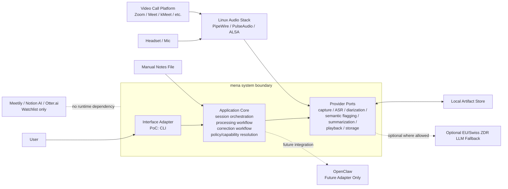
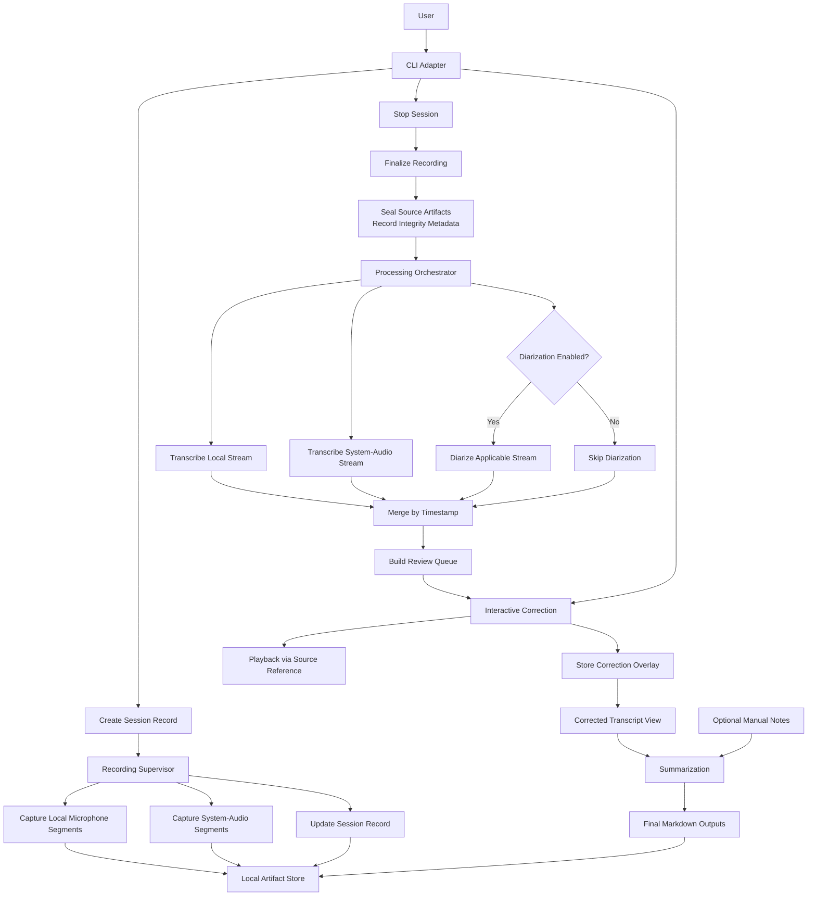
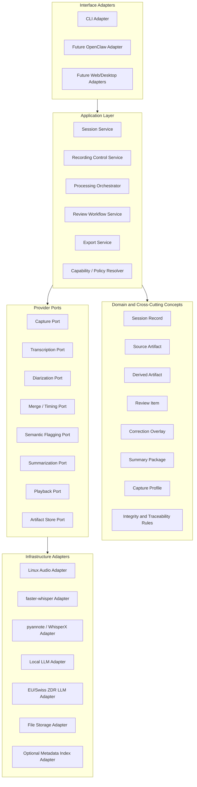

# mena Architecture Working Draft

Status: working draft for interactive architecture decisions

This document captures architecture decisions incrementally while they are being discussed.
Sections may be revised as later decisions sharpen earlier wording.

## 1. Introduction and Goals

### 1.1 Purpose

This document records the current architecture baseline for `mena` using an `arc42`-style structure.
It is deliberately iterative. The goal is to preserve decisions early without pretending that all details are final.

### 1.2 Scope of This Draft

This draft currently covers:

- current system context
- current runtime pipeline
- initial glossary

Later sections will be added as decisions are made.

### 1.3 Decision Status Convention

- `Confirmed`: accepted as current architecture baseline
- `Provisional`: accepted for now, but likely to be refined later
- `Deferred`: intentionally not decided yet

## 2. Glossary

- `CLI`: Command-Line Interface
- `ASR`: Automatic Speech Recognition, meaning speech-to-text transcription
- `ALSA`: Advanced Linux Sound Architecture, a Linux audio subsystem
- `Artifact`: a persisted file or data object produced by the pipeline
- `Diarization`: identifying who spoke when
- `Manifest` / `Session Record`: persisted metadata and checkpoints for a meeting session and its processing lifecycle
- `System audio`: audio captured from the operating system output path
- `ZDR`: Zero Data Retention

## 3. System Context

Status: Confirmed

### 3.1 Context Statement

`mena` is a standalone privacy-first meeting notes system.
For the PoC, the primary scenario is an online meeting on Linux using dual-stream capture:

- local microphone input
- system-audio capture, typically carrying remote participants from a conference tool

The core pipeline must remain independent from:

- the first user interface (`CLI`)
- future interfaces (`OpenClaw`, web UI, desktop UI, mobile UI)
- specific model providers
- specific execution backends

Existing products such as `Meetily`, `Notion AI Meeting Notes`, and `Otter.ai` are reference products to watch, not runtime dependencies and not part of the system boundary.

### 3.2 Context Diagram



### 3.3 Current Clarifications

- `OpenClaw` remains outside the PoC system boundary, even though its current integration path is expected to overlap heavily with the `CLI` command surface.
- `Local artifact storage` is a first-class subsystem from day one.
- `System audio` is a convenient PoC term, but architecturally the broader concern is controlled capture-source routing. This matters because future scenarios include both conference-tool output capture and in-person microphone capture.

## 4. Runtime Pipeline

Status: Provisional

### 4.1 Runtime Narrative

#### Phase 0: Session Start

The user starts a session through the current interface adapter, which is the `CLI` for the PoC.
The system creates a `session record`.

The session record is primarily system-managed, not user-authored.
User input should remain minimal.
Likely user-supplied fields include:

- meeting language
- capture mode where needed
- diarization enabled or disabled
- optional path to manual notes

Most other fields are generated by the system, for example:

- session identifier
- timestamps
- selected audio devices or routes
- list of source artifacts
- processing checkpoints
- integrity metadata

#### Phase 1: Recording

Recording is the most critical runtime path.
The recording subsystem captures:

- local microphone segments
- system-audio segments

For the current PoC, `system-audio segments` usually represent audio coming from a remote conference tool such as `Zoom`, `Google Meet`, or `kMeet`.

The system continuously flushes recorded segments to local storage and updates the session record with capture state and checkpoints.

Architectural rule:

- recording is isolated from downstream processing

#### Phase 2: Session Finalization

When the user stops the session, the recording phase is finalized.
Source artifacts become immutable inputs for later steps.
The system records integrity metadata so that later processing can verify that raw recorded input has not changed.

Architectural rule:

- source artifact integrity must be verifiable

The concrete hashing algorithm is an implementation decision unless stronger requirements emerge later.

#### Phase 3: Automated Post-Meeting Processing

The processing orchestrator reads persisted source artifacts and performs:

- local stream transcription
- system-audio stream transcription
- optional diarization where enabled
- timestamp-based transcript merging
- flagging of low-confidence, overlap, or incoherent segments

Derived artifacts are written separately from source artifacts.

#### Phase 4: Human Correction

The correction adapter presents flagged segments only.
The user may:

- correct speaker attribution
- correct transcript text
- play back the related source audio
- skip a flag

Corrections are stored as an overlay rather than rewriting the source transcript.

Architectural rule:

- each review item must carry a stable source reference so that playback and traceability remain reliable

#### Phase 5: Finalization

The finalization step combines:

- corrected transcript view
- optional manual notes

It then performs summarization and export generation.

### 4.2 Runtime Diagram



### 4.3 Clarifications and Open Precision Work

- `System-audio capture` is the current PoC expression for online meetings. The broader architectural concern is `capture source routing`, which must allow future scenarios such as in-person microphone-based meetings without rewriting the core pipeline.
- `Audio playback during correction` is treated as mandatory, not optional.

### 4.4 Process Topology Decision

Status: Confirmed

The current process topology decision is:

- one dedicated `Capture Worker Process`
- one separate `Session Orchestrator Process`

The `Capture Worker Process` owns:

- capture-source routing
- audio capture
- segment flushing
- source-artifact updates
- capture facts and source-artifact finalization facts

The `Session Orchestrator Process` owns:

- session control
- post-meeting orchestration
- correction workflow
- export generation
- capability and policy resolution

Reasoning:

- recording robustness is the highest-priority quality attribute
- recording must be isolated from downstream processing failures
- this topology is still small enough for a PoC
- it creates cleaner work boundaries for later coding-agent implementation

### 4.5 Separate Process Evaluation Rule

Status: Confirmed

A separate process is warranted only when the benefit of runtime isolation is greater than the cost of extra coordination.

Current evaluation criteria:

- `Failure isolation`
  If this part crashes, must another part survive cleanly?
- `Real-time or hardware ownership`
  Does it own timing-sensitive loops, device handles, or OS-level capture responsibilities?
- `Resource isolation`
  Can it spike CPU, RAM, GPU, or block execution in ways that would materially harm the rest of the system?
- `Lifecycle independence`
  Does it need to continue running even if another part restarts or fails?
- `Privilege or security boundary`
  Does it need stricter containment or a narrower trust boundary?
- `Runtime or framework incompatibility`
  Does it need a different event loop, runtime model, or native integration boundary?

Architectural rule:

- use a separate process only when one or more of the above criteria are materially true
- otherwise prefer module boundaries and adapter boundaries inside an existing process

### 4.6 Why Interactive Correction Is Not a Separate Process

Status: Confirmed

`Interactive correction` is not currently modeled as a separate process because it does not yet meet the process-separation criteria strongly enough.

Current reasoning:

- correction failure must not endanger sealed source artifacts, but it does not need the same hardware and timing isolation as capture
- correction is not a real-time capture concern
- correction does not currently justify separate device ownership
- correction belongs naturally to the session orchestration and review flow

Architectural note:

- `interactive correction` still deserves a clear module boundary and adapter boundary
- it does not currently deserve an OS-process boundary

### 4.7 Most Likely Next Process Boundary

Status: Provisional

If the architecture grows beyond two processes, the most likely next candidate is a dedicated `Processing Worker Process`, not a separate correction process.

Reasoning:

- ASR, diarization, and summarization runtimes are more likely than correction UI to create memory pressure, GPU pressure, native-library instability, or long blocking operations
- this creates a stronger case for failure isolation and resource isolation
- this remains a future evolution path, not a current PoC requirement

### 4.8 Internal Protocol Direction

Status: Provisional

The architecture currently assumes a private but disciplined internal protocol between:

- `Session Orchestrator Process`
- `Capture Worker Process`

Current direction:

- version the protocol from day one
- use a schema-defined `command + event` shape
- keep live coordination in the protocol
- keep durable artifacts in files
- pass artifact references, not audio payloads
- keep stop/finalization behavior idempotent where reasonable

Current architectural stance:

- protocol design should be clean enough for future reuse
- protocol design should not be over-optimized as a public platform API

### 4.9 State Authority and Session Record Ownership

Status: Confirmed

The architecture uses a `single-writer` rule for the canonical `Session Record`.

Current authority split:

- `Session Orchestrator Process` is the primary writer of the canonical `Session Record`
- `Capture Worker Process` writes source artifacts and emits capture facts through the internal protocol
- the `Session Orchestrator Process` updates the `Session Record` based on durable artifact references and capture facts

Reasoning:

- reduces race conditions
- avoids split-brain session state
- keeps the session lifecycle model consistent
- makes reconciliation and resumability easier

Architectural rule:

- both processes must not directly mutate the same canonical session ledger

Allowed future refinement:

- the `Capture Worker Process` may maintain a narrow capture journal or local operational state if needed
- such a journal does not replace or compete with the canonical `Session Record`

### 4.10 Internal Protocol Message Catalog

Status: Provisional

The first architecture-level protocol catalog is intentionally small.

The protocol currently assumes:

- explicit commands
- explicit responses where acknowledgment or data is required
- explicit asynchronous events for capture facts
- versioned schemas from day one

#### Host-to-Capture Commands

- `InitializeCaptureWorker`
- `StartCapture`
- `StopCapture`
- `GetCaptureStatus`
- `ShutdownCaptureWorker`

#### Capture-to-Host Responses and Events

- `CaptureWorkerReady`
- `CaptureStarted`
- `CaptureStartRejected`
- `SegmentFlushed`
- `CaptureHeartbeat`
- `CaptureWarning`
- `CaptureError`
- `CaptureStopped`
- `CaptureFinalized`
- `CaptureStatus`

#### Message Design Rules

- protocol messages carry control data, status data, and artifact references
- protocol messages do not carry raw audio payloads
- stop and finalization commands should be idempotent where reasonable
- live capture coordination belongs in the protocol
- durable artifacts belong in persisted storage

#### Deferred

- concrete transport mechanism
- concrete encoding mechanism
- whether capability exchange is needed in the first implementation
- exact error-code taxonomy

Deferred:

- further subdivision into additional supervised workers

Revisit trigger:

- new input topologies, such as richer in-person meeting capture
- processing concurrency requirements
- operational complexity that justifies more worker isolation

## 5. Building Block View

Status: Provisional

### 5.1 Layered Decomposition

The current architectural decomposition is:

- interface adapters
- application layer
- domain and cross-cutting concepts
- provider ports
- infrastructure adapters

The intent is to keep:

- user interaction separate from core workflow logic
- workflow logic separate from concrete model and audio tooling
- domain artifacts separate from interface-specific state

### 5.2 Layer Diagram



### 5.3 Current Building Blocks

#### Interface Adapters

- `CLI Adapter`
- future adapters such as `OpenClaw`, web UI, or desktop UI

#### Application Layer

- `Session Service`
- `Recording Control Service`
- `Processing Orchestrator`
- `Review Workflow Service`
- `Export Service`
- `Capability / Policy Resolver`

#### Domain and Cross-Cutting Concepts

- `Session Record`
- `Source Artifact`
- `Derived Artifact`
- `Review Item`
- `Correction Overlay`
- `Summary Package`
- `Capture Profile`
- `Integrity and Traceability Rules`

#### Provider Ports

- `Capture Port`
- `Transcription Port`
- `Diarization Port`
- `Merge / Timing Port`
- `Semantic Flagging Port`
- `Summarization Port`
- `Playback Port`
- `Artifact Store Port`

#### Infrastructure Adapters

- Linux audio integration
- ASR provider integration
- diarization provider integration
- local LLM integration
- EU/Swiss jurisdiction-safe fallback integration where allowed
- file storage and optional metadata indexing

### 5.4 Capture Port Decision

Status: Confirmed

The architecture uses:

- one generic `Capture Port`
- different explicit `Capture Profiles`

This means the core pipeline depends on a stable capture contract rather than on a meeting-type-specific implementation split.

Current reasoning:

- the PoC should move fast
- online dual-stream is the first active profile
- future in-person support should reuse the same core pipeline rather than fork it

Current failure mode to watch:

- if the generic capture contract becomes vague, it may hide meaningful differences between capture topologies

Architectural mitigation:

- `Capture Profile` must be explicit and strongly modeled
- routing metadata must be persisted in the `Session Record`
- downstream processing must consume artifacts plus capture metadata, not make hidden assumptions about source topology

## 6. Variability and Substitution Points

Status: Provisional

### 6.1 Purpose

This section identifies which parts of the system are:

- fixed architectural baseline
- replaceable behind stable contracts
- intentionally deferred pending research

The goal is to prevent early implementation convenience from hard-coding the PoC to one interface, one laptop profile, or one provider stack.

### 6.2 Variability Map

| Area | Current Baseline | Replaceable? | Notes |
|---|---|---|---|
| User interface | `CLI` | Yes | First adapter only; future adapters include `OpenClaw`, web UI, desktop UI |
| Capture topology | Online dual-stream | Yes | Future capture profiles include in-person microphone-based sessions |
| Capture implementation | Linux audio stack | Partly | PoC is Linux-only, but capture stays behind `Capture Port` |
| ASR provider | Not fixed yet | Yes | Must remain behind `Transcription Port` |
| Diarization provider | Not fixed yet | Yes | Must remain behind `Diarization Port` |
| Summarization provider | Not fixed yet | Yes | Local-first, EU/Swiss fallback where allowed |
| Semantic flagging provider | Not fixed yet | Yes | Same policy constraints as summarization |
| Artifact persistence pattern | Local artifact store | Partly | First-class subsystem; exact implementation still open |
| Metadata/index store | Not fixed yet | Yes | May begin minimal and grow later |
| Process topology | Not fixed yet | Yes | One process vs supervised workers remains open |
| Output format | Markdown | Partly | Markdown is current baseline; additional exports may come later |

### 6.3 Fixed Architectural Baseline

The following are currently treated as fixed unless later architecture work explicitly changes them:

- standalone PoC product
- Linux-only PoC scope
- online dual-stream PoC scenario
- local artifact store as first-class subsystem
- correction overlay instead of source transcript rewrite
- mandatory playback during correction
- provider access through ports rather than direct tool coupling
- capture variation handled through explicit `Capture Profiles`

### 6.4 Replaceable by Design

The following must be easy to swap without rewriting the core pipeline:

- interface adapter
- model/provider implementation
- local vs jurisdiction-safe fallback backend where allowed
- exact storage/indexing technology
- exact packaging/runtime strategy for different tester hardware profiles

### 6.5 Research-Driven Decisions

The following should not be guessed during implementation and should instead become explicit research tasks later:

- best Linux capture approach for reliable dual-stream routing
- realistic OS compatibility implications of the chosen capture approach
- ASR provider selection and tradeoffs
- diarization provider selection and tradeoffs
- persistence approach for artifacts, metadata, and resumable processing
- runtime strategy for lower-capability tester machines
- fallback-provider options that satisfy sovereignty constraints

### 6.6 Architectural Guardrail

If an implementation choice affects:

- replaceability
- failure isolation
- sovereignty policy enforcement
- resumability
- future interface independence

then it is not a mere implementation detail and must either appear in this architecture draft or be tracked as an open architecture question.

## 7. Deployment and Runtime Data Boundaries

Status: Provisional

### 7.1 Why This Matters Early

For the PoC, the developer machine and the first customer machine are the same machine.
This increases the risk of mixing:

- source code
- architecture and research documents
- runtime session artifacts
- model caches
- logs
- exported meeting notes

If these concerns are not separated early, the PoC will become hard to operate, hard to clean up, and easy to corrupt through normal development work.

### 7.2 Current Boundary Rule

The repository root must not be treated as the product's runtime home.

The architecture assumes a separation between:

- repository contents
- runtime working data
- long-lived user data
- generated exports

### 7.3 Architectural Consequences

- runtime artifacts must not be written into arbitrary source-code directories
- session outputs must not rely on git-tracked paths as their canonical storage location
- integrity and reconciliation logic must work independently from the repository layout
- local development convenience must not define the production data model

### 7.4 Current Direction

The exact directory layout is still open, but the architecture already assumes:

- source code and documentation live in the repository
- runtime data lives outside normal source directories
- the application can be run locally by a developer without making the repository itself the canonical data store

This decision supports both:

- local PoC development on the same machine as day-to-day use
- later packaging into a more product-like local application

## 8. Session Model and Persistence Semantics

Status: Provisional

### 8.1 Session Bundle vs Session Record

The architecture distinguishes between:

- `Session Bundle`: the complete persisted collection for one meeting session
- `Session Record`: the structured ledger for one meeting session

The `Session Bundle` is the container concept.
It groups together everything that belongs to one meeting session.

The `Session Record` is one artifact inside that bundle.
It does not replace the bundle and it does not duplicate all bundle contents.

Current model:

```text
Session Bundle
├── Session Record
├── Source Artifacts
├── Derived Artifacts
├── Review Artifacts
└── Export Artifacts
```

### 8.2 Session Bundle Decision

Status: Confirmed

The baseline persistence pattern is:

- one `Session Bundle` per meeting session
- one `Session Record` per `Session Bundle`

Reasoning:

- it keeps session ownership clear
- it supports resumability cleanly
- it supports artifact integrity checks
- it avoids treating the repository or a global index as the canonical home of session data

### 8.3 Session Record Role

Status: Confirmed

The `Session Record` is canonical for:

- session identity
- workflow state
- artifact references
- integrity metadata
- checkpoints and operational trace

The `Session Record` is not canonical for:

- transcript bodies that already exist as artifacts
- raw audio payloads
- user-interface-only transient state
- privacy-sensitive analytics beyond what is required for session operation

### 8.4 Artifact-First Persistence Refinement

Status: Confirmed

The architecture uses:

- artifact-first persistence
- a per-session ledger (`Session Record`)
- a lightweight rebuildable global index

That means:

- files/artifacts are primary for captured and generated content
- the `Session Record` is primary for one session's lifecycle and references
- the global index is a projection and must be rebuildable

If divergence occurs:

- missing referenced artifact -> mark session broken and stop downstream trust
- unindexed artifact -> mark orphaned and require explicit recovery path
- integrity mismatch -> mark artifact tainted or corrupt and stop trusting it
- stale index with consistent bundles -> rebuild the index

### 8.5 UX and Quality Telemetry Separation

Status: Provisional

The architecture distinguishes between:

- `operational session data`
- `product-quality and UX telemetry`

The `Session Record` should contain only the operational data required to run, resume, verify, and inspect a session safely.

Product-quality and UX telemetry must be stored separately from core session operation.

Examples of telemetry that may be valuable:

- number of flagged segments
- number of user corrections
- categories of corrections
- processing durations
- model/provider identifiers
- fallback backend usage
- review completion status
- whether the user accepted the session result as satisfactory

Examples of data that must not be treated as product telemetry:

- transcript text
- meeting topic content
- participant identity
- user identity beyond what is operationally required for a local installation
- anything that reveals what was discussed

Architectural direction:

- telemetry must be privacy-preserving by design
- telemetry must be decoupled from canonical session operation
- telemetry should be derived from session outcomes and interaction events, not by duplicating meeting content
- telemetry should be exportable or analyzable without exposing meeting substance

### 8.6 Session Lifecycle as State Machine

Status: Confirmed

The session lifecycle must be modeled as a state machine, not as a one-way linear pipeline.

The earlier linear narrative is useful for explanation, but it is not sufficient as the architecture model.

Reasoning:

- processing may fail and resume
- review may be revisited
- exports may be regenerated
- optional steps such as diarization may be skipped or re-run

Current direction:

- normal forward progress exists
- retries and partial rollback paths must exist where operationally meaningful
- source artifacts remain immutable once sealed
- derived artifacts may be regenerated
- review overlays may evolve without mutating source artifacts

## 9. Architecture-Derived Research Backlog

Status: Provisional

This section captures research tasks that surfaced during architecture work and must not be lost.
These are not yet implementation issues.
They exist because the architecture depends on their outcomes.

### 9.1 Current Research Tasks

#### R-01 Local Model Runtime Strategy

Question:

- how should local model-backed stages be accessed on user machines?

Current options to evaluate:

- direct library integration
- `Ollama`
- `LM Studio`
- other suitable local runtime approaches

Why it matters:

- affects installation complexity
- affects runtime operability
- affects portability to weaker tester machines
- affects how local and fallback providers are abstracted behind ports

#### R-02 Linux Audio Capture and Routing Strategy

Question:

- what is the most reliable Linux approach for dual-stream capture and controlled capture-source routing?

Why it matters:

- affects recording robustness
- affects capture-profile design
- affects future in-person meeting support

#### R-03 Future OS Compatibility Implications

Question:

- what parts of the chosen Linux capture approach create future cross-platform constraints?

Why it matters:

- architecture should not accidentally assume Linux-specific behavior in the core pipeline

#### R-04 ASR Provider Strategy

Question:

- which ASR approach best fits the PoC and future product direction under sovereignty and operability constraints?

Why it matters:

- affects provider abstraction
- affects runtime profile
- affects output quality

#### R-05 Diarization Provider Strategy

Question:

- which diarization approach best fits the PoC and future product direction under sovereignty and operability constraints?

Why it matters:

- affects processing reliability
- affects model/runtime dependencies
- affects later speaker-related features

#### R-06 Fallback Provider Policy

Question:

- which remote fallback providers are acceptable under sovereignty constraints, and for which stages exactly?

Why it matters:

- affects policy enforcement
- affects tester operability on weaker machines
- affects what the user may or may not configure directly

#### R-07 Install / Update / Uninstall Path for Local CLI Distribution

Question:

- what should the local install, upgrade, and uninstall path look like for a Linux CLI product used on the same machine as development and testing?

Why it matters:

- affects local operability
- affects repo-vs-runtime-data separation
- affects future packaging direction

#### R-08 Internal Protocol Implementation Strategy

Question:

- which concrete transport and encoding approach best fits the private internal protocol?

Current candidates:

- `stdio`
- local socket
- JSON-based schema messages
- stronger schema tooling later if justified

Why it matters:

- affects process supervision
- affects contract testing
- affects implementation complexity

#### R-09 Privacy-Preserving UX Telemetry Design

Question:

- how should product-quality telemetry be modeled so that it yields useful UX insight without exposing meeting substance or user identity?

Why it matters:

- affects product improvement
- affects privacy guarantees
- affects future analytics structure

### 9.2 Rule for New Research Tasks

An item belongs in this research backlog when:

- the architecture already depends on the answer
- the answer is not yet stable enough to hard-decide
- guessing during implementation would create avoidable rework or policy risk
