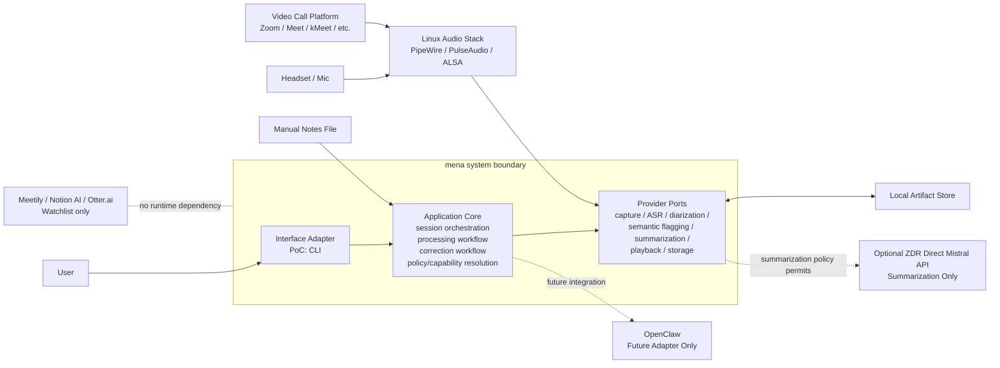
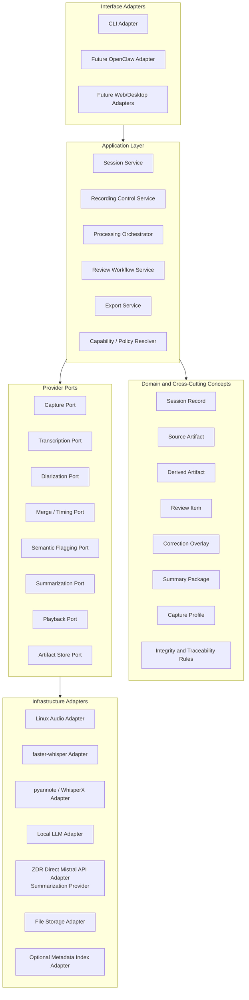
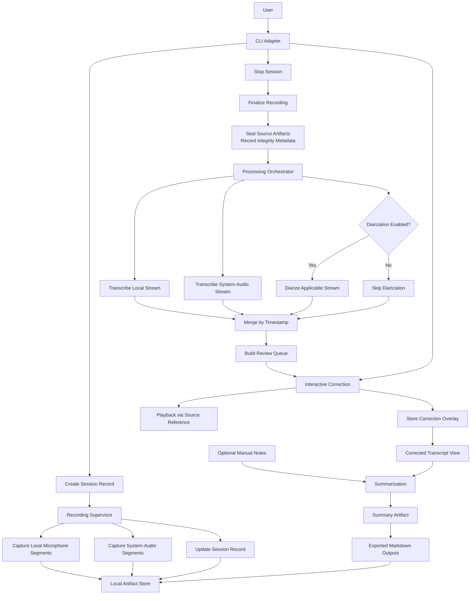

# mena Architecture Overview

Status: arc42-structured architecture overview; provisional where marked

Metadata:

- Last updated: 2026-05-01
- Maintainer: architecture session between customer and Codex
- Source inputs: requirements documents, architecture review, and recorded architecture discussions in this repository
- Review status: architecture-review feedback incorporated for current architecture baseline

This document captures the current architecture baseline.
Sections may be revised as research, review, and implementation sharpen earlier wording.

## 1. Introduction and Goals

### 1.1 Purpose

This document records the current architecture baseline for `mena` using an `arc42`-style structure.
It is deliberately iterative. The goal is to preserve decisions early without pretending that all details are final.

### 1.2 Scope of This Overview

This overview currently covers:

- current system context
- PoC v0 scope and build sequence
- current runtime pipeline
- initial glossary
- building block view
- variability and substitution points
- deployment and runtime-data boundaries
- session model and persistence semantics
- architecture-derived research backlog

Sections may be expanded as decisions are made.

### 1.3 Decision Status Convention

- `Confirmed`: accepted as current architecture baseline
- `Provisional`: accepted for now, but likely to be refined later
- `Deferred`: intentionally not decided yet

### 1.4 Current Quality Priorities

Status: Provisional

Current priority order:

1. `Recording robustness / recoverability`
2. `Sovereignty / privacy`
3. `Resumability / traceability`
4. `Local operability`
5. `Replaceability / evolvability`
6. `Output quality / user trust`
7. `Performance / processing time`
8. `Interface convenience`

Current interpretation:

- `Recording robustness / recoverability` outranks implementation simplicity and feature richness.
- `Sovereignty / privacy` outranks convenience in remote fallback configuration.
- `Local operability` and `replaceability / evolvability` are both important, but they must not undermine the first three priorities.
- `Performance / processing time` matters, but the current PoC does not have a strict latency target.
- `Interface convenience` is subordinate to correctness, safety, and future-proofing.

## 2. Constraints

Status: Provisional

This section captures constraints that are already strong enough to shape architecture.
Open choices are called out explicitly where research, PoC validation, or customer/product judgment is still needed.

### 2.1 Product and Scope Constraints

Status: Confirmed

- The PoC is a standalone local product, not an OpenClaw plugin and not a fork of an existing meeting-notes product.
- The PoC is CLI-first for speed of testing and because it is naturally compatible with agent harnesses.
- The CLI is only an interface adapter. Core workflow logic must not depend on CLI-specific behavior.
- PoC v0 user-facing scope includes both `online_dual_stream` and `in_person_single_mic` capture profiles in CLI form.
- The implementation sequence remains `online_dual_stream` first, then `in_person_single_mic`.
- The PoC focuses on recorded meeting processing. Fully live meeting assistance is out of scope for the first PoC.
- Existing tools such as Meetily, Notion AI Meeting Notes, and Otter.ai are products to observe, not architectural baselines or runtime dependencies.

### 2.2 Platform Constraints

Status: Confirmed for PoC, Provisional for Product

- Linux is the first implementation and test platform.
- Linux-first must not mean Linux-coupled core logic. OS-specific capture, paths, process supervision, and packaging belong behind adapters.
- Future product direction should remain compatible with a desktop app on Linux, macOS, and Windows unless research proves a strong reason to narrow scope.
- Runtime data must not live inside the source repository.

### 2.3 Data Sovereignty and Provider Constraints

Status: Confirmed

- Audio recording, transcription, and diarization are local-only stages. `mena` must not send audio to a remote service.
- Summarization is local by default, stage-focused, and may use a direct Mistral provider for the PoC when the accepted setup/runtime policy allows it. Semantic review remains optional and outside the direct Mistral provider mechanism pending follow-up product validation.
- The direct Mistral provider is architecture-allowed only when the user's account posture and accepted policy satisfy `CON-01`; default-retention API access is not architecture-compliant.
- Zero Data Retention is treated as an **operator-attested contractual predicate**, not as a runtime-verifiable signal. The application cannot programmatically verify ZDR scope, plan tier, training opt-out, subprocessor posture, or account funds, and must not pretend that it can. Per `ADR-033`, the direct Mistral provider is disabled unless accepted setup/runtime policy, provider-owned API constraints, and user/operator account-posture acknowledgement allow it for the stage. See [R-06 synthesis](../research/synthesis-research-phase-1.md#35-r-06--fallback-provider-policy) for the policy background and residual risk list.
- Remote provider authorization remains stage-specific. A local fallback authorization never authorizes a later direct Mistral provider transition.
- Model and provider choices must be behind ports and a policy/capability resolver. Workflow code must not call concrete providers directly.
- User-created session data remains local and survives uninstall by default.
- Raw audio is the canonical source artifact and must be treated as sealed after capture.

### 2.4 Architecture and Implementation Constraints

Status: Confirmed

- The codebase must support dependency inversion and strict separation between core workflow logic, adapters, provider integrations, and user interfaces.
- Durable artifacts are file-based for the PoC. The session index is for discovery and convenience, not the source of truth.
- The active `Session Orchestrator Process` is the canonical writer of the `Session Record` while it holds session authority.
- The `Capture Worker Process` owns real-time audio capture and emits facts, events, and artifact references.
- Internal coordination protocols and durable schemas must be versioned from day one.
- The architecture must be legible enough for coding agents to implement work in parallel without violating boundaries.

### 2.5 Constraints Needing Research or PoC Validation

Status: Open

These questions should not block the architecture overview.
They should be answered through research, first implementation experience, and user testing.

- The incremental complexity of `in_person_single_mic` needs validation during implementation, but it is now part of PoC v0 scope rather than a post-PoC idea.
- Legal and policy analysis of the direct Mistral provider for summarization was advanced by R-06 ([synthesis §3.5](../research/synthesis-research-phase-1.md#35-r-06--fallback-provider-policy)) and is now expressed as provider-owned technical constraints plus user/operator-owned account posture in `ADR-033`. Residual contractual risk remains and must be reviewed if Mistral's terms change.
- "Good enough" output quality is an empirical PoC learning outcome. The architecture must provide a fast feedback loop and traceable artifacts rather than pretending a threshold is known upfront.
- CLI device/profile confirmation friction is an empirical UX learning outcome. The architecture must expose profile and device choices cleanly so the CLI can evolve without changing core logic.

## 3. Context and Scope

Status: Confirmed

### 3.1 Context Statement

`mena` is a standalone privacy-first meeting notes system.
For the PoC, the primary implementation sequence starts with an online meeting on Linux using dual-stream capture:

- local microphone input
- system-audio capture, typically carrying remote participants from a conference tool

The same PoC also includes an in-person meeting profile using one room microphone.
That profile follows after `online_dual_stream` in the build sequence.

The core pipeline must remain independent from:

- the first user interface (`CLI`)
- future interfaces (`OpenClaw`, web UI, desktop UI, mobile UI)
- specific model providers
- specific execution backends

Existing products such as `Meetily`, `Notion AI Meeting Notes`, and `Otter.ai` are reference products to watch, not runtime dependencies and not part of the system boundary.

### 3.2 Context Diagram



### 3.3 Current Clarifications

- `OpenClaw` remains outside the PoC system boundary, even though its current integration path is expected to overlap heavily with the `CLI` command surface.
- `Local artifact storage` is a first-class subsystem from day one.
- `System audio` is a convenient PoC term for online meetings, but architecturally the broader concern is controlled capture-source routing. This matters because PoC scope includes both conference-tool output capture and in-person microphone capture.

## 4. Solution Strategy

Status: Provisional

The architecture uses a local, artifact-first pipeline with explicit process, provider, and interface boundaries.
The goal is to validate product usefulness quickly without making PoC shortcuts the long-term product architecture.

### 4.1 Core Strategy

Status: Confirmed

- Treat each meeting as a durable session bundle containing source artifacts, derived artifacts, overlays, exports, and a compact session record.
- Keep raw audio as the canonical source artifact.
- Preserve generated transcripts and user corrections separately so the product can explain what came from the model and what came from review.
- Keep the first user interface as a CLI adapter while designing the workflow core so desktop and agent adapters can be added later.
- Use capture profiles to model different meeting setups without changing the core capture port.

### 4.2 Runtime Strategy

Status: Confirmed

- Split the PoC into a `Session Orchestrator Process` and a `Capture Worker Process`.
- Use the capture worker for real-time audio ownership and failure isolation.
- Use the orchestrator for session lifecycle, artifact decisions, user-facing workflow, provider policy, and canonical session record updates.
- Use files for durable artifacts and the internal protocol only for live coordination.
- If the orchestrator disappears in the CLI PoC, the capture worker should attempt a graceful stop and seal capture artifacts rather than record indefinitely.

### 4.3 Provider Strategy

Status: Confirmed

- Keep recording, transcription, and diarization local-only.
- Route all model/runtime access through provider ports and a policy-aware resolver.
- Allow summarization to use direct ZDR Mistral as a PoC route when policy, credentials, and required authorization allow it.
- Defer the concrete local runtime strategy, for example direct libraries versus Ollama or LM Studio, to research.

### 4.4 Evolution Strategy

Status: Provisional

- Optimize the first implementation for a fast Linux CLI PoC, but keep OS-specific behavior behind adapters.
- Build `online_dual_stream` first, then add `in_person_single_mic` through the same capture-profile model.
- Treat `in_person_single_mic` as a capture-profile extension unless implementation proves the incremental complexity is materially higher than expected.
- Use replayable artifacts, fake providers, and consent-safe fixtures so coding agents can implement and test most behavior without live meetings.
- Use the first runnable PoC to discover practical quality thresholds and CLI friction rather than trying to define them in advance.
- Keep architecture, research backlog, and implementation tasks separate so unresolved research does not become accidental implementation policy.

## 5. Building Block View

Status: Provisional

### 5.1 Layered Decomposition

The current architectural decomposition is:

- interface adapters
- application layer
- domain and cross-cutting concepts
- provider ports
- infrastructure adapters

The intent is to keep:

- user interaction separate from core workflow logic
- workflow logic separate from concrete model and audio tooling
- domain artifacts separate from interface-specific state

### 5.2 Layer Diagram



### 5.3 Current Building Blocks

#### Interface Adapters

- `CLI Adapter`
- future adapters such as `OpenClaw`, web UI, or desktop UI

#### Application Layer

- `Session Service`
- `Recording Control Service`
- `Processing Orchestrator`
- `Review Workflow Service`
- `Export Service`
- `Capability / Policy Resolver`

#### Domain and Cross-Cutting Concepts

- `Session Record`
- `Source Artifact`
- `Derived Artifact`
- `Review Item`
- `Correction Overlay`
- `Summary Package`
- `Capture Profile`
- `Integrity and Traceability Rules`

#### Provider Ports

- `Capture Port`
- `Transcription Port`
- `Diarization Port`
- `Merge / Timing Port`
- `Semantic Flagging Port`
- `Summarization Port`
- `Playback Port`
- `Artifact Store Port`

#### Infrastructure Adapters

- Linux audio integration
- ASR provider integration
- diarization provider integration
- local LLM integration
- direct ZDR Mistral API integration for summarization where allowed
- file storage and optional metadata indexing

### 5.4 Capture Port Decision

Status: Confirmed

The architecture uses:

- one generic `Capture Port`
- different explicit `Capture Profiles`

This means the core pipeline depends on a stable capture contract rather than on a meeting-type-specific implementation split.

Current reasoning:

- the PoC should move fast
- online dual-stream is implemented first
- in-person single-mic support should reuse the same core pipeline rather than fork it

Current failure mode to watch:

- if the generic capture contract becomes vague, it may hide meaningful differences between capture topologies

Architectural mitigation:

- `Capture Profile` must be explicit and strongly modeled
- routing metadata must be persisted in the `Session Record`
- downstream processing must consume artifacts plus capture metadata, not make hidden assumptions about source topology, filenames, or one-file-per-source shortcuts

#### Linux PoC Realisation (Informative)

Status: Confirmed for the Linux PoC adapter; informative for the architectural Capture Port

`ADR-024` records the concrete Linux topology that satisfies the Capture Port for `online_dual_stream`. The pattern is PipeWire-first:

- enumerate active playback streams, sinks, and sources in the user session
- require explicit user confirmation of which playback stream is the meeting audio (the CLI surfaces application binary, stream name, and media name)
- create a session-scoped dedicated null sink (a virtual sink that exists only for this capture session, not a permanent desktop reconfiguration)
- move only the chosen meeting playback stream into that null sink (do not swap the system default sink)
- capture the monitor port of the null sink as the remote/system-audio stream
- create a separate loopback from the null sink to the user's actual playback device so the call remains audible
- capture the chosen microphone source directly as the local stream

The user-facing selection surface must present readable route labels first. Backend identifiers such as PipeWire node IDs or Pulse sink-input IDs are implementation handles; they may be shown as secondary/debug disambiguators but must not be the only normal user-facing choice.

Tiered fallback when dedicated routing fails: after a valid online route plan exists, degrade to the selected microphone plus the selected output sink monitor and mark the remote source `system_mix_remote`. `mic_only` is not a valid `online_dual_stream` fallback for the #83 PoC slice; if neither the dedicated route nor the selected output sink monitor can provide system audio, online capture fails or finalizes as partial while preserving already sealed chunks. Degradation events are written to session metadata; the recorder never silently retries. A degraded capture must be visible to the user and must not be reported as an ordinary clean dedicated-route capture.

The supported Linux environment for `online_dual_stream` is **PipeWire user-session desktops**; PulseAudio is treated as a compatibility path through `pipewire-pulse`; ALSA-only and headless/minimal environments are out of scope for that profile. `in_person_single_mic` reuses the same adapter family and drops most of the routing complexity (no dedicated sink, no playback move, no speaker loopback).

This pattern is informative for the architecture (it lives behind the Capture Port) and is described here so coding agents and reviewers can connect §5.4 to the concrete Linux adapter without crossing folder boundaries. Full discussion lives in the [R-02 synthesis](../research/synthesis-research-phase-1.md#32-r-02--linux-audio-capture-and-routing-strategy).

## 6. Runtime View

Status: Provisional

### 6.1 Runtime Narrative

#### Phase 0: Session Start

The user starts a session through the current interface adapter, which is the `CLI` for the PoC.
The record setup flow collects the session facts needed before audio capture can be trusted:

1. select or confirm the capture profile;
2. select or confirm the meeting language;
3. select or confirm profile-dependent audio routes;
4. show the consent disclaimer;
5. start live capture only after the required choices are complete.

The system creates a `Session Record`.

The Session Record is primarily system-managed, not user-authored.
User input should remain minimal.
Likely user-supplied fields include:

- meeting language
- capture mode where needed
- diarization enabled or disabled
- optional path to manual notes

Most other fields are generated by the system, for example:

- session identifier
- timestamps
- selected audio devices or routes
- user-readable labels shown for selected devices or routes
- list of source artifacts
- recording lifecycle and finalization state
- degradation or interruption state
- processing checkpoints
- integrity metadata

Meeting language selected or confirmed during `record` is the session-level source of truth for language-sensitive downstream processing. Configuration may provide defaults before the session fact exists, but later `process` and `summarize` commands must not silently replace the persisted session language.

#### Phase 1: Recording

Recording is the most critical runtime path.
The recorder must support continuous capture for the PoC meeting-duration target and write ordered sealed segments while the meeting is in progress.
The current PoC target is 90 minutes of continuous recording, with 30-second segment flushing unless a measured technical reason justifies a different cadence.
`ADR-032` pins the implementation boundary: capture streams/processes are long-lived, while file chunks rotate at the persistence layer. The current PoC adapter may use long-lived `pw-record --raw -` subprocesses, but GStreamer/PyGObject remains a future adapter family behind the same capture contract.
For `online_dual_stream`, the recording subsystem captures:

- local microphone segments
- system-audio segments

For the current PoC, `system-audio segments` usually represent audio coming from a remote conference tool such as `Zoom`, `Google Meet`, or `kMeet`.

For `in_person_single_mic`, the recording subsystem captures:

- room microphone segments

Raw source capture is quality-preserving by default:

- use a lossless PCM source artifact format;
- avoid lossy compression in the canonical recording path;
- preserve useful source channel information where practical, especially for `room_mic`;
- persist actual sample rate, channel count/layout, format, and any normalization facts.

Provider-specific preparation such as downmixing, resampling, or stitching is a derived processing concern. It must not mutate the sealed raw source segments.

The system continuously flushes recorded segments to local storage and updates the Session Record with capture state, segment references, and checkpoints.
The user-facing interface should expose a minimal recording health heartbeat, for example elapsed recording time and flushed segment count.
The exact refresh cadence is an interface detail to tune during testing.

Architectural rule:

- recording is isolated from downstream processing
- capture progress must be visible enough that the user can detect obvious "is it recording?" failures
- only the current unflushed segment may be lost or corrupted by a crash or hard interruption; already sealed segments remain recoverable and processable when integrity checks pass

#### Phase 2: Session Finalization

When the user stops the session, the recording phase is finalized.
Source artifacts become immutable inputs for later steps.
The system records integrity metadata so that later processing can verify that raw recorded input has not changed.
Finalization records whether the recording stopped cleanly, finalized after Ctrl-C or another user interruption, or remains partial/interrupted after a system failure.
Interrupted recordings are not ordinary successes, but sealed segments may still be valid inputs for partial processing.

Architectural rule:

- source artifact integrity must be verifiable

The concrete hashing algorithm is an implementation decision unless stronger requirements emerge later.

#### Phase 3: Automated Post-Meeting Processing

The processing orchestrator reads persisted source artifacts and performs:

- applicable source transcription
- optional diarization where enabled
- timestamp-based transcript merging
- flagging of low-confidence, overlap, or incoherent segments

Derived artifacts are written separately from source artifacts.
Processing consumes capture-source metadata plus ordered segment references, not a single WAV-path assumption.
When a provider needs a single compatible `audio_path`, the processing core creates provenance-backed provider-prep artifacts from ordered source segments.
Provider adapters declare accepted or preferred input requirements and own provider invocation.
For issue #83, ASR and diarization provider ports continue to receive a prepared `audio_path`; they do not accept raw capture-segment sequences directly.
Sealed source segments remain the canonical evidence for the meeting audio.

Language-sensitive processing uses the session language selected at recording time:

- transcription/ASR uses it for language configuration and lexicon or prompt-biasing;
- summarization uses it for prompt and output policy by default;
- diarization treats it as session metadata unless a concrete provider requires language-specific behavior;
- semantic coherence remains language-agnostic as a product mechanism, though session language may be available as context/provenance.

Speaker-label rule when diarization is disabled:

- `online_dual_stream`: `local_mic` is labeled `Local`; `system_audio` is labeled `Remote`
- `in_person_single_mic`: `room_mic` is labeled `Room`

#### Phase 4: Human Correction

The correction adapter presents flagged segments only.
The user may:

- correct speaker attribution
- correct transcript text
- play back the related source audio
- skip a flag

Corrections are stored as an overlay rather than rewriting the source transcript.

Architectural rule:

- each review item must carry a stable source reference so that playback and traceability remain reliable
- playback must always be reachable from a flagged segment, but the user may choose to resolve a flag without playing audio

#### Phase 5: Summarization

The summarization step combines:

- corrected transcript view
- optional sealed manual-notes artifact

It then produces a summary artifact.

Manual notes are imported explicitly before summarization, copied into the session bundle, and treated as a versioned sealed input artifact.
If the user changes the original notes later, the changed notes are imported as a new notes artifact version and summarization is rerun to produce a new summary candidate.

#### Phase 6: Export

The export step renders selected summary artifacts into user-facing output formats such as markdown.
Export is intentionally separate from summarization because it should be retryable and regenerable without invoking provider runtimes again.

#### Post-Meeting Processing Boundaries

From a user perspective, recording, processing, correction, summarization, and export may feel like one meeting workflow.
Architecturally they remain separate boundaries:

- `record`: capture source audio and durable source metadata
- `process`: automated transcription, diarization, merge/timing, confidence flagging, and semantic review
- `correct`: user-interactive correction over a review queue; no LLM dependency in the current contract
- `summarize`: LLM-derived summary from the active correction overlay and optional manual notes
- `export`: render persisted summary artifacts; no LLM dependency

These boundaries matter because each step has different retry, provenance, resource, and human-decision rules.
The end of `process` and the end of `summarize` are terminal local-LLM resource boundaries for the CLI PoC.

### 6.2 Runtime Diagram



### 6.3 Clarifications and Open Precision Work

- `System-audio capture` is the current PoC expression for online meetings. The broader architectural concern is `capture source routing`, which must also support the PoC `in_person_single_mic` profile without rewriting the core pipeline.
- `Audio playback during correction` is mandatory as an available feature. It is not mandatory for the user to listen before resolving every flag.

#### PoC Application Command Surface

Status: Confirmed

The PoC CLI is an adapter, but the application layer still needs a stable verb surface.
The initial architecture-facing command set is:

- `record`: create a session, select/confirm capture profile, meeting language, and devices/routes, show the consent disclaimer, run recording, finalize source artifacts, and print the processing handoff
- `list`: list known sessions from the rebuildable global index
- `show`: inspect one session's state and artifacts
- `process`: run or resume automated post-meeting processing
- `correct`: run or resume the correction workflow
- `summarize`: generate or regenerate a structured summary artifact
- `export`: generate or inspect final markdown outputs from summary artifacts
- `resume`: continue the next pending step for a session where that is unambiguous

Exact CLI flags and prompt wording are interface-adapter details.
The application services must not depend on terminal-specific control flow.

### 6.4 Process Topology Decision

Status: Confirmed

The current process topology decision is:

- one dedicated `Capture Worker Process`
- one separate `Session Orchestrator Process`

The `Capture Worker Process` owns:

- capture-source routing
- audio capture
- segment flushing
- source-artifact updates
- capture facts and source-artifact finalization facts

The `Session Orchestrator Process` owns:

- session control
- post-meeting orchestration
- correction workflow
- export generation
- capability and policy resolution

For the CLI PoC, the `Session Orchestrator Process` is per CLI invocation.
There is no daemon.
Continuity across commands comes from reconstructing session state from the session bundle and global index.

Reasoning:

- recording robustness is the highest-priority quality attribute
- recording must be isolated from downstream processing failures
- this topology is still small enough for a PoC
- it creates cleaner work boundaries for later coding-agent implementation

### 6.5 Separate Process Evaluation Rule

Status: Confirmed

A separate process is warranted only when the benefit of runtime isolation is greater than the cost of extra coordination.

Current evaluation criteria:

- `Failure isolation`
  If this part crashes, must another part survive cleanly?
- `Real-time or hardware ownership`
  Does it own timing-sensitive loops, device handles, or OS-level capture responsibilities?
- `Resource isolation`
  Can it spike CPU, RAM, GPU, or block execution in ways that would materially harm the rest of the system?
- `Lifecycle independence`
  Does it need to continue running even if another part restarts or fails?
- `Privilege or security boundary`
  Does it need stricter containment or a narrower trust boundary?
- `Runtime or framework incompatibility`
  Does it need a different event loop, runtime model, or native integration boundary?

Architectural rule:

- use a separate process only when one or more of the above criteria are materially true
- otherwise prefer module boundaries and adapter boundaries inside an existing process

### 6.6 Why Interactive Correction Is Not a Separate Process

Status: Confirmed

`Interactive correction` is not currently modeled as a separate process because it does not yet meet the process-separation criteria strongly enough.

Current reasoning:

- correction failure must not endanger sealed source artifacts, but it does not need the same hardware and timing isolation as capture
- correction is not a real-time capture concern
- correction does not currently justify separate device ownership
- correction belongs naturally to the session orchestration and review flow

Architectural note:

- `interactive correction` still deserves a clear module boundary and adapter boundary
- it does not currently deserve an OS-process boundary

### 6.7 Most Likely Next Process Boundary

Status: Deferred

If the architecture grows beyond two processes, the most likely next candidate is a dedicated `Processing Worker Process`, not a separate correction process.

Reasoning:

- ASR, diarization, and summarization runtimes are more likely than correction UI to create memory pressure, GPU pressure, native-library instability, or long blocking operations
- this creates a stronger case for failure isolation and resource isolation
- this remains a future evolution path, not a current PoC requirement

### 6.8 Internal Protocol Direction

Status: Provisional

The architecture currently assumes a private but disciplined internal protocol between:

- `Session Orchestrator Process`
- `Capture Worker Process`

Current direction:

- version the protocol from day one
- include protocol version agreement and minimal peer capability declaration in initialization
- use a schema-defined `command + event` shape
- keep live coordination in the protocol
- keep durable artifacts in files
- pass artifact references, not audio payloads
- keep stop/finalization behavior idempotent where reasonable

Current architectural stance:

- protocol design should be clean enough for future reuse
- protocol design should not be over-optimized as a public platform API

### 6.9 State Authority and Session Record Ownership

Status: Confirmed

The architecture uses a `single-writer` rule for the canonical `Session Record`.

Current authority split:

- `Session Orchestrator Process` is the primary writer of the canonical `Session Record`
- `Capture Worker Process` writes source artifacts and emits capture facts through the internal protocol
- the `Session Orchestrator Process` updates the `Session Record` based on durable artifact references and capture facts

For the CLI PoC, this single-writer rule means:

- only one active orchestrator may operate on a given session bundle at a time
- each new CLI invocation reconstructs authority from the session bundle before acting
- concurrent orchestrator access to the same session must be rejected or made to wait

Reasoning:

- reduces race conditions
- avoids split-brain session state
- keeps the session lifecycle model consistent
- makes reconciliation and resumability easier

Architectural rule:

- both processes must not directly mutate the same canonical session ledger

Allowed future refinement:

- the `Capture Worker Process` may maintain a narrow capture journal or local operational state if needed
- such a journal does not replace or compete with the canonical `Session Record`

### 6.10 Internal Protocol Message Catalog

Status: Provisional

The implemented PoC protocol catalog is intentionally small.

The protocol currently assumes:

- explicit commands
- explicit responses where acknowledgment or data is required
- explicit asynchronous events for capture facts
- versioned schemas from day one

The earlier aspirational names map to the current protocol as follows:
`InitializeCaptureWorker` is performed by `hello`/`hello_ack`; `StartCapture` by
`start_capture`/`capture_started`; `StopCapture` by `stop_capture`/`capture_finalized`;
`SegmentFlushed` by `segment_flushed`/`segments_flushed`; `CaptureStatus` by
`capture_status`; `CaptureError` by `error`; and `CaptureFinalized` by `capture_finalized`.

#### Host-to-Capture Commands

- `hello`: opens the protocol session and carries protocol version agreement data.
- `start_capture`: requests the worker to begin capture with the selected profile, sources, routes, and segment cadence.
- `stop_capture`: requests user-initiated capture finalization.

#### Capture-to-Host Responses and Events

- `hello_ack`: acknowledges `hello` and confirms the accepted protocol version.
- `capture_started`: confirms that capture has started and echoes the effective session directory, profile, sources, and segment cadence.
- `capture_status`: reports non-terminal capture progress, including recording and finalizing states.
- `capture_route_event`: reports capture route degradation or recovery facts for selected sources.
- `segment_flushed`: reports one sealed, partial, or failed audio segment artifact reference.
- `segments_flushed`: reports a non-empty batch of flushed segment facts.
- `capture_finalized`: reports terminal capture status and summary metadata after finalization.
- `error`: reports a protocol or capture failure using the generic error payload.

#### Message Design Rules

- protocol messages carry control data, status data, and artifact references
- protocol messages do not carry raw audio payloads
- stop and finalization commands should be idempotent where reasonable
- live capture coordination belongs in the protocol
- durable artifacts belong in persisted storage

#### PoC Transport and Encoding

Status: Confirmed for the PoC (per `ADR-025`)

The PoC transport is **dedicated `stdio`** between the orchestrator and a child capture worker:

- orchestrator-to-worker traffic on the child's `stdin`
- worker-to-orchestrator traffic on the child's `stdout`
- `stderr` is reserved for human-oriented diagnostics and must not be mixed with protocol traffic

The wire format is **compact UTF-8 JSON, one top-level object per LF-terminated line**. No pretty-printing on the wire. Every frame is a single object with a stable envelope: `v` (protocol version), `type`, `id`, `session_id`, `payload`. The first message after spawn is `hello` carrying `protocol_major`, `protocol_minor`, `role`, and an optional build identifier; this performs the version-agreement step in §8.5 in concrete form.

No heartbeats in v0. Liveness is detected through OS-level signals: EOF on read, EPIPE on write, `SIGPIPE`, exit codes, and bounded startup/shutdown timeouts. Heartbeats may be added later if evidence shows live-but-stuck workers that those signals miss.

The exact error-code taxonomy and any future move to RFC 7464 JSON Text Sequences, LSP-style `Content-Length` framing, or `socketpair(AF_UNIX, SOCK_SEQPACKET, ...)` remain deferred. JSON-RPC, gRPC, and Protocol Buffers are explicitly out of scope for v0. See the [R-08 synthesis](../research/synthesis-research-phase-1.md#36-r-08--internal-protocol-implementation-strategy) for the full evolution-trigger list.

#### Deferred

- exact error-code taxonomy
- `GetCaptureStatus` as a dedicated status query command
- `ShutdownCaptureWorker` as an explicit shutdown command
- `CaptureWorkerReady` as a distinct worker-ready event
- `CaptureStartRejected` as a distinct rejection event
- `CaptureWarning` as a distinct warning event
- `CaptureStopped` as a distinct stop acknowledgement event
- `CaptureHeartbeat` or equivalent liveness events
- future framing/transport upgrades (JSON Text Sequences, LSP-style `Content-Length`, Unix-domain `socketpair`)
- further subdivision into additional supervised workers

Revisit trigger:

- new input topologies, such as richer in-person meeting capture
- processing concurrency requirements
- operational complexity that justifies more worker isolation

## 7. Deployment View

Status: Provisional

### 7.1 Why This Matters Early

For the PoC, the developer machine and the first customer machine are the same machine.
This increases the risk of mixing:

- source code
- architecture and research documents
- runtime session artifacts
- model caches
- logs
- exported meeting notes

If these concerns are not separated early, the PoC will become hard to operate, hard to clean up, and easy to corrupt through normal development work.

### 7.2 Current Boundary Rule

The repository root must not be treated as the product's runtime home.

The architecture assumes a separation between:

- repository contents
- runtime working data
- long-lived user data
- generated exports

### 7.3 Architectural Consequences

- runtime artifacts must not be written into arbitrary source-code directories
- session outputs must not rely on git-tracked paths as their canonical storage location
- integrity and reconciliation logic must work independently from the repository layout
- local development convenience must not define the production data model

### 7.4 Current Direction

The exact directory layout is still open, but the architecture already assumes:

- source code and documentation live in the repository
- runtime data lives outside normal source directories
- the application can be run locally by a developer without making the repository itself the canonical data store

This decision supports both:

- local PoC development on the same machine as day-to-day use
- later packaging into a more product-like local application

## 8. Cross-Cutting Concepts

Status: Provisional

Cross-cutting concepts define recurring architectural rules that multiple building blocks must obey.
They are not a dumping ground for every important topic.

### 8.1 Capture Source Model

Status: Confirmed

#### Problem

`mena` must support different ways of obtaining meeting audio without rewriting the rest of the processing pipeline.

PoC profiles:

- online meeting with dual-stream capture
- in-person meeting with a single room microphone

#### Architectural Rule

The system processes audio through explicit `Capture Profiles` and `Capture Sources`, not through filename conventions or hidden interface assumptions.

A `Capture Profile` defines:

- expected source topology
- meaning of each source
- diarization expectations
- whether speaker identity is structurally known
- how downstream processing should interpret captured artifacts

A `Capture Source` records:

- logical source identity
- technical source kind
- semantic role
- selected device or route
- channel layout
- diarization policy
- expected pollution risk where relevant
- actual captured format facts once recording has run, including sample rate, channel count/layout, and any normalization/degradation facts

`Device / Route Selection` binds a logical capture source to a concrete operating-system device or route.
If multiple devices or routes plausibly match a required source, the interface adapter asks the user to confirm using readable labels. Backend route identifiers remain durable metadata, not the primary user-facing language.

#### Initial Profiles

`online_dual_stream`:

- source: `local_mic`
- semantic role: local user
- diarization: not needed
- source: `system_audio`
- semantic role: remote participant mix, with possible pollution from non-meeting system audio
- diarization: optional or expected when speaker attribution matters

`in_person_single_mic`:

- source: `room_mic`
- semantic role: mixed room speakers
- diarization: expected when speaker attribution matters
- status: PoC profile implemented after `online_dual_stream`; not expected to require a core pipeline rewrite
- channel expectation: one logical mixed-room source; mono microphones must work, stereo or multichannel input may be preserved where feasible, and provider-specific mono/downmix requirements are represented as derived processing preparation rather than as a raw capture precondition

Current assumption:

- `in_person_single_mic` should be a lower-incremental-cost profile if the capture profile abstraction holds.
- the main uncertainty is quality, especially diarization quality under imperfect microphones, room acoustics, overlap, and speaker distance

Speaker-label rule when diarization is disabled:

- `online_dual_stream`: `local_mic` becomes `Local`, `system_audio` becomes `Remote`
- `in_person_single_mic`: `room_mic` becomes `Room`

The `Room` label is intentionally a soft signal.
It tells the user the system has a mixed room source without claiming reliable speaker attribution.

#### User Interaction Rule

If only one profile is active, the system may default to it.

If multiple devices or routes plausibly match a required source, the interface adapter should ask the user to confirm the selected device or route.

Example:

- headset microphone and laptop microphone are both available
- `mena` should surface the choice instead of silently assuming the correct one

The operating system may provide default devices and available routes, but the system must not assume that the operating-system default is necessarily the best meeting source.

#### Affected Parts

- `Capture Worker Process`
- `Session Orchestrator Process`
- `Session Record`
- `Capture Port`
- artifact metadata
- processing orchestration
- future interface adapters

#### Failure Mode Prevented

Without this concept, the PoC may hard-code:

- local file means the user
- remote file means everyone else

That works for online dual-stream capture but breaks for in-person single-mic capture.

#### Open Questions

- exact minimum source metadata for the first implementation
- user-facing command shape for profile selection once multiple profiles exist
- capture-source health checks
- Linux-specific routing mechanics

Research link:

- [R-02 Linux Audio Capture and Routing Strategy](../research/backlog/r-02-linux-audio-capture-and-routing-strategy.md)

### 8.2 Artifact Lifecycle and Integrity

Status: Confirmed

#### Problem

Recording, processing, correction, and export all touch persisted artifacts.
Without shared lifecycle and integrity rules, the system can silently mutate source material, confuse raw output with corrected output, or trust stale/corrupt files.

#### Architectural Rule

Artifacts are classified by role and lifecycle.
Downstream artifacts must never mutate upstream artifacts in place.

The architecture uses this evidence chain:

```text
raw audio
  -> raw ASR transcript
      -> correction overlay
          -> corrected transcript view
              -> summary / exports
```

#### Artifact Categories

`Source artifacts`:

- canonical captured inputs
- highest evidentiary value
- sealed after capture
- examples: raw audio segment sequences, capture segment manifests, finalized raw audio

`Derived artifacts`:

- generated from source artifacts
- preserved for transparency
- may be regenerated if upstream artifacts remain valid
- examples: raw ASR transcript, diarization output, merged transcript

`Review artifacts`:

- represent human or system review state
- change interpretation without rewriting raw derived output
- examples: review queue, correction overlay

`Speaker anchor artifacts`:

- forward-compatibility artifacts produced from diarization output plus human correction
- persist corrected or confirmed speaker labels together with their associated voice embeddings when such embeddings are produced
- examples: corrected speaker label to embedding mapping, provider/model metadata, source segment references
- not a cross-session speaker profile, matching index, or automatic identification feature

`Export artifacts`:

- final or user-facing composed outputs
- may be regenerated from valid upstream artifacts and overlays
- examples: corrected transcript view, summary markdown, export bundle

Telemetry artifacts are intentionally excluded for now.
Telemetry remains a research topic until its event model, storage rules, identifiers, and privacy constraints are defined.

#### Integrity Rules

- raw audio source artifacts are canonical and must not be mutated after sealing
- ordered capture segment metadata is part of the source-artifact trust boundary
- provider-prep audio produced by stitching, downmixing, or resampling is derived from sealed source artifacts and must carry provenance
- raw ASR transcripts are preserved as original derived outputs, but are not canonical truth
- corrections are stored as overlays and do not rewrite raw transcripts
- corrected transcript views and summaries are composed outputs
- downstream processing must verify required upstream artifacts before trusting them
- if a source artifact fails integrity verification, downstream trust stops

Implementation note for the CLI PoC:

- `mena.session_integrity` owns reusable session-bundle verification
- verification covers session-record capture metadata, manifest-backed artifact bytes, artifact reference consistency, processing-state references, and orphaned files under the session artifact directory
- global-index rebuild is a projection from session bundles; it does not become the canonical store for meeting content

#### Provisional Lifecycle States

Initial lifecycle vocabulary:

- `being-written`: artifact production is in progress and the artifact is not safe as input
- `sealed`: artifact production is complete and integrity metadata is available
- `invalidated`: artifact failed verification, was superseded, or must not be used as current input

Artifact category remains orthogonal to lifecycle state.
For example, a `derived` transcript can be `sealed` or `invalidated`; `derived` is not itself a lifecycle state.

The exact implementation names may be refined during implementation, but the source/derived/review/export distinction and the write/seal/invalidate lifecycle gates are architectural.

#### Affected Parts

- `Capture Worker Process`
- `Session Orchestrator Process`
- `Artifact Store Port`
- `Processing Orchestrator`
- `Review Workflow Service`
- `Export Service`
- `Session Record`
- global index projection

#### Failure Mode Prevented

Without this concept, the system may:

- overwrite raw transcripts with corrected text
- lose the distinction between model output and user correction
- trust corrupted audio or stale derived artifacts
- make future regeneration with improved models difficult

#### Open Questions

- exact hash algorithm and integrity metadata format
- exact artifact directory layout inside a `Session Bundle`
- exact lifecycle state names used in implementation

### 8.3 Session State and Recovery Model

Status: Provisional

#### Problem

Session progress is not a one-way linear checklist.
Recording, processing, review, export, interruption, retry, and regeneration can happen in different orders depending on user actions and system failures.

Without a shared state and recovery model, the system may rely on vague flags, infer state from file presence, or confuse user interruption with system failure.

#### Architectural Rule

Session state is layered.
The architecture does not commit to one giant state machine or to a specific implementation representation such as a simple enum.

The current architectural commitment is:

- model broad session lifecycle explicitly
- model processing jobs explicitly
- model artifact validity/freshness explicitly
- model review progress explicitly
- record failure reasons and recovery options where useful
- distinguish user interruptions from system/process interruptions

#### Layered State Model

`Session lifecycle state`:

- broad phase of the meeting session from the user's and system's perspective
- examples: created, recording, recorded, interrupted, processing, review pending, reviewed, exported, failed
- exact names are provisional

`Job state`:

- operational state of a processing step
- examples: transcription pending/running/completed/failed/skipped; diarization pending/running/completed/failed/skipped
- GPU out-of-memory during transcription belongs here as a failed job with a failure reason, not as a top-level session lifecycle state

`Artifact state`:

- trust and freshness of persisted artifacts
- examples: source audio sealed/invalidated; summary current/stale/superseded
- this connects directly to `Artifact Lifecycle and Integrity`

`Review state`:

- progress of human correction and review
- examples: review queue pending/in progress/completed/abandoned; review item unresolved/corrected/skipped/marked overlap
- exact names are provisional

#### Failure and Recovery Semantics

System or process interruption:

- the system should detect interrupted work on next start
- already completed work should be reused where safe
- recovery should be based on session records and artifact integrity, not guesswork
- in-progress operations should be detectable through explicit operation markers, partial artifacts, atomic rename-on-complete, and integrity verification

User interruption:

- the system should stop or pause intentionally
- later progress should wait for explicit user action where appropriate
- user interruption must not be conflated with system failure

Processing failure:

- the failed job should record enough reason to support recovery
- examples: GPU out-of-memory, missing model, provider failure, invalid input artifact
- recovery options may include retrying, using another local backend, using an allowed fallback, skipping optional work, or aborting the workflow
- retries must be bounded and must eventually resolve to success, user action, skipped optional work, or abort
- aborted work must leave machine-readable diagnostics for analysis and a human-facing message for the user

Recording interruption:

- all already flushed and sealed source segments remain candidates for recovery;
- the current unflushed segment is the maximum expected data-loss window;
- the session is marked interrupted or partial rather than finalized as a normal success;
- processing may consume a partial recording only when source-artifact integrity checks pass and the user or policy accepts partial output.

#### Error Classification and Recovery Authority

Status: Confirmed

Adapters detect concrete failures, but they do not decide product recovery.
The active `Session Orchestrator Process` owns recovery decisions because it has access to stage policy, session state, artifact integrity, and user intent.

Authority split:

- provider, capture, storage, and protocol adapters report typed failures with structured context
- the policy/capability layer defines which recovery paths are allowed for the current stage
- the active orchestrator chooses the next action according to stage policy and session state
- the user is prompted when recovery changes privacy, cost, quality, requires credentials, requires setup, or requires human judgment

Recovery decisions must be bounded.
The system must not retry indefinitely.

Examples:

- recording failure preserves flushed segments, marks capture interrupted, and informs the user; no fallback replaces failed capture
- transcription may automatically switch from the accepted primary runtime to the accepted local CPU fallback when authorized, but must not use remote fallback
- missing local model is a setup/preflight problem and should produce an actionable message
- diarization failure may offer retry, accepted local CPU fallback, skip diarization, or continue with capture-profile default labels
- semantic flagging failure may allow correction to continue with confidence-based flags when no authorized route can complete it
- summarization uses the accepted stage route, or an authorized fallback route, when policy, credentials, and consent allow it
- export failure is retryable and must not invalidate upstream artifacts

For the PoC, direct Mistral provider consent remains explicit and stage-scoped. Accepted primary Mistral summarization may run without prompting on every run after setup/runtime authorization.
For a later product, this may evolve into an installation-level setting that remains user-facing and changeable.

#### Regeneration and Superseding

Source artifacts are sealed and are not casually superseded.

Derived, review, and export artifacts may become:

- stale
- regenerated
- superseded

Example:

- a raw ASR transcript generated by one model may later be superseded by a transcript generated from the same sealed audio using a better model
- the previous transcript remains available for traceability unless an explicit cleanup policy removes it

#### Decided Now

- the state model must be layered
- recovery must distinguish user interruption from system/process interruption
- source artifacts remain authoritative even when downstream jobs fail
- derived/review/export artifacts may be regenerated or superseded
- exact state representation is not decided

#### Open Design Thoughts

- a simple enum may be too weak for the full model
- several smaller state fields may be clearer than one large state enum
- exact state names should be kept provisional until implementation pressure clarifies them
- the state model should stay small enough that developers and agents can reason about it reliably

#### Affected Parts

- `Session Orchestrator Process`
- `Capture Worker Process`
- `Session Record`
- processing jobs
- review workflow
- export generation
- global index projection

#### Failure Mode Prevented

Without this concept, the system may:

- use vague flags such as `done` or `valid`
- overwrite history during reprocessing
- show exports that appear current but were generated from stale corrections
- recover by guessing from file presence alone
- treat user cancellation and system failure as the same event

### 8.4 Provider Capability and Policy Model

Status: Provisional

#### Problem

Different pipeline stages need different execution providers.
Some stages must remain strictly local because they handle audio or speaker-sensitive data.
Other stages may use a policy-approved remote fallback if local execution is unavailable or insufficient.

Without a shared provider and policy model, provider selection logic can become scattered across workflows and adapters.
That creates risk of laptop-specific assumptions, accidental remote calls, or inconsistent sovereignty enforcement.

#### Architectural Rule

Provider-backed stages must go through:

```text
Workflow
  -> capability request
      -> policy-aware capability resolver
          -> provider adapter
```

Workflow code must not call concrete providers directly.

Provider selection must consider:

- required capability
- stage policy
- local availability
- configured credentials
- sovereignty constraints
- allowed fallback rules

#### Current Stage Policy

`recording`:

- local only
- no remote fallback

`transcription`:

- local only
- no remote fallback
- reason: audio must not leave the machine due to `mena`

`diarization`:

- local only
- no remote fallback
- reason: audio and speaker-sensitive data must not leave the machine due to `mena`

`semantic coherence flagging`:

- local by default
- no controlled CPU fallback for Ollama in the PoC
- remains optional for the current PoC
- may degrade or skip when the local semantic provider is unavailable
- no direct Mistral provider or fallback in the current PoC; follow-up product analysis must first validate whether semantic review is valuable enough to become mandatory or otherwise route-bearing

`summarization`:

- local by default
- direct Mistral may be accepted as primary, fallback, or only viable provider when the stage policy allows it
- likely first stage where a more capable remote model might be useful

Current remote LLM route decision:

- direct Mistral API is the PoC provider candidate for summarization when local execution is unavailable, insufficient, or not the accepted provider for that stage
- it is allowed only when the user's Mistral account posture and accepted policy satisfy `CON-01`
- default-retention API access is not architecture-compliant, even when the provider is European
- OpenRouter or similar brokers are not part of the PoC provider path
- choosing a model family does not by itself decide sovereignty; the access path, jurisdiction, routing, retention, and contractual guarantees matter

Per `ADR-033`, ZDR is treated as an **operator-attested contractual predicate**, not as a runtime-verifiable signal. Direct Mistral provider profiles are unavailable unless accepted setup/runtime policy and user/operator account-posture acknowledgement allow them for the stage. The provider owns endpoint selection, request shape, fixed Mena-selected model use, and API error mapping. The user/operator owns the Mistral account, subscription, workspace, ZDR posture, and funds/quota. The current allow-conditions are:

- user/operator-attested organisation-controlled commercial Mistral AI Studio account posture for business use
- user/operator-attested Scale-tier or stronger commercial subscription; Experiment/default-retention account posture is excluded
- user/operator-attested written ZDR approval for the specific account/workspace
- user/operator-attested dedicated workspace and workspace-scoped API key for `mena`, with rotation and expiry owned by the operator
- provider-owned default direct Mistral API path for text summarization only; no user endpoint configuration and no explicit US endpoint
- plain-text chat-completions only (no audio, files, OCR, Agents, Fine-Tuning, Batch, Connectors, Libraries, Web Search)
- fixed standard non-Labs text model selected by Mena; arbitrary configured Mistral model IDs and `labs/*` model IDs are rejected automatically
- direct Mistral API only; no brokered access (OpenRouter and equivalents)
- explicit user/admin authorization according to the accepted setup/runtime policy — never a silent background remote transition

When provider readiness or user/operator acknowledgement is missing, the product behaviour is **"Mistral summarization provider unavailable"**, not best-effort remote calls. Residual risks (metadata retention beyond ZDR, training/handling carve-outs for feedback/Labs/order-form overrides, account/workspace posture controlled outside Mena, endpoint/routing terms controlled by Mistral, funds/quota outside Mena, and special-category personal data risk in arbitrary meeting transcripts) must be documented in product copy per `PDR-004`. Full reasoning lives in `ADR-033` and the [R-06 synthesis](../research/synthesis-research-phase-1.md#35-r-06--fallback-provider-policy).

#### PoC Provider Adapter Decisions

Status: Confirmed (per `ADR-021`, `ADR-022`, `ADR-023`)

The architecture preserves provider-port replaceability, but the PoC pins concrete first adapters so coding agents can ship without re-litigating the choice:

- **Local LLM (summarisation, semantic flagging) — `ADR-021`, with resource stewardship from `ADR-030`.** PoC default adapter is **Ollama**. A second adapter for owned `llama.cpp` (`llama-server`) should be added as an early hardening slice once model-dependent workflow code is stable enough to validate the Inference Port boundary. Default model profile: 3B-4B-parameter quantised instruct model; 1B-3B fallback profile on <=8 GB RAM machines; 7B is opt-in for stronger machines; 12B-class models are not the baseline. vLLM is out of scope for the PoC. Workflow code asks for stage-level capabilities ("structured summary", "semantic coherence check"), not for `/v1/chat/completions`. Mena manages Mena-owned local LLM model residency at stage boundaries; it does not stop the Ollama daemon as routine behavior.
- **ASR — `ADR-022`.** PoC primary ASR adapter is **`faster-whisper`** with hardware-selected Whisper-family profiles. `large-v3-turbo` is the quality ceiling for machines with sufficient VRAM/RAM headroom, not a universal default; `large-v3` is retained only as an explicit quality-reference rerun on stronger machines. Installation/preflight should choose a suitable model-size configuration from available VRAM/RAM and adapter capability. **`whisper.cpp`** is the first fallback adapter for weaker or more brittle environments (CPU-only, ≤8 GB RAM, no AVX2). Provider metadata (provider name, checkpoint, quantisation, device type, decode parameters including `condition_on_previous_text` and `hallucination_silence_threshold`, detected language, timestamp mode) is persisted with every transcript so reruns are deterministic. Vocabulary support uses `initial_prompt` and hotword hints (soft biasing); deterministic vocabulary control remains out of scope.
- **Diarisation — `ADR-023`.** PoC adapter is **`pyannote/speaker-diarization-community-1`**, invoked **scenario-aware**: not run on the local mic in `online_dual_stream` (structural attribution from the local mic is sufficient), run on the remote/system stream only when there are multiple remote speakers worth distinguishing, and run on the room mic for `in_person_single_mic`. The combined dual-stream is **not** fed to `community-1` because the model card requires mono input and downmixes stereo by averaging. Three diarisation artifacts are persisted: regular timeline (preserves overlap), exclusive projection, and correction overlay. Confidence is a **product-level heuristic layer** (overlap presence, very short speaker turns, speaker-flipping rate, regular-vs-exclusive disagreement, speaker-count instability) rather than a model signal — `community-1` does not expose calibrated confidence. Graceful degradation uses coarse labels (`You`, `Remote speaker 1`, `Speaker unknown`, `Room`) rather than confident-but-wrong identities.

Full per-adapter rationale and divergence resolution lives in the [research synthesis §3.1, §3.3, §3.4](../research/synthesis-research-phase-1.md#3-per-task-synthesis).

#### Installation Profile and Setup Policy

Status: Confirmed (per `ADR-028`, extended by `ADR-029` and `ADR-031`)

Installation and preflight must not decide provider setup by inspecting the machine and installing whatever happens to be possible.

The architecture distinguishes:

- `Profile catalog`: product-supported setup definitions controlled by Mena
- `Local installation state`: what this machine currently has installed, downloaded, configured, and reachable
- `User or administrator choice`: the selected setup path among profiles that are policy-allowed and viable on the detected machine

A profile may include stage coverage, provider adapters, runtime commands, model identifiers, dependency surfaces, storage expectations, policy constraints, and hardware requirements.
Local installation state may satisfy, partially satisfy, or fail to satisfy a profile, but it is not itself a product recommendation.

Setup flow must separate:

- profile lookup
- hardware and local-state evaluation
- planned-change presentation
- user confirmation
- dependency/model/configuration mutation
- post-setup verification

The product must not offer impossible or policy-disallowed setups as selectable choices.
Unsupported setups may be explained, but cannot be selected.

For the Linux CLI PoC, issue #68 implements only the first fixed local profile.
That profile is a structural seed for the catalog boundary, not a general multi-profile recommendation system.
General remote fallback setup, profile updates, telemetry-informed recommendations, doctor, and re-setup UX are deferred. The current exception is direct Mistral summarization setup, which may be represented as an accepted summarization provider profile when `ADR-033` policy predicates and `PDR-004` user/operator acknowledgements are present. This exception does not enable remote semantic review or any other remote stage.

Issue #72 adds accepted runtime profile state. Successful setup persists the accepted profile under `RuntimePaths.state_home` as product state, not repository state or user-authored configuration. Processing loads that accepted state, revalidates current runtime evidence before constructing providers, and uses the accepted or explicitly selected fallback profile instead of provider defaults.

Processing fallback is explicit per run. If the accepted profile is stale or unavailable, non-interactive processing fails unless the command carries an explicit fallback policy. When fallback is used, run-level provenance records the accepted profile, actual profile, and fallback reason; stage artifacts continue to record provider/model/device metadata through their provider contracts.

`ADR-031` extends this into setup-time fallback authorization, and `ADR-033` extends the model to ordered fallback profile lists for summarization. The accepted primary summarization provider remains in the existing stage policy shape. Setup should persist a separate ordered list of accepted summarization fallback provider profiles, plus which fallback transitions may be used automatically. Runtime commands consume only those accepted choices; they do not invent new fallback profiles during processing. An accepted primary Mistral summarization profile uses the same accepted-primary runtime behavior as any other accepted primary profile: processing may run it without asking again after revalidating current evidence and the accepted remote-account posture. If a fallback transition is not authorized, interactive commands ask before fallback and non-interactive commands fail unless a one-run fallback authorization is present.

Per `ADR-033`, Mistral is a normal summarization provider behind the existing summarization port. It sits at the same provider abstraction level as Ollama:

- the summarization request content is the same provider-independent Mena input;
- the output contract is the same Mena-owned `summary.v1` / `SummaryResult` schema;
- summary artifacts already persist provider name/model metadata;
- summary reuse is scoped by provider configuration, including non-secret Mistral account/workspace or policy-evidence identity when remote account posture affects authorization;
- runtime profile provenance already records stage provider/model/device/policy.

Therefore the direct Mistral summarization provider should reuse the existing provider metadata, provider config identity, summary artifact, and runtime provenance shapes, extended only as needed to keep remote account/workspace or policy-evidence identity from crossing reuse boundaries. It must not create Mistral-specific payload selection, artifact schemas, or provenance subsystems.

The Mistral provider owns Mistral-specific details:

- direct Mistral API endpoint/path selection;
- request envelope and structured-output mechanism;
- API-key validation/readiness checks;
- Mistral API error classification;
- retry behavior where Mistral response semantics make retry safe;
- the fixed model selected by Mena.

The implementation must not expose user-configurable Mistral endpoints or arbitrary Mistral model IDs. The implementation must read current Mistral API docs during the slice to choose the readiness probe, structured-output path, retry classification, and error mapping.

The ordered fallback-list state shape should stay close to the current setup profile model: an ordered list of accepted summarization fallback provider/profile entries with provider, model, device, policy, authorization status, automatic-transition authorization, authorization source where relevant, and blocking/unavailable reasons. Fallback direction comes only from the accepted ordered list for that stage, not from provider identity.

For direct Mistral summarization specifically, the implemented shapes are:

- Mistral as accepted primary in `stage_policies`, with an empty fallback list;
- local summarization primary in `stage_policies`, with Mistral as the first accepted fallback provider;
- local summarization primary in `stage_policies`, with an empty fallback list.

Do not add a placeholder local LLM CPU fallback for summarization. Controlled local Ollama CPU fallback should reuse the ordered fallback-provider list by adding an accepted local CPU Ollama provider/profile entry when that capability exists. Multi-step chains such as local GPU -> local CPU -> Mistral are future-valid only after that local CPU profile exists.

For the PoC, the Mistral API key follows the same pattern as the pyannote/Hugging Face token: it is supplied through `MENA_MISTRAL_API_KEY` in the operator's environment or another runtime configuration source available to the process. Mena must not automatically consume generic `MISTRAL_API_KEY`, and must not write the key into `setup-state.json`, `config.toml`, logs, provenance artifacts, or error messages.

Mena can enforce only its technical perimeter: direct Mistral provider, Mena-owned request content and summary schema, fixed Mena-selected model, Mena-scoped credential source, and no secret persistence. The user/operator owns the Mistral account, workspace, API key, subscription, ZDR activation, legal terms, funds/quota, and commercial posture. Mena may present a setup acknowledgement for that account posture, but must not claim it verified those account facts.

Setup disclosure is governed by `PDR-004`: selecting Mistral sends summarization text to the user's configured Mistral account, may incur Mistral API charges, depends on the user's account/ZDR posture, may be inappropriate for special-category or similarly sensitive meeting content unless the operator has confirmed the account and legal posture, and will be recorded in provenance when used.

#### Local Runtime Resource Stewardship

Status: Confirmed (per `ADR-030`)

Post-meeting processing is a resource-managed local workflow, not a set of independent provider calls.

Mena should prefer checkpoint-safe completion over speed when an accepted slower local fallback exists. The active orchestrator owns resource recovery decisions because it has stage policy, session state, artifact integrity, and user intent.

Resource stewardship rules:

- keep provider runtimes warm during active stage work
- release Mena-owned provider residency at terminal stage or command boundaries
- never stop the Ollama daemon as normal product behavior
- never unload arbitrary model runners that Mena cannot reasonably claim it loaded or used
- before using local CPU fallback, release Mena-owned competing resources and recheck whether primary execution is plausible
- apply #78 fallback at source/artifact granularity, not arbitrary audio-chunk granularity

For the current CLI PoC, the end of `process` and the end of `summarize` are terminal local-LLM boundaries.
If a future command runs semantic review and summarization as one contiguous active workflow, the local LLM lease may span both stages and release at the final summarization boundary.

#### User Configuration Rule

Local provider configuration may be flexible during PoC and research.

Direct Mistral provider configuration must be narrow:

- the user may provide required credentials for the direct Mistral API path and acknowledge that account/workspace posture is their responsibility
- for the PoC, the API key is provided through `MENA_MISTRAL_API_KEY` or another explicit Mena-scoped runtime configuration source; setup persists only presence and scope evidence
- the user must not be able to arbitrarily choose disallowed remote providers or models
- allowed remote provider options must be constrained by policy
- for the PoC, direct Mistral provider use requires valid credentials, explicit stage-scoped authorization/consent, the fixed Mena-selected model, provider-owned endpoint/request constraints, and user/operator account-posture acknowledgement
- a later product may support an installation-level setting, but it must remain user-facing and changeable

#### Scaffold Implication

The future repository scaffold should preserve this boundary.

Expected conceptual areas:

- capability contracts or ports
- policy/capability resolver
- local provider adapters
- remote provider adapters where allowed
- tests for provider selection and policy enforcement

Example conceptual shape:

```text
workflow
  asks for summarize(...)

resolver
  chooses local provider if available and sufficient
  or chooses policy-approved fallback if allowed
  or fails with an actionable reason

provider adapter
  executes the selected local runtime or remote API
```

#### Decided Now

- recording, transcription, and diarization are local-only
- summarization remains stage-focused and may support direct ZDR Mistral as an accepted primary, fallback, or only viable route in the PoC
- semantic review remains optional and outside the direct Mistral provider mechanism
- provider selection must be centralized behind a policy-aware resolver
- workflow code must not directly call concrete providers
- remote provider/model choice is policy-constrained
- direct Mistral provider use requires the authorization/consent required by the accepted setup/runtime policy
- install/preflight must keep profile catalog, local installation state, and user/admin choice separate
- impossible or policy-disallowed setups must not be offered as selectable choices

#### Deferred

- exact policy/config format
- exact hardware or capability detection thresholds
- multi-profile recommendation UX and catalog update mechanism
- doctor and re-setup commands

#### Affected Parts

- `Processing Orchestrator`
- `Capability / Policy Resolver`
- transcription provider port
- diarization provider port
- summarization provider port
- semantic flagging provider port
- CLI and future interface adapters
- installation and configuration flow
- setup/preflight evaluation and mutation flow

#### Failure Mode Prevented

Without this concept, the system may:

- hard-code a local runtime such as `Ollama` directly inside workflow logic
- scatter sovereignty checks across provider adapters
- allow accidental remote processing of audio
- make weaker-machine support depend on ad hoc implementation choices
- make future provider replacement unnecessarily expensive

Research links:

- [R-01 Local Model Runtime Strategy](../research/backlog/r-01-local-model-runtime-strategy.md)
- [R-06 Fallback Provider Policy](../research/backlog/r-06-fallback-provider-policy.md)

### 8.5 Schema and Protocol Versioning

Status: Confirmed

#### Problem

`mena` stores local artifacts and metadata that may outlive a single implementation version.
It also uses an internal protocol between the `Session Orchestrator Process` and the `Capture Worker Process`.

Without explicit versioning, iterative development can silently break older session records, artifact metadata, or process messages.
This risk is higher because the project is expected to be implemented incrementally by coding agents.

#### Architectural Rule

Persisted schemas and internal protocol messages must carry explicit versions from day one.

Versioning applies to:

- `Session Record`
- artifact metadata
- correction overlay format
- review queue format
- internal protocol messages
- global index projection

Versioning does not mean every format must be perfect or stable immediately.
It means the system can identify what format it is reading and fail or migrate deliberately.
The PoC implementation is the first `v1` schema epoch: persisted contracts introduced during the PoC should start with a concrete `v1` schema or explicit version marker, not with undocumented folklore.

Versioning is local to each contract.
There is no single global application schema version that forces unrelated formats to evolve together.
For example, the `Session Record`, the capture-worker protocol, discovery metadata, capture metadata, transcript artifacts, and export artifacts should each carry the version that belongs to that contract.

#### PoC v1 Epoch Rule

The PoC should establish formal persisted contracts without adding a formal migration framework yet.
Before meaningful tester or user sessions exist, a PR may refine a still-forming `v1` contract directly, including breaking shape changes, but the PR must say that it is changing the current `v1` contract.
Once there are PoC sessions worth preserving, additive compatible fields may remain in `v1`, while breaking changes require a new major contract such as `v2`.

Do not build a generic migration registry, migration CLI, or global schema-discovery system until real persisted data, an implementation issue, or an intentional breaking `v2` requires it.

#### Compatibility Rules

Current PoC compatibility rules:

- readers must reject unknown incompatible major versions
- readers may accept compatible minor additions when safe
- migrations must be explicit, not accidental
- local development may use simple migration paths, but silent reinterpretation is not allowed
- protocol peers must agree on a supported protocol version before relying on messages
- the initial capture-worker initialization message performs this agreement and carries minimal peer capabilities

#### Internal Protocol Rule

The internal protocol should distinguish:

- protocol version
- message type
- message schema version where needed

The exact transport and encoding are deferred, but versioning is not.
Minimal capability exchange is not deferred; it is part of initialization.

#### Storage Schema Rule

Stored session and artifact metadata should include enough version information to support:

- safe reading
- safe rejection
- future migration
- debugging older sessions

#### What Is Not Decided

- exact version numbering convention
- exact migration mechanism
- exact schema definition language
- exact protocol encoding

#### Affected Parts

- `Session Record`
- `Capture Worker Process`
- `Session Orchestrator Process`
- internal protocol
- artifact metadata
- correction overlays
- review workflow
- global index projection
- future migration tooling

#### Failure Mode Prevented

Without this concept, the system may:

- misread older session records
- silently treat stale metadata as current
- make old sessions unrecoverable after implementation changes
- allow two process versions to exchange messages they interpret differently
- make coding-agent parallel work unsafe because contracts drift invisibly

### 8.6 Local Data Location and Retention Model

Status: Provisional

#### Problem

For the PoC, the development machine and the first user machine may be the same machine.
Later product direction may move toward a desktop application and additional operating systems.

Without explicit local data rules, the system may mix source code, runtime data, user meeting data, model caches, logs, exports, and test fixtures.
That creates privacy, operability, uninstall, and future packaging problems.

#### Architectural Rule

The repository is not the product runtime home.

The architecture distinguishes:

- repository data
- application installation data
- configuration data
- session/user data
- cache/model data
- logs and diagnostics
- exports
- test fixtures

These categories may live on the same machine, but they have different ownership and retention rules.

#### Data Classes

`Repository data`:

- source code
- architecture and requirements documents
- tests
- fixtures
- agent instructions
- managed by git
- should not contain real meeting recordings by default

`Application installation data`:

- installed CLI/application files
- packaged code
- helper binaries where applicable
- removed by uninstall

`Configuration data`:

- user preferences
- allowed provider settings
- credential references or secure credential pointers
- default capture/profile choices
- usually preserved across upgrades

`Session/user data`:

- session bundles
- raw audio
- transcripts
- correction overlays
- session records
- user-owned
- not deleted by uninstall by default

`Cache/model data`:

- downloaded models
- runtime caches
- temporary model files
- clearable separately from session data

Model downloads are setup/preflight work, not surprise recording-time work.
The user should see what model/runtime assets are needed, where they come from, the expected size where known, and where they will be stored.
Integrity should be verified where upstream checksums, signatures, or package mechanisms support it.

#### Setup State Separation Rule

Status: Confirmed (per `ADR-028`)

The selected setup profile, local installation state, and downloaded model/cache files are separate concepts.

- The selected profile records what Mena intends to use.
- Local installation state records what the machine currently has installed, pulled, configured, and reachable.
- Model/cache files are assets that may satisfy part of the selected profile.

Setup/preflight must not infer product support from random file presence alone.
It should inspect local state through explicit checks, compare that state to the selected profile, present planned changes, and mutate only after confirmation.

This rule prepares the architecture for future doctor and re-setup workflows without requiring those features in the PoC.
The same evaluation logic should be reusable for initial setup, smoke verification, and later health checks.

`Logs and diagnostics`:

- operational logs
- warnings/errors
- crash and recovery diagnostics
- structured diagnostic events with allowlisted fields
- human-readable CLI output
- must avoid meeting substance by mechanism, not developer discipline

Logs and diagnostics are separate from product telemetry.
PoC logs stay local; a future product bug-report flow belongs in [docs/ideas](../ideas/).

`Exports`:

- final markdown summaries
- user-facing transcripts
- export bundles
- user-owned

#### Uninstall and Retention Rule

Uninstalling `mena` means removing the application, not deleting user-created meeting data.

Architectural rule:

```text
uninstall != delete sessions
uninstall != delete exports
uninstall != delete repository
```

Any destructive cleanup or purge operation must be explicit and separate from normal uninstall.

#### Cross-Platform Rule

Linux is the first platform adapter, not the shape of the core.

Platform-specific concerns include:

- audio capture adapter
- device and route discovery
- install/update/uninstall mechanics
- local data path conventions
- future desktop packaging

Core concepts must remain platform-independent:

- session bundle model
- artifact lifecycle
- correction overlay model
- provider capability model
- summarization/export workflow
- quality and recovery semantics

Local paths must be resolved through a platform-aware layer.
Linux path conventions may be the first implementation, but must not be embedded in core session or workflow logic.

#### Commercial Direction Note

Pricing, licensing, and entitlement models are deferred.

Future commercial licensing must not redefine ownership of user-created session data or weaken local-first sovereignty guarantees without an explicit architecture decision.

#### Decided Now

- repository root is not runtime home
- user session data survives normal uninstall by default
- runtime data classes have distinct ownership and retention rules
- platform-specific paths belong behind a platform-aware boundary
- Linux-first PoC must not make core concepts Linux-shaped

#### Deferred

- exact Linux path conventions
- future macOS and Windows path conventions
- install/update/uninstall mechanism
- cleanup/purge UX
- model cache retention policy
- commercial licensing and entitlement architecture

#### Affected Parts

- CLI adapter
- future desktop adapter
- configuration handling
- artifact store
- session bundle storage
- logging
- installer/packaging flow
- test fixtures
- future cross-platform adapters

#### Failure Mode Prevented

Without this concept, the system may:

- write real sessions into the repository
- accidentally commit sensitive meeting data
- delete user-created data during uninstall
- hard-code Linux filesystem assumptions into the core pipeline
- mix tests, runtime cache, and real user data
- make future desktop packaging more expensive than necessary

Research links:

- [R-03 Future OS Compatibility Implications](../research/backlog/r-03-future-os-compatibility-implications.md)
- [R-07 Install / Update / Uninstall Path for Local CLI Distribution](../research/backlog/r-07-install-update-uninstall-path-for-local-cli-distribution.md)

### 8.7 Internal Process Contract and Supervision

Status: Provisional

#### Problem

The architecture separates capture from orchestration using:

- `Session Orchestrator Process`
- `Capture Worker Process`

This split only improves robustness if ownership, coordination, and shutdown behavior are explicit.
Otherwise the system can still leave dangling capture workers, corrupt finalization, or infer live state from files.

#### Architectural Rule

Live coordination happens through the internal protocol.
Durable facts live in artifacts and session records.
Process supervision must protect the recording path first.

Adapter-specific triggers must map to neutral lifecycle semantics.

Examples of adapter or platform triggers:

- CLI interruption
- desktop app quit
- OS termination signal
- user stop request
- parent process death
- process crash
- laptop shutdown

Examples of neutral lifecycle semantics:

- request graceful stop
- force stop
- capture worker lost
- orchestrator lost
- capture finalized
- capture interrupted

#### Process Authority

`Session Orchestrator Process` owns:

- user intent
- workflow state
- canonical `Session Record` writes
- processing/review/export orchestration

`Capture Worker Process` owns:

- actual capture state
- capture health
- segment flushing
- finalization facts
- source-artifact references

#### Protocol Boundary

Protocol messages may carry:

- commands
- responses
- events
- health/status
- artifact references

Protocol messages must not carry:

- raw audio payloads
- full transcripts
- large binary data
- unframed human-readable logs

#### Supervision Rules

- duplicate `StopCapture` must be safe
- finalization must be idempotent where possible
- capture worker must emit explicit finalization facts
- orchestrator must not assume capture stopped until it receives confirmation or detects failure
- if the capture worker dies, the orchestrator must mark capture state as interrupted or failed
- logs and protocol traffic must be separated or explicitly framed
- at most one active orchestrator may operate on a session bundle at a time
- a session-level lock or lease must protect canonical session record writes
- stale lock recovery is required, but exact file format and timeout behavior are implementation details

#### Orchestrator Loss Behavior

For the CLI PoC:

- if the `Capture Worker Process` loses its controlling `Session Orchestrator Process`, it should attempt graceful stop and seal usable artifacts
- it should not run indefinitely as an orphan process
- already flushed data must remain usable

This behavior is provisional.
Future desktop-app architecture may revisit it because background lifecycle expectations can differ from CLI expectations.

#### Decided Now

- live coordination belongs in the internal protocol
- durable capture results belong in artifacts and session records
- raw audio must not flow through the control protocol
- the CLI PoC uses per-invocation orchestrators, not a daemon
- continuity across commands is reconstructed from session bundles and the global index
- adapter-specific termination triggers map to neutral lifecycle semantics
- duplicate stop/finalization paths must be safe
- CLI PoC orphan behavior is graceful stop and seal, not indefinite recording

#### Deferred

- exact supervision mechanism
- exact orphan timeout behavior
- exact transport/logging mechanism
- future desktop background-process behavior

#### Affected Parts

- `Session Orchestrator Process`
- `Capture Worker Process`
- internal protocol
- session state model
- artifact finalization
- logging
- CLI adapter
- future desktop adapter

#### Failure Mode Prevented

Without this concept, the system may:

- leave capture running after the user-facing process exits
- corrupt or duplicate finalization
- infer live capture state from files alone
- break protocol parsing with logs
- fail to distinguish graceful stop from interrupted capture

Research link:

- [R-08 Internal Protocol Implementation Strategy](../research/backlog/r-08-internal-protocol-implementation-strategy.md)

### 8.8 Testing and Replayability

Status: Provisional

#### Problem

`mena` depends on audio capture, transcription, diarization, summarization, and local/remote provider behavior.
These are difficult to test reliably through live end-to-end runs only.

The project is also expected to be implemented with heavy use of coding agents.
Coding agents need tight feedback loops, stable fixtures, and explicit contracts to avoid accidentally breaking cross-module behavior.

#### Architectural Rule

The system must be designed so core workflows can be tested through replayable artifacts and provider contracts, not only through live recording sessions.

Live audio capture should be tested separately from downstream processing where possible.

#### Replayable Test Inputs

The architecture should support test fixtures such as:

- short synthetic or consent-safe audio files
- prepared session bundles
- sample session records
- sample raw transcripts
- sample diarization outputs
- sample correction overlays
- expected final markdown outputs

Real meeting recordings must not become default test fixtures.

#### Contract Test Boundaries

The following boundaries should have focused tests:

- capture profile interpretation
- session record schema loading and validation
- artifact lifecycle and integrity checks
- internal protocol message handling
- provider capability and policy resolution
- provider adapter contracts
- correction overlay application
- export generation

#### Provider Testing Rule

Provider-backed stages must be testable without always invoking the real provider.

Examples:

- transcription workflow can be tested with a fake ASR provider returning a known transcript
- diarization workflow can be tested with a fake diarization provider returning known speaker segments
- summarization workflow can be tested with deterministic fake summaries
- policy resolver can be tested against local/unavailable/fallback scenarios

Real provider integration tests may exist, but they should be separated from fast deterministic tests.

#### Golden Output Rule

For stable pipeline behavior, selected fixture runs should have expected outputs.

Golden outputs may include:

- merged transcript structure
- review queue contents
- corrected transcript view
- final markdown summary shape

Golden outputs should be used carefully:

- stable structure should be asserted
- brittle exact wording from generative models should not be over-asserted unless the provider is fake or deterministic

#### Privacy Rule

Test fixtures must not depend on private real meeting content by default.

If real recordings are ever used for evaluation, they must be handled outside normal committed fixtures unless explicitly consented and sanitized.

#### Affected Parts

- repository scaffold
- test fixture layout
- provider ports and adapters
- session bundle format
- artifact store
- correction workflow
- export workflow
- CI/local test commands
- future coding-agent issue design

#### Failure Mode Prevented

Without this concept, the system may:

- require live meetings to test basic pipeline behavior
- make coding-agent changes hard to verify
- accidentally commit private meeting data as fixtures
- couple tests to one provider runtime or one laptop setup
- miss contract drift between core workflow and provider adapters

#### Deferred

- exact test framework
- exact fixture format and size limits
- exact golden-output approval workflow
- whether real provider integration tests run locally, manually, or in CI

### 8.9 Variability and Substitution Points

Status: Provisional

#### Purpose

This section identifies which parts of the system are:

- fixed architectural baseline
- replaceable behind stable contracts
- intentionally deferred pending research

The goal is to prevent early implementation convenience from hard-coding the PoC to one interface, one laptop profile, or one provider stack.

#### Variability Map

| Area | Current Baseline | Replaceable? | Notes |
|---|---|---|---|
| User interface | `CLI` | Yes | First adapter only; future adapters include `OpenClaw`, web UI, desktop UI |
| Capture topology | `online_dual_stream` first, then `in_person_single_mic` | Yes | Both are PoC profiles expressed through `Capture Profiles` |
| Capture implementation | Linux audio stack | Partly | PoC is Linux-only, but capture stays behind `Capture Port` |
| ASR provider | `faster-whisper` with hardware-selected profile | Yes | Must remain behind `Transcription Port`; accepted local CPU fallback is setup-governed |
| Diarization provider | `pyannote/community-1`, scenario-aware | Yes | Must remain behind `Diarization Port`; accepted local CPU fallback is setup-governed |
| Summarization provider | Stage-focused provider: local default, direct Mistral where accepted | Yes | Direct Mistral may be primary, fallback, or only viable provider when policy allows |
| Semantic flagging provider | Local optional semantic review | Yes | Remains outside the direct Mistral provider mechanism; may degrade/skip when the local provider is unavailable |
| Artifact persistence pattern | Local artifact store | Partly | First-class subsystem; exact implementation still open |
| Metadata/index store | Not fixed yet | Yes | May begin minimal and grow later |
| Process topology | Orchestrator plus capture worker | Partly | Additional worker processes beyond this pair are not fixed |
| Output format | Markdown | Partly | Markdown is current baseline; additional exports may come later |

#### Fixed Architectural Baseline

The following are currently treated as fixed unless later architecture work explicitly changes them:

- standalone PoC product
- Linux-only PoC scope
- CLI PoC scope with `online_dual_stream` and `in_person_single_mic`
- local artifact store as first-class subsystem
- correction overlay instead of source transcript rewrite
- playback always available during correction
- provider access through ports rather than direct tool coupling
- capture variation handled through explicit `Capture Profiles`

#### Replaceable by Design

The following must be easy to swap without rewriting the core pipeline:

- interface adapter
- model/provider implementation
- local vs jurisdiction-safe fallback backend where allowed
- exact storage/indexing technology
- exact packaging/runtime strategy for different tester hardware profiles

#### Research-Driven Decisions

The following should not be guessed during implementation and should instead become explicit research tasks later:

- best Linux capture approach for reliable dual-stream routing
- realistic OS compatibility implications of the chosen capture approach
- ASR provider selection and tradeoffs
- diarization provider selection and tradeoffs
- persistence approach for artifacts, metadata, and resumable processing
- runtime strategy for lower-capability tester machines
- fallback-provider options that satisfy sovereignty constraints

#### Architectural Guardrail

If an implementation choice affects:

- replaceability
- failure isolation
- sovereignty policy enforcement
- resumability
- future interface independence

then it is not a mere implementation detail and must either appear in this architecture overview or be tracked as an open architecture question.

### 8.10 Session Model and Persistence Semantics

Status: Provisional

#### Session Bundle vs Session Record

The architecture distinguishes between:

- `Session Bundle`: the complete persisted collection for one meeting session
- `Session Record`: the structured ledger for one meeting session

The `Session Bundle` is the container concept.
It groups together everything that belongs to one meeting session.

The `Session Record` is one artifact inside that bundle.
It does not replace the bundle and it does not duplicate all bundle contents.

Current model:

```text
Session Bundle
├── Session Record
├── Source Artifacts
├── Derived Artifacts
├── Review Artifacts
├── Speaker Anchor Artifacts
├── Input Artifacts
└── Export Artifacts
```

#### Session Bundle Decision

Status: Confirmed

The baseline persistence pattern is:

- one `Session Bundle` per meeting session
- one `Session Record` per `Session Bundle`
- optional sealed input artifacts, such as imported manual notes, belong inside the session bundle

Reasoning:

- it keeps session ownership clear
- it supports resumability cleanly
- it supports artifact integrity checks
- it avoids treating the repository or a global index as the canonical home of session data

#### REQ-F18 Forward-Compatibility Speaker Anchors

Status: Confirmed

When diarization produces speaker embeddings and the correction workflow confirms or corrects speaker labels, `mena` must persist a versioned speaker-anchor artifact inside the `Session Bundle`.
This artifact satisfies `REQ-F18` as per-session forward-compatibility storage only.
It does not implement cross-session speaker matching, profile clustering, enrollment, or automatic identification; those remain deferred in [Speaker Profile Learning](../ideas/speaker-profile-learning.md).

The speaker-anchor artifact should link:

- stable source-audio or segment references
- the diarization provider, model, and schema version
- the anonymous speaker identifier produced by diarization
- the corrected or confirmed speaker label
- the embedding vector or a local reference to the sealed embedding artifact
- correction provenance
- confidence or quality metadata where available

Diarization adapters that are used for REQ-F18-compliant PoC runs must expose exportable speaker embeddings through the `Diarization Port` or declare that the capability is unavailable.
The orchestrator must record unavailable embeddings explicitly rather than silently dropping them.
If diarization is skipped or no embeddings are produced, the `Session Record` must make that absence explicit.

#### Session Record Role

Status: Confirmed

The `Session Record` is canonical for:

- session identity
- workflow state
- active operation markers and recovery checkpoints
- artifact references
- integrity metadata
- checkpoints and operational trace

The `Session Record` is not canonical for:

- transcript bodies that already exist as artifacts
- raw audio payloads
- user-interface-only transient state
- privacy-sensitive analytics beyond what is required for session operation

#### Artifact-First Persistence Refinement

Status: Confirmed

The architecture uses:

- artifact-first persistence
- a per-session ledger (`Session Record`)
- a lightweight rebuildable global index

That means:

- files/artifacts are primary for captured and generated content
- the `Session Record` is primary for one session's lifecycle and references
- the global index is a projection and must be rebuildable

The global index is intentionally narrow in the PoC.
It supports session discovery for commands such as `list`, `show`, and `resume`.
It may contain:

- session id
- bundle path
- creation and last-updated timestamps
- current high-level lifecycle state
- capture profile
- optional user-facing title if one exists

It must not become the canonical store for transcripts, summaries, user notes, or meeting content.
Full-text search, cross-session entities, and analytics are future product ideas, not PoC global-index responsibilities.

If divergence occurs:

- missing referenced artifact -> mark session broken and stop downstream trust
- unindexed artifact -> mark orphaned and require explicit recovery path
- integrity mismatch -> mark artifact invalidated and stop trusting it
- stale index with consistent bundles -> rebuild the index

#### Manual Notes as Versioned Input Artifacts

Status: Confirmed

Manual notes are not part of recording, transcription, diarization, or correction.
They are optional input to summarization.

The user may provide manual notes after recording and before summarization.
When provided, `mena` imports the notes file into the session bundle as a sealed input artifact.
Summaries must reference the exact manual-notes artifact version they used.

If the user edits the original notes file later, `mena` does not silently re-read it.
The user can import the updated notes as a new input artifact version and rerun summarization.
This produces a new summary candidate while preserving the previous notes artifact and previous summary for comparison and traceability.

#### UX and Quality Telemetry Separation

Status: Deferred

The architecture distinguishes between:

- `operational session data`
- `product-quality and UX telemetry`

The `Session Record` should contain only the operational data required to run, resume, verify, and inspect a session safely.

When product-quality and UX telemetry is introduced, it must be stored separately from core session operation.

Examples of telemetry that may be valuable:

- number of flagged segments
- number of user corrections
- categories of corrections
- processing durations
- model/provider identifiers
- fallback backend usage
- review completion status
- whether the user accepted the session result as satisfactory

Examples of data that must not be treated as product telemetry:

- transcript text
- meeting topic content
- participant identity
- user identity beyond what is operationally required for a local installation
- anything that reveals what was discussed

Future architectural direction:

- telemetry must be privacy-preserving by design
- telemetry must be decoupled from canonical session operation
- telemetry should be derived from session outcomes and interaction events, not by duplicating meeting content
- telemetry should be exportable or analyzable without exposing meeting substance

Telemetry is not part of the PoC implementation scope.

##### UX Telemetry Red Lines

Status: Confirmed (per `ADR-027`, even though telemetry remains deferred per `ADR-014`)

Even though telemetry is not implemented in the PoC, the architectural red lines below are documented now so future work cannot drift around them:

- never collect meeting substance — no transcript text, summary text, action items, extracted entities, embeddings, audio snippets, screenshots, semantic labels, or content-derived keywords
- never collect participant identity or participant-linked surrogates — no names, emails, calendar attendees, voiceprints, or any token that tracks the same person across meetings
- never collect free-form strings — no user comments, raw exception messages, prompt text, copied shell commands, meeting titles, filenames, folder names, file paths, URLs, hostnames, or argument strings
- never ship crash dumps or memory-bearing diagnostics by default; if crash insight is needed, use symbolic error classes and aggressively sanitised top-frame summaries
- never use session replay, heatmaps, or full behavioural chronology
- never rely on hashed or pseudonymous stable IDs as a workaround — pseudonymisation is not anonymisation under EDPB and GDPR
- never silently submit telemetry over the network in PoC v0; if telemetry is introduced later, the only architecturally compatible model is local-only short-retention storage with manual user export, no persistent identifiers, closed-vocabulary metrics, and a schema registry/privacy-review gate per metric

Allowed categories (only after `ADR-014` is unparked, with explicit user opt-in):

- operational health and reliability — categorical/bucketed only — app version, enabled local models/backends, startup success/failure class, stage success/failure classes, storage pressure, crash class counts
- performance buckets — coarse ranges only (e.g. "under 1 minute / 1–5 minutes / over 5 minutes"); never exact durations
- closed-vocabulary feature-flow counters — `recording_started`, `recording_stopped`, `summary_requested`, `export_used`, `settings_opened`, `fallback_backend_selected`
- explicitly user-volunteered judgement — thumbs-up/down on a summary, small closed-list reason codes — only when surfaced via a manual export package

Full reasoning lives in the [R-09 synthesis](../research/synthesis-research-phase-1.md#37-r-09--privacy-preserving-ux-telemetry-design).

#### Session Lifecycle as State Machine

Status: Confirmed

The session lifecycle must be modeled as a state machine, not as a one-way linear pipeline.

The earlier linear narrative is useful for explanation, but it is not sufficient as the architecture model.

Reasoning:

- processing may fail and resume
- review may be revisited
- exports may be regenerated
- optional steps such as diarization may be skipped or re-run

Current direction:

- normal forward progress exists
- retries and partial rollback paths must exist where operationally meaningful
- source artifacts remain immutable once sealed
- derived artifacts may be regenerated
- review overlays may evolve without mutating source artifacts

## 9. Architecture Decisions

Status: Provisional

The detailed architecture-derived research backlog lives in:

- [Architecture Research Backlog](../research/backlog/architecture-research-backlog.md)

This separation is intentional:

- the architecture overview remains the architectural narrative and decision trail
- the research backlog remains the execution-oriented list of questions that need bounded or deep research

### 9.1 Decision Log

Status: Provisional

Decision records have been migrated to individual files in [`docs/decisions/`](../decisions/README.md).

Each decision has its own file (ADR-NNN for architecture, PDR-NNN for product) with full context, decision, and consequences. The index in `docs/decisions/README.md` lists all records with status and date.

Cross-references throughout this document use the `ADR-NNN` / `PDR-NNN` numbering scheme.

### 9.2 Decisions Needing Follow-Up

Status: Open

- Validate actual incremental implementation cost of `in_person_single_mic`; current architecture assumes it is a capture-profile extension implemented after `online_dual_stream`.
- Compare local summarization output against direct ZDR Mistral output during PoC testing where the operator-attested allow-conditions in `ADR-033` are met.
- Validate `ADR-024` device/route discovery and tiered fallback behaviour against representative meeting tools (Zoom desktop, kMeet, Google Meet in-browser) and identify per-client quirks.
- Validate `ADR-021` model profile thresholds against representative tester hardware (modern dev laptop, 16 GB no-dGPU, 8 GB no-dGPU) and confirm the chunked map-reduce summarisation strategy.
- Validate `ADR-030` resource stewardship thresholds and release behavior on constrained GPU machines during #40/#78 UAT.
- Validate `ADR-033` user-facing disclosure copy with at least one tester before enabling direct Mistral summarization by default in any environment.
- R-03 (future OS compatibility) and R-07 (install/update/uninstall) are now Ready and remain to be executed.

## 10. Quality Requirements

Status: Provisional

This section translates the current quality priorities into concrete architectural scenarios.

### 10.1 Utility Tree

#### 1. Recording Robustness / Recoverability

Highest priority.

##### 1.1 Capture survives downstream failure

Scenario:

- while capture is running, the `Session Orchestrator Process` crashes or must restart

Expected:

- the `Capture Worker Process` continues safely where feasible or, at minimum, all already flushed segments remain preserved and usable

##### 1.2 Bounded data loss on recording interruption

Scenario:

- a system-level interruption occurs during recording, for example process kill, power loss, or OS-level failure

Expected:

- loss is limited to the current unflushed segment
- already flushed source artifacts remain recoverable

##### 1.3 Detect capture degradation explicitly

Scenario:

- an audio device disappears, capture routing drifts, or captured system-output audio becomes polluted

Expected:

- the system emits an explicit warning or error
- the system does not silently report capture as healthy

#### 2. Sovereignty / Privacy

##### 2.1 Allowed remote fallback under insufficient local inference capability

Scenario:

- a machine lacks sufficient local inference capability for an LLM-dependent stage such as summarization or semantic flagging

Expected:

- only an allowed remote fallback may be used
- fallback use remains constrained by sovereignty policy
- the user may provide required credentials, but may not arbitrarily configure disallowed remote providers or models

##### 2.2 Future product telemetry reveals no meeting substance

Scenario:

- product-quality telemetry is added, exported, or analyzed for UX improvement

Expected:

- correction counts, durations, model/provider identifiers, and satisfaction outcomes may be present
- transcript text, participant identity, meeting topic, and discussion substance are absent

##### 2.3 Local data remains inspectable and controllable

Scenario:

- the user wants to inspect, retain, or remove local runtime/session data

Expected:

- relevant session artifacts remain locally accessible
- data is not trapped only inside hidden internal storage structures

#### 3. Resumability / Traceability

##### 3.1 Resume after interrupted processing

Scenario:

- processing is interrupted by a process or system failure, for example during diarization or summarization

Expected:

- on next launch, the system detects the interrupted state
- already completed steps are reused where safe
- source artifacts remain trusted if integrity checks still pass

##### 3.2 Distinguish user interruption from system interruption

Scenario:

- the user intentionally stops or interrupts a workflow, or the system interrupts it unexpectedly

Expected:

- user-initiated interruption leaves the system waiting for later user action
- system/process interruption leads to safe recovery and resumability behavior on next start
- the two cases are not conflated

##### 3.3 Artifact integrity is verifiable

Scenario:

- a source artifact changes after sealing

Expected:

- integrity mismatch is detected before further downstream trust is granted

##### 3.4 Rebuild projections from canonical data

Scenario:

- the global index becomes stale or corrupted

Expected:

- the index can be rebuilt from `Session Bundles` and `Session Records`

#### 4. Local Operability

##### 4.1 Clean local runtime separation

Scenario:

- the developer machine is also the first customer machine

Expected:

- repository files, runtime data, model caches, logs, and user outputs stay separated

##### 4.2 Install, update, and remove path is manageable

Scenario:

- a user wants to install, update, or remove the local CLI product

Expected:

- product files can be installed and removed cleanly
- uninstalling the product does not imply deleting the repository or user session data by default

##### 4.3 Constrained local processing prefers completion

Scenario:

- post-meeting processing runs on a constrained local machine after another Mena LLM stage left model residency behind

Expected:

- Mena releases only Mena-owned resources
- the Ollama daemon is not stopped as routine product behavior
- primary runtime is retried only when current evidence says it is plausible
- the accepted primary route may run without a runtime confirmation prompt
- accepted fallback transitions may be used automatically only when setup or a one-run command authorization allows them
- local fallback authorization does not authorize remote fallback
- fallback, degradation, or failure is recorded in provenance and explained to the user

#### 5. Replaceability / Evolvability

##### 5.1 Interface swap without core rewrite

Scenario:

- the `CLI` is later complemented by `OpenClaw`, a desktop UI, or another adapter

Expected:

- core workflow logic remains unchanged

##### 5.2 Provider swap without domain rewrite

Scenario:

- the `ASR`, diarization, or summarization provider changes

Expected:

- domain artifacts and orchestration logic remain stable

##### 5.3 Capture-profile extension without pipeline fork

Scenario:

- the PoC implementation adds `in_person_single_mic` after `online_dual_stream`

Expected:

- the core pipeline reuses the same artifact/session model rather than forking around meeting type

#### 6. Output Quality / User Trust

##### 6.1 Exception-first review remains bounded

Scenario:

- a noisy or uncertain meeting generates many low-confidence segments

Expected:

- the user reviews flagged segments by default, not an overwhelming raw transcript

##### 6.2 Output is trustworthy enough to adopt

Scenario:

- the user finishes a session and judges whether the result is acceptable

Expected:

- the meeting notes are useful enough to replace or materially reduce the current manual process

#### 7. Performance / Processing Time

##### 7.1 Safe completion outranks speed

Scenario:

- a faster processing option conflicts with recoverability, sovereignty constraints, or stability

Expected:

- the system chooses the safer and more policy-compliant path over the faster one

##### 7.2 Automated stages complete without babysitting

Scenario:

- post-meeting processing runs on a realistic local machine

Expected:

- automated stages proceed without manual intervention between steps unless a true review or failure boundary is reached

#### 8. Interface Convenience

##### 8.1 Convenience remains subordinate to architecture goals

Scenario:

- a more convenient interface behavior would blur safety or architectural boundaries

Expected:

- convenience is sacrificed before robustness, privacy, resumability, or clean separation of concerns

## 11. Risks and Technical Debt

Status: Provisional

This section lists risks that are already visible from the architecture discussion.
It is not a full project risk register.

### 11.1 Product and Scope Risks

| Risk | Current Assessment | Mitigation / Follow-Up |
| --- | --- | --- |
| In-person single-mic scope may delay the online dual-stream learning loop if implemented too early. | Medium likelihood, medium impact. | Build online first, then in-person through the same capture-profile model. |
| The CLI may accidentally shape core product behavior too strongly. | Medium likelihood, high impact. | Keep workflow logic interface-independent and document CLI-specific behavior as adapter behavior. |
| The PoC may optimize for the first technical user and fail less technical testers. | Medium likelihood, high impact. | Keep install/uninstall, device confirmation, and minimal configuration as architectural concerns, not late UX polish. |
| Minimum useful output quality is not yet quantified. | High likelihood, high impact. | Use first runnable PoC sessions to establish practical acceptance criteria before deeper optimization. |

### 11.2 Technical Risks

| Risk | Current Assessment | Mitigation / Follow-Up |
| --- | --- | --- |
| Linux audio routing may be fragile across devices and meeting tools. | High likelihood, high impact. | R-02 Done; ADR-024 pins PipeWire-first with dedicated null sink and tiered fallback; capture stays behind adapters and profiles. Per-client quirks (Zoom/kMeet/Google Meet) remain to be validated. |
| Local model runtime choice may create installation or hardware lock-in. | High likelihood, high impact. | R-01 Done; ADR-021 adopts Ollama default with owned `llama.cpp` as the first hardening adapter once model-dependent workflow code exists; vLLM out of scope; Inference Port replaceability is validated before model work becomes product-critical. |
| ASR quality may be insufficient for target meetings, accents, or mixed languages. | Medium likelihood, high impact. | R-04 Done; ADR-022 adopts `faster-whisper` with hardware-selected Whisper-family profiles (`large-v3-turbo` as ceiling; `large-v3` quality rerun) and `whisper.cpp` fallback; raw audio is preserved so transcripts can be regenerated. |
| Diarization may fail for overlap, poor microphones, or in-person single-mic meetings. | High likelihood, medium impact. | R-05 Done; ADR-023 adopts scenario-aware `pyannote/community-1` (not run on local mic in dual-stream); confidence is a product heuristic; correction overlay is the load-bearing layer. |
| Fallback providers may violate sovereignty expectations if policy is vague. | Medium likelihood, high impact. | R-06 Done; ADR-033 pins direct Mistral as a normal summarization provider with stage-focused authorization, user/operator account-posture responsibility, unavailable-by-default behavior, and residual contractual risk; Mistral's terms must be reviewed if they change. |
| Internal protocol may be under-specified for parallel agent implementation. | Medium likelihood, medium impact. | R-08 Done; ADR-025 pins stdio + newline-delimited JSON with explicit version-agreement; protocol and schemas versioned from day one. |
| Local install/update/uninstall may be harder than expected. | Medium likelihood, medium impact. | R-07 promoted to Ready by this synthesis; ADR-021/ADR-022/ADR-023/ADR-024 give R-07 the concrete dependency surfaces it needs (Ollama, `faster-whisper`/`whisper.cpp`, `pyannote.audio`, PipeWire user-session adapter). Repo / install / config / session / cache / logs separation rules from §8.6 stand. |

### 11.3 Architecture Debt

| Debt Item | Current Assessment | Mitigation / Follow-Up |
| --- | --- | --- |
| Decisions are captured in one architecture overview rather than separate ADRs. | Acceptable for current phase. | Promote contentious or expensive decisions to ADRs when implementation starts. |
| Research backlog items are broad. | Acceptable if each has verifiable start and finish criteria. | Refine individual tasks before assigning deep research agents. |
| Telemetry is intentionally not designed yet. | Acceptable because privacy failure would be worse than delayed telemetry. | R-09 Done; ADR-027 confirms ADR-014 for the PoC horizon and documents the red lines (§8.10). Future remote telemetry would be a separate architecture decision. |
| Coding agents may drift from intended boundaries. | Material risk for implementation phase. | Use folder-level `AGENTS.md`, contract tests, architecture tests where useful, and issue templates that reference relevant decisions. |

### 11.4 Items Requiring Product Validation or Research

Status: Open

- Use first-user testing to determine what "good enough" means for notes, corrections, speaker labels, and summaries.
- Use first-user testing to compare local and direct ZDR Mistral summarization output where the operator-attested allow-conditions in `ADR-033` are met.
- Use first CLI testing to determine how much device/profile confirmation is helpful before it becomes friction.
- Execute R-03 (future OS compatibility) and R-07 (install/update/uninstall) — both promoted to Ready by the [research phase 1 synthesis](../research/synthesis-research-phase-1.md).

## 12. Glossary

- `CLI`: Command-Line Interface
- `ASR`: Automatic Speech Recognition, meaning speech-to-text transcription
- `ALSA`: Advanced Linux Sound Architecture, a Linux audio subsystem
- `Artifact`: a persisted file or data object produced by the pipeline
- `Diarization`: identifying who spoke when
- `Manifest` / `Session Record`: persisted metadata and checkpoints for a meeting session and its processing lifecycle
- `Speaker anchor artifact`: per-session artifact that links corrected speaker labels to local voice embeddings for forward compatibility; not a cross-session speaker profile
- `System audio`: audio captured from the operating system output path
- `ZDR`: Zero Data Retention
