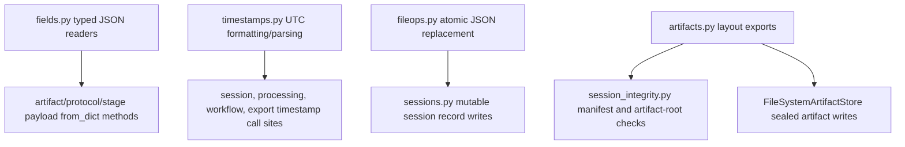

# Shared Primitives Consolidation - Plan

## Goal Capsule

- **Objective:** Consolidate repeated JSON field readers, UTC timestamp helpers, atomic JSON writes, and artifact path layout derivation into small owner modules without changing persisted JSON shapes or validation behavior.
- **Authority hierarchy:** GitHub issue #116 defines scope; `docs/architecture/architecture-overview.md` §8.2, ADR-007, ADR-011, and `docs/architecture/implementation-guardrails.md` define durability and minimal-surface constraints; existing tests and fixtures define behavior.
- **Execution profile:** Standard behavior-preserving refactor across `app/src/mena/` with focused leaf-module tests and unchanged workflow behavior.
- **Stop conditions:** Stop if a duplicate helper has ambiguous behavior that cannot be preserved with an explicit owner API or call-site rule, or if a persisted artifact/session/protocol JSON shape would need to change.
- **Tail ownership:** The implementing agent owns code migration, local verification, self-review, PR body updates, and residual documentation for any intentionally deferred duplicates.

---

## Product Contract

### Summary

Issue #116 asks for a locality refactor: remove copy-pasted primitive helpers and route callers through owner modules while preserving the product's current PoC behavior.
The user-visible product, CLI workflows, persisted session bundles, artifact manifests, processing state payloads, provider artifacts, and existing JSON formatting semantics must remain unchanged.

### Problem Frame

The app now repeats the same low-level parsing and persistence idioms across many stage modules.
That repetition makes future schema and lifecycle changes risky because a field rule, timestamp rule, or path convention can drift in one module while reviewers assume it is shared.
The refactor is justified only when the deletion test stays clean: removing a copy should move knowledge to its owner, not to every caller.

### Requirements

**Shared validation helpers**

- R1. Provide one owner module for typed JSON field readers used by persisted artifact, protocol, setup, discovery, profile, and workflow payload parsers.
- R2. Preserve per-call validation semantics, including non-empty string checks, `bool` rejection for integer fields, nullable required fields, optional fields, object/list checks, numeric range checks, enum checks, SHA-256 checks, and caller-specific exception classes/messages where tests assert them.
- R3. Keep stricter variants such as positive integers, non-negative integers, and enum validation explicit instead of weakening them into a generic permissive reader.

**Timestamp and file primitives**

- R4. Provide one UTC timestamp helper for the `YYYY-MM-DDTHH:MM:SSZ` idiom and one parse/normalization helper only where existing callers already parse or normalize UTC timestamps.
- R5. Provide one atomic JSON write helper for session-record style JSON files and migrate the existing ad hoc writers without changing indent, sort order, newline, or replacement semantics.
- R6. Keep exclusive artifact byte/file writes under `artifacts.py`; do not blur the difference between generic JSON replacement and artifact-store exclusive file creation.

**Artifact layout ownership**

- R7. Export artifact layout helpers from `artifacts.py` so callers that need the artifacts directory or manifest path stop hard-coding `session_dir / "artifacts"` and `artifact-manifest.v1.json`.
- R8. Preserve artifact IDs, relative paths, manifest filenames, manifest schema version, and integrity findings emitted by session integrity checks.

**Scope control**

- R9. Do not introduce a validation framework, schema registry, migration system, or broad application utility layer.
- R10. Keep the public app behavior and durable contract shapes unchanged; this refactor must be reviewable as a locality and ownership improvement.

### Scope Boundaries

### In Scope

- Add small owner modules under `app/src/mena/` for JSON fields, timestamps, and generic atomic JSON writes.
- Add artifact layout exports to `app/src/mena/artifacts.py`.
- Migrate the duplicate helper call sites listed in issue #116 where equivalent behavior can be preserved.
- Add focused unit tests for the new owner modules and adjust existing module tests only when imports or explicit ownership change.

### Out of Scope

- Changing persisted JSON field names, versions, path formats, timestamp precision, timezone semantics, or manifest structure.
- Building schema discovery, schema migrations, validation registries, or generic framework abstractions.
- Refactoring workflow orchestration, stage ownership, provider ports, CLI flow, capture worker behavior, or conductor extraction topics.
- Reading deferred ideas in `docs/ideas/` for scope expansion.

### Acceptance Examples

- AE1. Given an existing artifact manifest with boolean `version`, when `FileSystemArtifactStore.list()` loads it, then the same integer-field error behavior is preserved through the shared field reader.
- AE2. Given session creation at `2026-05-08T05:30:00+00:00`, when `create_session()` writes `session.json` and the bundle directory name, then outputs remain `2026-05-08T05:30:00Z` and `..._2026-05-08T053000Z`.
- AE3. Given session integrity loads an artifact manifest, when the manifest path is needed, then it comes from `artifacts.py` layout helpers and the emitted finding paths/codes remain unchanged.
- AE4. Given a workflow artifact parser that currently raises its own contract error label, when a field is malformed, then the shared reader preserves that module's exception type and message content.

---

## Planning Contract

### Key Technical Decisions

- KTD1. Keep primitives as leaf modules, not a framework. Add narrowly named modules such as `app/src/mena/fields.py`, `app/src/mena/timestamps.py`, and `app/src/mena/fileops.py`; each should depend only on the standard library and avoid importing domain modules.
- KTD2. Make exception construction injectable or wrapper-friendly. Shared field readers should centralize type checks while allowing callers to keep domain-specific exception classes and message prefixes such as `ArtifactStoreError`, `ProtocolError`, `ProcessingStateError`, and stage-specific contract errors.
- KTD3. Preserve drift as explicit API shape. Existing variants are not all identical, so the owner module should expose named options or narrow helper functions for non-empty strings, nullable required fields, positive/non-negative numbers, enum values, JSON objects, lists, and SHA-256 validation rather than forcing every caller into one signature.
- KTD4. Put artifact layout exports in `artifacts.py`. The artifact store already owns `ARTIFACT_MANIFEST_FILENAME`, relative path validation, and the `Path("artifacts")` convention, so session integrity should ask that module for artifact root and manifest paths.
- KTD5. Keep generic atomic JSON replacement separate from artifact exclusive writes. `sessions.py` style JSON writes replace mutable records, while `artifacts.py` writes and copies sealed artifacts through exclusive temp/link behavior.

### High-Level Technical Design

The design keeps each primitive owned by one small surface while leaving domain modules responsible for their contracts.
Domain parsers should still decide which fields are required, nullable, ranged, or enum-constrained; the shared module only removes duplicated mechanics.

### Assumptions

- The issue text is the product contract for this refactor; no separate requirements artifact exists.
- Existing tests are the primary behavior oracle because this work must not change product behavior.
- It is acceptable to leave a helper local when its semantics are not one of the issue's shared primitives or when extracting it would obscure a domain-specific rule.

### Sources and Research

- GitHub issue #116 identifies the duplicate helpers, in-scope work, out-of-scope work, and verification expectations.
- `docs/architecture/architecture-overview.md` §8.2 requires artifacts to preserve lifecycle and integrity semantics.
- ADR-007 keeps durable artifacts in files and live coordination in protocol messages.
- ADR-011 requires versioned durable schemas and protocol contracts without broad migration machinery.
- `docs/architecture/implementation-guardrails.md` requires minimal application surface and forbids generic migration/framework expansion unless promoted.
- Local scan found duplicate field readers in `app/src/mena/artifacts.py`, `app/src/mena/discovery.py`, `app/src/mena/processing.py`, `app/src/mena/protocol.py`, `app/src/mena/setup.py`, `app/src/mena/transcription.py`, `app/src/mena/diarization.py`, `app/src/mena/merge_timing.py`, `app/src/mena/summarization.py`, `app/src/mena/review_flagging.py`, `app/src/mena/semantic_coherence.py`, `app/src/mena/correction_overlay.py`, `app/src/mena/profiles.py`, `app/src/mena/session_integrity.py`, and `app/src/mena/cli.py`.

---

## Implementation Units

### U1. Shared Typed Field Readers

- **Goal:** Add a small field-reader owner module and tests that capture the validation variants currently duplicated across payload parsers.
- **Requirements:** R1, R2, R3, R9, R10; covers AE1 and AE4.
- **Dependencies:** None.
- **Files:** `app/src/mena/fields.py`, `app/tests/test_fields.py`, existing test files that already assert malformed payload behavior.
- **Approach:** Design the owner around typed access to `Mapping[str, object]` and object attributes where existing callers need both. Keep domain-specific exception classes at the caller boundary through a narrow error factory, wrapper, or explicit exception parameter. Include helpers for required/optional strings, ints excluding `bool`, positive/non-negative ints, numbers excluding `bool`, booleans, mappings, lists, nullable required fields, enum strings, SHA-256 strings, and JSON-serializable metadata only where these behaviors are already present.
- **Patterns to follow:** Existing `ArtifactRecord.from_dict()`, `ProcessingStageState.from_dict()`, `CaptureStatusPayload.from_dict()`, `TranscriptArtifact.from_dict()`, and `CorrectionOverlayArtifact.from_dict()` tests show the expected strict type checks and error messages.
- **Test scenarios:** Required non-empty string returns a string and rejects missing, empty, and non-string values with caller-selected error type/message; required integer returns an `int` and rejects `bool`; optional string returns `None` for missing/null and rejects non-string values; required nullable helpers distinguish missing from explicit null; object/list readers reject scalar values; range helpers reject zero/negative inputs as their names imply; enum/SHA helpers preserve existing invalid-value messages.
- **Verification:** `app/tests/test_fields.py` proves the owner behavior directly, and targeted existing contract tests still pass without changing payload expectations.

### U2. Migrate Payload Parsers to the Field Owner

- **Goal:** Replace duplicated `_required_*` and `_optional_*` helpers in domain modules with imports or thin domain wrappers around `fields.py`.
- **Requirements:** R1, R2, R3, R9, R10; covers AE1 and AE4.
- **Dependencies:** U1.
- **Files:** `app/src/mena/artifacts.py`, `app/src/mena/discovery.py`, `app/src/mena/processing.py`, `app/src/mena/protocol.py`, `app/src/mena/setup.py`, `app/src/mena/transcription.py`, `app/src/mena/diarization.py`, `app/src/mena/merge_timing.py`, `app/src/mena/summarization.py`, `app/src/mena/review_flagging.py`, `app/src/mena/semantic_coherence.py`, `app/src/mena/correction_overlay.py`, `app/src/mena/profiles.py`, `app/src/mena/session_integrity.py`, `app/src/mena/cli.py`, and their existing tests under `app/tests/`.
- **Approach:** Migrate in clusters by exception type and semantic shape, keeping thin local wrappers only when they preserve domain labels or avoid broad edits. Do not migrate unrelated helpers such as capture route target requirements that are not JSON field readers. Preserve `cli._required_int`'s positive-value behavior either at the call site or through an explicitly positive helper.
- **Patterns to follow:** Use the module-local contract tests named in `app/tests/test_protocol.py`, `app/tests/test_processing.py`, `app/tests/test_artifacts.py`, `app/tests/test_transcription.py`, `app/tests/test_diarization.py`, `app/tests/test_merge_timing.py`, `app/tests/test_summarization.py`, `app/tests/test_review_flagging.py`, `app/tests/test_semantic_coherence.py`, and `app/tests/test_correction_overlay.py`.
- **Test scenarios:** Existing malformed payload tests continue to fail on the same invalid inputs and report the same domain error class; protocol payload tests still reject invalid versions, source IDs, negative counts, and malformed details; artifact manifest tests still reject boolean integers and path escapes; stage artifact tests still reject unsupported versions and malformed timestamps.
- **Verification:** Grep shows no issue-targeted duplicate `_required_str`/`_required_int`/`_optional_str`/`_required_bool`/`_required_list`/`_required_dict` copies remain outside the owner module or intentional thin wrappers, and the affected module tests pass.

### U3. Shared UTC Timestamp Helpers

- **Goal:** Add one timestamp owner module and migrate UTC `Z` formatting and existing parse/normalization idioms.
- **Requirements:** R4, R10; covers AE2.
- **Dependencies:** None.
- **Files:** `app/src/mena/timestamps.py`, `app/tests/test_timestamps.py`, `app/src/mena/sessions.py`, `app/src/mena/processing.py`, `app/src/mena/diarization.py`, `app/src/mena/transcription.py`, `app/src/mena/merge_timing.py`, `app/src/mena/summarization.py`, `app/src/mena/review_flagging.py`, `app/src/mena/semantic_coherence.py`, `app/src/mena/correction_workflow.py`, `app/src/mena/correction_overlay.py`, `app/src/mena/setup.py`, `app/src/mena/export.py`, and `app/src/mena/cli.py`.
- **Approach:** Centralize second-precision UTC formatting to preserve `isoformat(timespec="seconds").replace("+00:00", "Z")` outputs and separate any filename-safe variant that removes colons. Keep callers that need microsecond handling or special sort keys explicit if the generic helper would change behavior.
- **Patterns to follow:** `app/tests/test_sessions.py` asserts bundle directory names and `created_at`; `app/tests/test_correction_workflow.py` and `app/tests/test_correction_overlay.py` assert timestamp formatting and ordering behavior; processing and stage tests assert persisted `started_at`/`completed_at` values.
- **Test scenarios:** A timezone-aware UTC datetime formats as `YYYY-MM-DDTHH:MM:SSZ`; an offset-aware datetime normalizes to UTC before formatting; a naive datetime is handled the same way as existing call sites that already accept naive values, or those call sites remain local; filename-safe formatting removes colons only in the directory/export-name contexts; existing parse helpers still reject malformed timestamp strings.
- **Verification:** `app/tests/test_timestamps.py`, `app/tests/test_sessions.py`, and affected workflow tests pass with unchanged expected timestamp strings.

### U4. Shared Atomic JSON Replacement

- **Goal:** Move generic mutable JSON replacement into one file-operation helper and migrate current copies.
- **Requirements:** R5, R6, R10.
- **Dependencies:** None.
- **Files:** `app/src/mena/fileops.py`, `app/tests/test_fileops.py`, `app/src/mena/sessions.py`, and any non-artifact duplicate JSON writer confirmed during implementation.
- **Approach:** Implement an atomic JSON writer that preserves `json.dumps(..., indent=2, sort_keys=True) + "\n"`, UTF-8 encoding, temp sibling naming, and `Path.replace()` semantics. Keep artifact-store sealed artifact writes and exclusive file copy/write logic in `artifacts.py`.
- **Patterns to follow:** `app/src/mena/sessions.py` `_write_json_atomically()` and `app/tests/test_sessions.py::test_update_session_record_writes_atomically`.
- **Test scenarios:** The helper writes sorted, indented JSON with a trailing newline; replacing an existing JSON file leaves the final path with only the new complete content; a simulated temp-write failure does not replace the existing file; callers can pass any mapping currently accepted by session record updates.
- **Verification:** `app/tests/test_fileops.py` proves the helper, and `app/tests/test_sessions.py` still passes unchanged.

### U5. Artifact Layout Exports

- **Goal:** Export artifact layout helpers from `artifacts.py` and migrate session integrity away from hard-coded artifact directories and manifest paths.
- **Requirements:** R7, R8, R10; covers AE3.
- **Dependencies:** None.
- **Files:** `app/src/mena/artifacts.py`, `app/src/mena/session_integrity.py`, `app/tests/test_artifacts.py`, `app/tests/test_session_integrity.py`.
- **Approach:** Add public or intentionally module-level helpers such as `artifact_root(session_dir: Path) -> Path` and `artifact_manifest_path(session_dir: Path) -> Path` near `ARTIFACT_MANIFEST_FILENAME`. Use them in `FileSystemArtifactStore` and `session_integrity.py` so the manifest filename and artifact root convention stay with the artifact owner.
- **Patterns to follow:** `FileSystemArtifactStore.__init__()` already derives `self.artifact_root` and `self.manifest_path`; `_load_manifest_records()` and `_verify_orphaned_artifact_files()` in `session_integrity.py` currently rederive the same paths.
- **Test scenarios:** Artifact store initialization uses the exported layout and still creates `artifacts/artifact-manifest.v1.json`; session integrity reports the same manifest invalid/version/session mismatch codes and display paths; orphaned artifact detection still ignores the manifest and temp files.
- **Verification:** `app/tests/test_artifacts.py` and `app/tests/test_session_integrity.py` pass with unchanged expected paths and finding codes.

### U6. Duplication Proof, Gates, and Self-Review

- **Goal:** Prove the refactor preserved behavior and removed the targeted duplicate primitives.
- **Requirements:** R2, R8, R9, R10.
- **Dependencies:** U1, U2, U3, U4, U5.
- **Files:** `app/src/mena/`, `app/tests/`, PR body.
- **Approach:** Run targeted tests while migrating, then run the full app gate from `app/`. Use grep to prove duplicates are gone or record any intentional thin wrappers with a reason in the PR body. Self-review the diff against issue #116, durable-contract guardrails, and persisted-format risks.
- **Patterns to follow:** `app/AGENTS.md` requires `make check` from `app/` before handoff and PR notes with validation and local self-review.
- **Test scenarios:** Full app tests pass; grep identifies no unowned duplicate private helpers for the issue-targeted primitives; existing fixture/contract tests pass unchanged, demonstrating no persisted contract shape drift.
- **Verification:** `make check` passes from `app/`, grep evidence is captured in the PR notes, and the PR body names any intentional residual wrappers or exclusions.

---

## Verification Contract

| Gate | Applies to | Done signal |
|---|---|---|
| `uv run pytest tests/test_fields.py tests/test_timestamps.py tests/test_fileops.py` from `app/` | U1, U3, U4 | New owner module tests pass. |
| Targeted existing contract tests from `app/tests/` | U2, U3, U5 | Existing malformed-payload, timestamp, artifact manifest, and session integrity expectations pass unchanged. |
| Grep duplication proof | U2, U6 | No targeted `_required_*`, `_optional_*`, UTC `isoformat().replace("+00:00", "Z")`, or generic atomic JSON writer copies remain outside owner modules or documented wrappers. |
| `make check` from `app/` | All units | Format, lint, mypy, and pytest pass under the repo's configured gate. |
| Local self-review | U6 | Diff is reviewed for issue scope, durable contract parity, no schema/framework expansion, and no out-of-scope workflow refactor. |

---

## Definition of Done

- Shared primitive owner modules exist with focused tests and no broad framework surface.
- All migrated call sites preserve their existing exception class, validation strictness, timestamp output, JSON formatting, artifact paths, and manifest/session contract shapes.
- Artifact layout knowledge used by session integrity flows through `artifacts.py`.
- Duplicate primitive definitions targeted by issue #116 are removed or explicitly documented as intentional thin wrappers.
- `make check` passes from `app/`.
- The PR body includes scope, validation results, grep proof, known residual wrappers or non-goals, and a local self-review section.
- Dead-end migration code, unused compatibility helpers, and abandoned aliases are removed before handoff.
