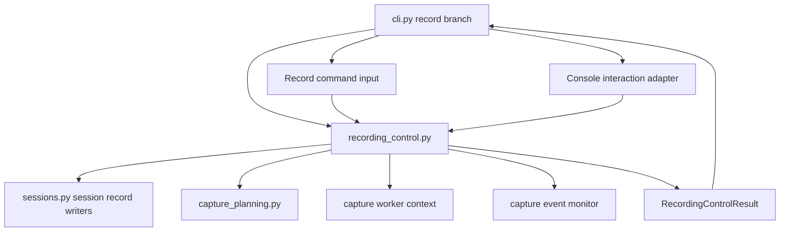
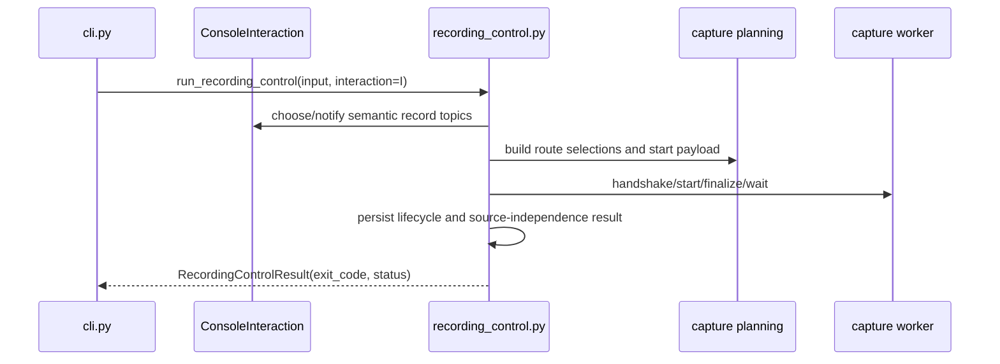

# Recording Control Workflow Extraction - Plan

## Goal Capsule

| Field | Value |
|---|---|
| Objective | Finish issue #117 by extracting the `record` command workflow from `app/src/mena/cli.py` into a workflow module that depends on the interaction port rather than terminal prompt mechanics. |
| Authority | GitHub issue #117 is the scope contract; PR #125 handoff defines the already-completed interaction-port slice and the remaining work. |
| Execution profile | Behavior-preserving application refactor with tests moved from CLI monkeypatch paths to workflow-interface coverage. |
| Stop conditions | Stop if preserving byte-identical CLI wording conflicts with moving prompt wording to the adapter, or if workflow extraction would require changing capture worker protocol or persisted session schemas. |
| Tail ownership | This branch already has PR #125 open against `develop`; update that PR rather than creating a new one unless repository state changes. |

---

## Product Contract

### Summary

Issue #117 restores ADR-002 for `record`: the CLI should be an adapter, while recording orchestration should live in an application workflow module. The interaction port slice is already committed on this branch in `app/src/mena/interaction.py`; this plan completes the remaining slice by moving the recording control workflow out of `cli.py`, implementing the console adapter against real record prompts, and relocating workflow tests onto the new interface.

Product Contract preservation: Product Contract unchanged from issue #117 and PR #125 handoff; this plan narrows execution to the remaining scope already identified there.

### Problem Frame

The current `record` branch in `app/src/mena/cli.py` owns too many responsibilities: parsing command arguments, prompting users, planning capture routes, creating session records, driving the capture worker, persisting lifecycle updates, handling interrupts, and printing terminal messages. This makes the CLI a workflow owner instead of an adapter, and it forces workflow behavior tests to script `input_fn` and patch CLI internals rather than exercise a stable application boundary.

### Requirements

**Workflow boundary**

- R1. Move recording orchestration into `app/src/mena/recording_control.py` so session creation, discovery persistence, route selection, capture lifecycle, source-independence validation, and final session-record updates are callable without going through CLI argument parsing.
- R2. Keep the `record` CLI branch thin: parse flags, build workflow inputs and adapters, call the workflow, print or map adapter-owned terminal output, and return the workflow result exit code.
- R3. Preserve the existing capture worker protocol, capture planning contracts, session-record schema, artifact layout, and source-independence behavior.

**Interaction port use**

- R4. Use `InteractionPort` for recording workflow decisions and notices instead of direct `input`, `print`, or prompt strings inside the workflow module.
- R5. Implement a console interaction adapter for record prompts in `cli.py` or a small CLI-owned helper, keeping current user-facing wording byte-identical where the issue expects no behavior change.
- R6. Keep prompt wording and exit-code wording in the CLI adapter layer; workflow topics and option labels/context remain semantic domain data.

**Verification and test shape**

- R7. Move record-workflow behavior tests from `app/tests/test_cli.py` to a workflow-focused test module using `ScriptedInteraction` and fake capture workers.
- R8. Keep a smaller set of CLI tests for argument parsing, prompt wording, adapter behavior, and exit-code mapping.
- R9. Reduce record-path monkeypatching against `mena.cli` measurably while preserving current `make check` coverage and the existing observable record command behavior.

### Scope Boundaries

#### In Scope

- Extraction of the `record` control flow and related capture lifecycle helpers required by that flow.
- A console adapter for `InteractionPort` shaped by existing record prompts.
- Workflow result types that let the CLI map success, cancellation, setup failure, capture failure, and finalized statuses to current exit codes and messages.
- Focused migration of record tests into `app/tests/test_recording_control.py`, while retaining CLI adapter tests in `app/tests/test_cli.py`.

#### Deferred to Follow-Up Work

- Retrofitting `correction_workflow` to the interaction port.
- Extracting `process`, `summarize`, `resume`, or export workflows from `cli.py`.
- Further decomposition of capture worker internals beyond what is needed to extract recording control.

#### Out of Scope

- Changing capture behavior, degradation rules, discovery semantics, capture worker protocol messages, persisted session schemas, or processing handoff text.
- Adding non-CLI user interfaces.
- Changing installed product runtime paths or UAT invocation semantics.

### Acceptance Examples

- AE1. Given `mena record --profile online --language en --name Planning` with a fake successful worker and a stop command, when the workflow runs through the CLI adapter, then the session bundle and `session.json` match the current successful record behavior and the terminal still prints the process handoff.
- AE2. Given ambiguous available routes and no explicit route flags, when the workflow asks for route choices, then the workflow emits semantic choice requests and the console adapter renders the same route-choice wording as today.
- AE3. Given unavailable audio discovery, when the workflow is invoked, then discovery is persisted, capture does not start, and the command exits with the same failure message and code as today.
- AE4. Given a worker spawn, protocol, exit, timeout, finalization, or source-independence failure, when the workflow handles the failure, then the session record carries the same failed lifecycle fields and failure payloads as today.
- AE5. Given a keyboard interrupt before start, during stop, or after finalization, when the workflow handles the interrupt path, then cancellation, interrupted stop reason, and already-finalized behavior match current CLI tests.

---

## Planning Contract

### Key Technical Decisions

- KTD1. `recording_control.py` owns workflow orchestration, not prompt rendering. The module may format domain labels such as route option labels, but user-facing prompt sentences and terminal command prompts remain in the CLI adapter so ADR-002 stays intact.
- KTD2. The workflow returns a typed result carrying exit code and final status signals rather than printing directly. This keeps CLI behavior stable while allowing tests to assert workflow outcomes without capturing terminal output for every path.
- KTD3. The first console adapter is record-shaped rather than generic. PR #125 deliberately delayed a console adapter until the first migration could shape it against real prompts; this avoids speculative adapter surface area.
- KTD4. Capture-worker and session-record helpers move only when doing so reduces workflow ownership in `cli.py`. Shared helpers that are genuinely CLI formatting or unrelated command utilities stay in `cli.py`.
- KTD5. Tests should characterize current behavior before each moved branch is deleted from `cli.py`. Existing record tests are the baseline; migrated tests should preserve their assertions against persisted records, worker interactions, and adapter requests.

### High-Level Technical Design

### Assumptions

- The existing `InteractionPort` API from PR #125 is sufficient for record prompts: choices, notices, and one free-form text request for the stop command.
- The stop command prompt is represented as a semantic text request such as `record.stop_command`; the console adapter preserves the current `record> ` prompt text.
- The current PR #125 body is the handoff note for issue #117; no separate local handoff file was found.

### Sequencing

Implement in three commit-sized slices: adapter/result boundary, workflow extraction, then test migration and CLI cleanup. Keep the branch usable after each slice, with `make check` green before final handoff.

---

## Implementation Units

### U1. Console Interaction Adapter for Record Prompts

- **Goal:** Add the CLI-owned adapter that renders record setup choices and notices from semantic `InteractionPort` requests while preserving current terminal wording.
- **Requirements:** R4, R5, R6, AE2
- **Dependencies:** Existing `app/src/mena/interaction.py` from PR #125
- **Files:** `app/src/mena/cli.py`, `app/tests/test_cli.py`, `app/tests/test_interaction.py`
- **Approach:** Introduce a small console adapter close to CLI prompt helpers. Map record topics such as profile selection, language default confirmation or entry if needed, microphone route choice, playback stream route choice, output sink route choice, stop command text, consent notice, cancellation, and degradation notices to current prompt text. Keep `_prompt_choice` and `_record_input` mechanics available to the adapter while workflows see only `ChoiceRequest`, `TextRequest`, `WorkflowNotice`, and related domain data.
- **Patterns to follow:** Existing `_prompt_choice`, `_format_audio_route_choice`, `_record_input`, and `ScriptedInteraction` request ordering.
- **Test scenarios:** Given a microphone route choice request with two options and a default, the adapter renders the same numbered prompt format and returns the selected `ChoiceOption`. Given a stop command text request, the adapter renders the current `record> ` prompt and returns the typed command. Given EOF or keyboard interrupt from the input function, the adapter propagates the same exception class expected by CLI cancellation handling. Given a notice topic for consent, the adapter prints the existing consent notice wording. Given an unknown record topic, the adapter fails loudly rather than silently inventing wording.
- **Verification:** CLI adapter tests prove prompt wording and exception behavior; no workflow orchestration moves in this unit.

### U2. Recording Control Workflow Module

- **Goal:** Move record orchestration from `cli.py` into `app/src/mena/recording_control.py` behind a callable workflow interface.
- **Requirements:** R1, R3, R4, AE1, AE3, AE4, AE5
- **Dependencies:** U1
- **Files:** `app/src/mena/recording_control.py`, `app/src/mena/cli.py`, `app/tests/test_recording_control.py`
- **Approach:** Define workflow input and result dataclasses carrying profile, language, session name, route flag values, verbosity, dry-run, worker timeout, injected worker factory, discovery function, clock, data root, and interaction port. Move session creation, discovery persistence, route resolution, start payload creation, capture plan persistence, worker lifecycle, monitor start/stop, finalization, capture metadata persistence, source-independence validation, and failure persistence into the module. Keep CLI-only argument parsing and terminal formatting outside the module.
- **Execution note:** Start by migrating a small successful-record test to the workflow interface, then move failure and interrupt branches in batches so behavior is characterized before deleting CLI-owned code.
- **Patterns to follow:** `run_correction_workflow` as a flat application workflow module, existing record branch lifecycle order in `cli.py`, and session writer helpers in `app/src/mena/sessions.py`.
- **Test scenarios:** Given a fake successful worker and scripted interaction, the workflow persists a recorded session with finalized capture plan, two source segments, and a processable handoff result. Given dry-run mode, the workflow creates and persists discovery but does not request stop input or start a worker. Given unavailable discovery, the workflow exits before capture planning and leaves capture metadata absent. Given worker spawn, handshake, protocol, wait, timeout, and finalization failures, the workflow persists failed lifecycle fields and failure records matching current CLI assertions. Given source-independence hash failures, silent identical hashes remain allowed and non-silent identical hashes fail exactly as current tests expect. Given keyboard interrupts before start, during stop, startup-finalize, and after finalization, the workflow preserves current status and finalization behavior.
- **Verification:** Workflow tests assert persisted `session.json`, capture metadata, failure records, worker calls, notices, and result exit codes without patching `mena.cli` internals.

### U3. Thin CLI Delegation and Output Mapping

- **Goal:** Replace the inline `record` branch in `cli.py` with argument validation, adapter construction, workflow invocation, and output or exit-code mapping.
- **Requirements:** R2, R5, R6, AE1, AE3
- **Dependencies:** U1, U2
- **Files:** `app/src/mena/cli.py`, `app/tests/test_cli.py`
- **Approach:** Keep parser flags and high-level `main()` error handling in `cli.py`. Convert existing printed status lines into adapter or CLI output mapping from `RecordingControlResult`, preserving messages such as created session, session record path, discovery formatting, capture-not-started reasons, capture finalized, finalized failure statuses, and process handoff. Remove or demote record-only private helpers from `cli.py` once their workflow or adapter owners exist.
- **Patterns to follow:** The `correct` command delegation from `cli.py` to `run_correction_workflow`, and existing CLI tests that assert user-visible output.
- **Test scenarios:** Given the successful CLI record command, output still includes session creation, session record path, discovery text, capture finalized, and process handoff. Given noninteractive missing profile or language, output and exit code match current behavior. Given explicit route flags, the CLI passes them through without prompting. Given route prompt cancellation, the CLI prints `Recording setup cancelled.` and the persisted session remains created-only.
- **Verification:** Remaining CLI tests focus on parser and adapter/output behavior, not worker lifecycle internals.

### U4. Test Migration and Coverage Cleanup

- **Goal:** Move workflow behavior coverage out of `test_cli.py`, reduce CLI monkeypatching for record paths, and keep `make check` green.
- **Requirements:** R7, R8, R9, AE1, AE2, AE3, AE4, AE5
- **Dependencies:** U2, U3
- **Files:** `app/tests/test_cli.py`, `app/tests/test_recording_control.py`, `app/tests/test_interaction.py`, `app/src/mena/recording_control.py`
- **Approach:** Rehome record lifecycle tests to `test_recording_control.py` with fake worker classes and `ScriptedInteraction`. Keep CLI tests for `record --help`, required profile/language behavior, prompt wording through the console adapter, explicit flag pass-through, and exit-code mapping. Remove duplicated assertions once workflow tests own them, and keep helper fixtures shared locally in the workflow test file unless they are already broadly useful.
- **Patterns to follow:** Existing fake worker classes and session record assertions in `app/tests/test_cli.py`, plus `ScriptedInteraction` request assertions in `app/tests/test_interaction.py`.
- **Test scenarios:** Workflow test count covers success, dry-run, unavailable discovery, route choice, noninteractive stop rejection, all existing worker failure variants, source-independence failure and silent allowance, verbose diagnostics signal, and interrupt timing. CLI test count covers visible command behavior and adapter wording. A grep for `monkeypatch.setattr("mena.cli...")` shows record-path usage reduced from the pre-extraction shape.
- **Verification:** `make check` passes from `app/`; coverage remains above the repository threshold; no tests rely on installed `mena` product paths.

---

## Verification Contract

| Gate | Scope | Done Signal |
|---|---|---|
| Focused workflow tests | `app/tests/test_recording_control.py` and retained record CLI tests | Record lifecycle, route choice, failure, interrupt, and source-independence paths pass against the extracted workflow. |
| Interaction/adapter tests | `app/tests/test_interaction.py` and adapter-focused CLI tests | Semantic requests map to current wording and scripted requests fail on mismatches. |
| Full app gate | `make check` from `app/` | Formatting, linting, typing, tests, and coverage pass using repo/dev invocation. |
| Manual smoke or documented substitute | `cd app && uv run mena record ...` with scratch `MENA_DATA_ROOT`, if practical | A real or fake-device smoke confirms the installed product paths are not used; if local audio prerequisites make this impractical, document the skipped condition in the PR. |

---

## Definition of Done

- The `record` command delegates to `recording_control.py` and no longer owns capture orchestration inline.
- The workflow module has no terminal prompt wording and uses `InteractionPort` for user decisions and notices.
- CLI-visible wording, exit codes, persisted session records, capture metadata, and failure payloads remain behavior-compatible with current tests.
- Record workflow behavior tests live primarily in `app/tests/test_recording_control.py`; `app/tests/test_cli.py` retains only CLI and adapter responsibilities for record paths.
- Dead-end migration code, unused compatibility helpers, and abandoned aliases are removed before handoff.
- `make check` passes from `app/`.
- PR #125 is updated with current scope, validation, known limitations, and local self-review notes before review readiness.

---

## Sources & Research

- GitHub issue #117: "Introduce interaction port and extract recording control workflow from cli.py".
- PR #125 handoff note: interaction port complete; remaining work is `recording_control.py`, console adapter, and workflow test migration.
- Architecture references: `docs/decisions/ADR-002-cli-as-an-adapter.md`, `docs/decisions/ADR-004-session-orchestrator-process-and-capture-worker-process.md`, `docs/decisions/ADR-006-per-invocation-orchestrator-as-canonical-session-record-writer.md`, `docs/decisions/ADR-019-centralize-error-recovery-authority-in-the-active-orchestrator.md`, `docs/decisions/ADR-025-poc-internal-protocol-stdio-newline-delimited-json.md`, `docs/decisions/ADR-032-continuous-capture-with-rotating-source-segments.md`.
- Code references: `app/src/mena/interaction.py`, `app/src/mena/cli.py`, `app/src/mena/correction_workflow.py`, `app/tests/test_cli.py`, `app/tests/test_interaction.py`.
