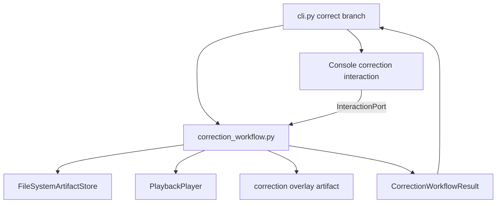
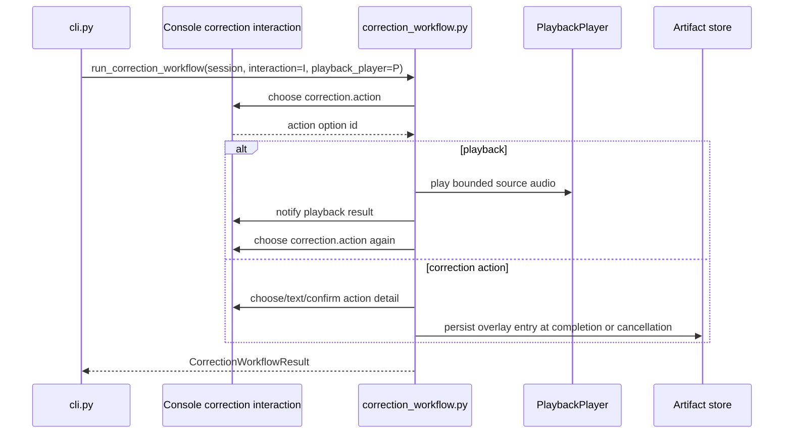

# Correction Workflow Interaction Port Retrofit - Plan

## Goal Capsule

| Field | Value |
|---|---|
| Objective | Retrofit `app/src/mena/correction_workflow.py` to the existing interaction port so correction decisions are semantic requests and CLI wording lives in the adapter. |
| Authority | GitHub issue #119 is the executable scope contract; ADR-002 and `docs/architecture/architecture-overview.md` define the adapter boundary. |
| Execution profile | Behavior-preserving internal refactor with focused workflow tests migrated from `input_fn` scripting to `ScriptedInteraction`. |
| Stop conditions | Stop if preserving current CLI wording conflicts with semantic workflow requests, or if the change would require altering review-queue, correction-overlay, merged-transcript, or playback contracts. |
| Tail ownership | Branch work should open or update a PR against `develop`; keep the PR draft until local gates and self-review are complete. |

---

## Product Contract

### Summary

Issue #119 completes the next interaction-port migration after recording control: `correction_workflow.py` must stop asking a string-based `input_fn` questions and instead ask an `InteractionPort` for correction decisions.
The visible CLI correction workflow remains the same: review items print the same contextual information, prompts keep their existing wording, playback stays available, and correction overlays remain separate from source transcripts.

Product Contract preservation: Product Contract unchanged from GitHub issue #119; this plan adds only implementation structure and verification detail.

### Problem Frame

`correction_workflow.py` currently owns terminal prompt strings through `_prompt_action`, `_prompt_speaker_assignment`, `_prompt_text_edit`, and `_prompt_overlap_mark`.
That shape violates ADR-002 because the application workflow depends on prompt wording and a function that answers printed strings.
The existing `InteractionPort` provides the needed seam: workflows ask for choices, confirmations, text, and notices using stable topics; adapters own rendering and input mechanics.

### Requirements

**Interaction boundary**

- R1. Replace the public `input_fn` dependency on `run_correction_workflow` with an `InteractionPort` dependency.
- R2. Express correction decisions as semantic interaction requests for action choice, speaker assignment, text edit, and overlap marking.
- R3. Keep prompt wording and invalid-input retry mechanics in the CLI adapter layer, not in `correction_workflow.py`.
- R4. Keep `PlaybackPlayer` as its own injected dependency; do not fold playback execution into the interaction port.

**Behavior preservation**

- R5. Preserve current correction behavior for skip, speaker reassignment, new speaker labels, text edits, overlap marks, playback retries, cancellation staging, and completed overlay metadata.
- R6. Preserve current CLI-visible prompt text and invalid-input messages for the `correct` command.
- R7. Preserve printed review-item context unless moving a specific message into a notice is necessary for adapter ownership; the user-visible output must remain equivalent.

**Test and scope control**

- R8. Replace workflow tests that script `input_fn` answers with `ScriptedInteraction` responses and topic assertions.
- R9. Keep CLI tests for correction prompt wording, invalid input handling, cancellation mapping, and adapter behavior.
- R10. Do not change review queue selection, flag ordering, overlay schema, transcript immutability, source-audio playback resolution, or session path resolution unless needed for the interaction-port seam.

### Scope Boundaries

#### In Scope

- `run_correction_workflow` signature and callers.
- Correction-specific semantic topics and option identifiers.
- A console correction adapter in `app/src/mena/cli.py` or a small CLI-owned helper.
- Test migration in `app/tests/test_correction_workflow.py` plus focused CLI adapter tests.

#### Deferred to Follow-Up Work

- Removing duplicated `_resolve_session` / `_extract_session_id` only if the session helper issue has already landed in this branch.
- Retrofitting `process`, `summarize`, `resume`, `export`, or setup fallback prompts to the interaction port.
- A non-CLI correction UI or richer correction screen.

#### Out of Scope

- Review-queue generation and flagging policy.
- Correction overlay schema, artifact naming, and active-overlay selection.
- Playback command selection, audio clipping, source-reference resolution, and playback window timing.
- Changing the product scope of correction or adding new correction actions.

### Acceptance Examples

- AE1. Given a review queue with low-confidence and overlap flags, when scripted interaction chooses speaker reassignment and overlap mark, then the workflow persists the same correction overlay entries as the current `input_fn` path.
- AE2. Given an invalid correction action typed in the CLI, when the user then chooses skip, then the CLI prints the same invalid-action guidance and the workflow records one skipped item.
- AE3. Given a speaker reassignment request, when the user chooses an existing candidate by number, existing speaker id, speaker label, or a new label, then the same speaker ids and labels are persisted as today.
- AE4. Given the user requests playback, when playback fails or succeeds, then the workflow stays on the same review item and the CLI reports playback failure or completion as today.
- AE5. Given EOF or keyboard interrupt after at least one correction entry, when the workflow cancels, then a staged overlay is persisted and the CLI reports cancellation as today.

---

## Planning Contract

### Key Technical Decisions

- KTD1. Correction workflow owns decision timing and domain context; the CLI adapter owns prompt wording, input aliases, validation copy, and printed notices. This follows the `ConsoleRecordInteraction` pattern already used by `recording_control.py`.
- KTD2. Action choice should be a `ChoiceRequest` with stable option ids such as `playback`, `skip`, `speaker_reassignment`, `text_edit`, and `overlap_mark`. The workflow consumes option ids, while the adapter maps CLI aliases like `p`, `s`, `r`, `t`, and `o`.
- KTD3. Speaker reassignment should use a `TextRequest` with candidate-speaker context plus semantic validation notices, because the current port has no freeform-choice primitive. The workflow resolves numbers, existing ids, existing labels, and new labels from the returned text while the adapter owns prompt and validation wording.
- KTD4. Overlap marking should use `ConfirmationRequest` with default `False`, preserving the current empty-enter behavior.
- KTD5. Workflow tests should assert interaction topics and persisted artifacts; CLI tests should assert wording and alias parsing. This keeps workflow behavior independent from terminal mechanics.

### High-Level Technical Design

### Assumptions

- `InteractionPort` is already available from the recording-control slice and is the correct seam for correction decisions.
- It is acceptable for the first correction console adapter to live near `ConsoleRecordInteraction` in `app/src/mena/cli.py`; extraction to a dedicated adapter module is follow-up unless the implementation reveals meaningful duplication.
- Review item context can remain printed by the workflow for this issue if converting it to notices would expand the slice beyond prompt ownership; the mandatory boundary is that decisions no longer depend on prompt strings or `input_fn`.

### Sequencing

Implement in three small slices: introduce correction interaction topics and adapter tests, switch `run_correction_workflow` to the port with workflow tests, then clean up prompt helpers and CLI delegation.

---

## Implementation Units

### U1. Correction Console Adapter

- **Goal:** Add CLI-owned handling for correction interaction topics while preserving current prompt strings, aliases, and invalid-input messages.
- **Requirements:** R2, R3, R6, R9, AE2, AE3
- **Dependencies:** Existing `app/src/mena/interaction.py`
- **Files:** `app/src/mena/cli.py`, `app/tests/test_cli.py`, `app/tests/test_interaction.py`
- **Approach:** Add a correction adapter or extend a small adapter family beside `ConsoleRecordInteraction`. Map `correction.action` to the current action prompt and aliases, map `correction.speaker_assignment` text requests to the current speaker prompt, map speaker validation notices to the current retry messages, map `correction.text_edit` to the current text prompt, and map `correction.overlap_mark` to the current yes/no prompt with default false. Unknown correction topics should fail loudly.
- **Patterns to follow:** `ConsoleRecordInteraction`, `_prompt_choice`, `ScriptedInteraction`, and existing prompt tests in `app/tests/test_cli.py`.
- **Test scenarios:** Given action input `z` followed by `s`, the adapter prints `Invalid action` and returns the skip option. Given action aliases `p`, `play`, and `playback`, each resolves to the playback option. Given a speaker assignment text request, the adapter prints the current speaker prompt and returns the typed text. Given speaker validation notices for empty input or invalid number, the adapter prints the current retry messages. Given overlap input empty, `n`, `no`, `y`, and `yes`, the adapter returns the same booleans as today. Given an unsupported correction topic, the adapter raises a clear error.
- **Verification:** Adapter tests prove byte-equivalent correction prompt wording and alias behavior without running a full correction workflow.

### U2. Workflow Port Adoption

- **Goal:** Change `run_correction_workflow` to use `InteractionPort` for all correction decisions while preserving overlay behavior.
- **Requirements:** R1, R2, R4, R5, R8, AE1, AE3, AE4, AE5
- **Dependencies:** U1
- **Files:** `app/src/mena/correction_workflow.py`, `app/tests/test_correction_workflow.py`
- **Approach:** Replace `input_fn` with `interaction`. Convert `_prompt_action`, `_prompt_speaker_assignment`, `_prompt_text_edit`, and `_prompt_overlap_mark` into semantic request helpers or remove them once their prompt wording belongs in the adapter. Keep candidate speaker parsing in the workflow: request raw speaker assignment text with candidate context, resolve numbers/ids/labels/new labels, emit semantic validation notices for retryable invalid input, and keep `_new_speaker_id` plus catalog ordering unchanged. Keep playback request resolution and `PlaybackPlayer` untouched.
- **Execution note:** Start with characterization coverage for the existing persisted overlay cases, then migrate each action branch to `ScriptedInteraction` before deleting the prompt helper it replaces.
- **Patterns to follow:** `run_recording_control_workflow` dependency injection, `ScriptedInteraction` request assertions, and existing correction overlay persistence tests.
- **Test scenarios:** Given scripted action responses for speaker reassignment, text edit, overlap mark, and skip, the workflow persists the same entry types and counts as current tests. Given scripted speaker assignment text `2`, an existing speaker id, an existing speaker label, and a new label, the workflow resolves each to the same persisted speaker ids and labels as today. Given scripted playback then skip, the fake player receives the same `PlaybackRequest` and the workflow returns to the same item before consuming the skip action. Given playback resolution or player failure, the workflow records a warning notice or equivalent adapter-visible signal and asks for action again. Given EOF or keyboard interrupt from the interaction adapter after one entry, the workflow persists a staged overlay with current cancellation metadata and re-raises for CLI handling. Given an unscripted or mismatched interaction in tests, `ScriptedInteractionError` fails the test at the unexpected topic.
- **Verification:** Workflow tests assert persisted overlay payloads, source transcript immutability, result counters, playback calls, cancellation staging, and interaction topic order.

### U3. CLI Delegation and Compatibility

- **Goal:** Update the `correct` command to construct the correction interaction adapter and call the new workflow signature.
- **Requirements:** R1, R3, R6, R9, AE2, AE4, AE5
- **Dependencies:** U1, U2
- **Files:** `app/src/mena/cli.py`, `app/tests/test_cli.py`
- **Approach:** Replace the `input_fn` argument passed to `run_correction_workflow` with the correction adapter. Keep CLI exception mapping for artifact, workflow, EOF, and keyboard interrupt errors. Retain CLI tests that prove the public command still exits and prints as before for invalid action, cancellation, playback failure text, and successful completion.
- **Patterns to follow:** Current `correct` command delegation and `record` command interaction adapter construction.
- **Test scenarios:** Given a full `mena correct <session>` command with scripted inputs, the command returns 0 and prints the current completion summary. Given invalid action then skip, the command prints current invalid-action text. Given keyboard interrupt, the command prints `Correction workflow cancelled.` and returns 1. Given `CorrectionWorkflowError`, the command prints `Cannot run correction workflow:` and returns 1.
- **Verification:** CLI tests cover adapter construction, public output, exit-code mapping, and no direct workflow prompt strings in the application workflow.

### U4. Cleanup and Scope Guardrails

- **Goal:** Remove obsolete prompt-helper plumbing and document any deliberately deferred duplicate-session helper cleanup.
- **Requirements:** R7, R10
- **Dependencies:** U2, U3
- **Files:** `app/src/mena/correction_workflow.py`, `app/tests/test_correction_workflow.py`, `docs/plans/2026-07-02-004-refactor-correction-interaction-port-plan.md`
- **Approach:** Delete unused `_prompt_*` functions once the adapter owns their behavior. Remove `Callable` imports if no longer needed by the workflow. Leave `_resolve_session` and `_extract_session_id` in place unless the shared session helper issue is already present in this branch; if left in place, do not expand the plan or implementation to solve that separate concern.
- **Patterns to follow:** Existing issue #119 instruction that session helper duplication is conditional, and repository commit hygiene for separating cleanup from behavior changes when practical.
- **Test scenarios:** A static search for `input_fn` in `app/src/mena/correction_workflow.py` finds no workflow prompt dependency. A static search for correction prompt strings in `app/src/mena/correction_workflow.py` finds no adapter-owned wording. Existing tests continue to prove review queue ordering, overlay schema behavior, playback resolution, and transcript immutability unchanged.
- **Verification:** Cleanup leaves no unused imports or dead helpers, and any deferred session helper duplication is noted in the PR rather than silently mixed into this slice.

---

## Verification Contract

| Gate | Scope | Done Signal |
|---|---|---|
| Focused correction workflow tests | `app/tests/test_correction_workflow.py` | All correction action, playback, cancellation, overlay persistence, and transcript immutability paths pass through `ScriptedInteraction`. |
| CLI adapter tests | `app/tests/test_cli.py` and `app/tests/test_interaction.py` | Correction prompt wording, aliases, invalid input messages, EOF/interrupt propagation, and CLI exit mapping remain compatible. |
| Static boundary check | `app/src/mena/correction_workflow.py` | No `input_fn` parameter or terminal prompt strings remain in the workflow decision path. |
| Full app gate | `make check` from `app/` | Formatting, linting, typing, tests, and coverage pass using repo/dev invocation. |
| Optional smoke | `cd app && uv run mena correct <scratch-session>` | If a scratch session with a review queue is available, CLI output matches the expected correction prompts; otherwise document why this was not run. |

---

## Definition of Done

- `run_correction_workflow` depends on `InteractionPort`, not `input_fn`.
- Correction action, speaker assignment, text edit, and overlap mark decisions are semantic requests with stable topics and option ids.
- CLI-visible correction prompts, aliases, invalid-input messages, cancellation text, playback messages, completion summary, and exit codes remain behavior-compatible.
- `PlaybackPlayer` remains separately injectable and playback behavior is unchanged.
- Correction workflow tests use `ScriptedInteraction` for decision flow and assert topic order where it protects the seam.
- Review queue ordering, correction overlay payloads, source transcript immutability, staged cancellation overlays, and completed overlay metadata remain unchanged.
- Obsolete prompt helpers and imports are removed unless they still serve the CLI adapter.
- `make check` passes from `app/`.
- The PR body names validation results, known non-goals, deferred session-helper cleanup if applicable, and local self-review findings.

---

## Sources & Research

- GitHub issue #119: "Retrofit correction workflow to the interaction port".
- Architecture references: `docs/decisions/ADR-002-cli-as-an-adapter.md`, `docs/architecture/architecture-overview.md` sections 6.1, 6.3, and 6.6.
- Requirement references: `docs/requirements/poc-requirements.md` entries for interactive correction, audio playback during correction, source transcript preservation, and CLI adapter separation.
- Code references: `app/src/mena/interaction.py`, `app/src/mena/recording_control.py`, `app/src/mena/cli.py`, `app/src/mena/correction_workflow.py`, `app/tests/test_interaction.py`, `app/tests/test_cli.py`, `app/tests/test_correction_workflow.py`.
