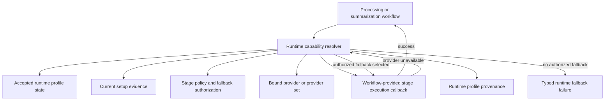

# Runtime Capability Resolver - Plan

## Goal Capsule

- **Objective:** Deepen `app/src/mena/runtime_profile.py` into the capability resolver for runtime-profile-backed provider acquisition and fallback while preserving current stage policy behavior.
- **Authority:** GitHub issue #120, `CONTEXT.md` glossary, ADR-010, ADR-019, ADR-029, ADR-031, ADR-033, and `docs/architecture/implementation-guardrails.md`.
- **Execution profile:** Behavior-preserving refactor with contract tests before broad workflow edits.
- **Stop conditions:** Stop if implementation requires new provider policy, new setup/preflight behavior, new persisted setup schema, or a generic plugin/capability registry.
- **Tail ownership:** Application changes must pass `make check` from `app/`; shipping follows the repository PR workflow against `develop`.

---

## Product Contract

### Summary

Runtime profile policy should have one home. `runtime_profile.py` should expose a resolver interface that returns bound, authorized providers for a requested stage, including existing fallback and provenance behavior. Workflow modules should ask the resolver for providers and should not own provider selection, provider validation, fallback reselection, or provider factory defaults.

### Problem Frame

The current implementation keeps the accepted runtime profile contract, fallback authorization ladder, and provider construction close together, but policy still leaks into workflow code. `processing_orchestration.py` catches provider-unavailable errors, maps them to stages, reselects fallback profiles, records fallback provenance, rebuilds providers, and retries the pipeline. `setup.py` also has private stage model/device helpers that duplicate resolver-side stage policy interpretation. This makes the capability resolver an idea in architecture rather than the single implementation surface named by issue #120.

### Requirements

**Resolver ownership**

- R1. `runtime_profile.py` must expose the capability resolver surface for stage-backed provider acquisition, fallback eligibility, authorization, bounded retry, and provenance routing.
- R2. Application workflow modules must consume resolver-bound providers instead of constructing production runtime providers and provider-time fallback loops themselves.
- R3. The existing provider ports remain the behavioral contract; this refactor must not replace them with duck-typed runtime validation in workflow code.

**Behavior preservation**

- R4. Accepted primary runtime profile selection, current-evidence revalidation, authorized local fallback, explicit one-run fallback, interactive fallback confirmation, and non-interactive refusal must keep their current behavior.
- R5. Stage-provider failure fallback must remain bounded to one fallback transition for the processing run and must preserve the existing fallback status, failure class, failed stage, and failed input artifact provenance fields.
- R6. Provenance records written through `store_runtime_profile_provenance` must remain byte-compatible in shape with the current `runtime-profile-provenance.v1` payload except for deterministic ordering differences already caused by JSON serialization.

**Scope control**

- R7. The implementation must not add new providers, policy rules, setup/preflight flows, internal protocol changes, or a generic multi-provider registry.
- R8. Setup-side stage policy helper duplication may be removed only when it can reuse resolver-owned policy helpers without changing setup evaluation semantics.

### Acceptance Examples

- AE1. Given an accepted primary profile whose required processing stages are ready, when `mena process` uses production providers, then the resolver returns primary transcription, diarization, and semantic providers and records non-fallback runtime profile provenance.
- AE2. Given an accepted primary profile that revalidates as unavailable and an authorized local fallback profile that is ready, when processing starts, then the resolver selects the fallback profile, binds fallback providers, and provenance reports `fallback.used: true` with the accepted authorization source.
- AE3. Given primary processing starts but a GPU-coupled transcription or diarization provider reports unavailable, when an authorized fallback is ready, then the resolver records stage-fallback provenance and retries the processing pipeline once using fallback transcription and diarization providers.
- AE4. Given a fallback profile is configured but unauthorized and there is no interactive or explicit one-run authorization, when primary revalidation or provider-time fallback needs that fallback, then the command fails with the existing actionable runtime fallback message.

### Scope Boundaries

In scope:

- Move runtime provider binding and processing-stage provider failure fallback into `runtime_profile.py`.
- Keep workflow modules responsible for workflow sequencing, artifact inputs/outputs, stage runners, and user-facing command outcomes.
- Remove or narrow `_require_provider`, `_provider_implements`, `runtime_fallback_stage_for_provider_failure`, and fallback provider rebuild logic from `processing_orchestration.py` when the resolver owns those decisions.
- Deduplicate stage policy interpretation helpers between `setup.py` and `runtime_profile.py` where it is small and behavior-preserving.

Out of scope:

- New setup profile schemas, external profile catalogs, new provider discovery, Mistral implementation, remote fallback behavior, and changes to setup authorization copy.
- Changing local-only guarantees for transcription, diarization, or semantic review.
- Making semantic review route-bearing.

---

## Planning Contract

### Key Technical Decisions

- KTD1. Resolver surface first, generic registry never. Add a small stage-oriented resolver API in `runtime_profile.py` that fits the existing bundled profiles and provider ports; do not introduce a plugin registry, capability graph, or provider discovery subsystem.
- KTD2. The bounded provider-failure retry loop lives inside the resolver. `processing_orchestration.py` should provide the stage-execution callback and ledger context the resolver needs, but the resolver decides whether a provider-unavailable failure is eligible for fallback, records route provenance, binds fallback providers, and invokes the one allowed retry.
- KTD3. Provider ports are the validation contract. Runtime production providers should be constructed through resolver-owned helpers that return the expected port objects; tests should cover incorrect injected fakes at the unit boundary where they matter, not preserve workflow-level duck typing for production runtime policy.
- KTD4. Preserve the current provenance writer. Keep `RuntimeProfileSelection` and `store_runtime_profile_provenance` as the durable contract, and build resolver return objects around those types instead of inventing a parallel provenance schema.
- KTD5. Keep setup deduplication narrow. Extract shared stage policy lookup helpers only if both setup evaluation and runtime profile code can call them without creating an import cycle or broad module split.

### High-Level Technical Design

Processing remains the owner of artifact flow and stage implementation. The resolver owns provider route decisions and the single allowed retry around a workflow-provided callback, returning either the callback result or a typed failure that preserves the current command exit behavior.

### Assumptions

- Issue #120's "after the processing/summarize extraction issue" dependency is satisfied by the existing `processing_orchestration.py` and `summarize_workflow.py` modules.
- No launch-blocking product question remains because the issue states behavior-preserving consolidation and names explicit non-goals.

### Risks & Dependencies

- Provider construction can become too abstract. Keep resolver types close to the existing stage names and provider ports, and defer generic capability modeling.
- Fallback provenance can drift if the resolver creates a new result type that does not reuse `RuntimeProfileSelection`. Treat existing provenance tests as characterization coverage before changing the wiring.
- Processing-stage retries need failed input artifact IDs from `ProcessingStageLedger`; the workflow should pass that context through a small callback or lookup hook rather than letting runtime profile code read workflow internals.

### Sources & Research

- GitHub issue #120: "Deepen runtime_profile into the capability resolver owning stage fallback."
- `CONTEXT.md`: "Capability resolver", "Stage-focused runtime profile", "Ordered fallback provider list", "Application workflow module".
- `docs/decisions/ADR-010-provider-ports-plus-policy-capability-resolution.md`
- `docs/decisions/ADR-019-centralize-error-recovery-authority-in-the-active-orchestrator.md`
- `docs/decisions/ADR-029-accepted-runtime-profile-state-revalidation-and-provenance.md`
- `docs/decisions/ADR-031-runtime-fallback-authorization-and-setup-state.md`
- `docs/decisions/ADR-033-stage-focused-direct-zdr-mistral-routes.md`
- `docs/architecture/implementation-guardrails.md`
- Current implementation anchors: `app/src/mena/runtime_profile.py`, `app/src/mena/processing_orchestration.py`, `app/src/mena/summarize_workflow.py`, `app/src/mena/setup.py`, `app/tests/test_processing_orchestration.py`, `app/tests/test_setup.py`.

---

## Implementation Units

### U1. Add Resolver Contract and Characterization Tests

- **Goal:** Define the resolver-facing return types and test the current runtime profile selection, fallback authorization, provider binding, and provenance behavior before workflow ownership changes.
- **Requirements:** R1, R3, R4, R5, R6, AE1, AE2, AE4.
- **Dependencies:** None.
- **Files:** `app/src/mena/runtime_profile.py`, `app/tests/test_runtime_profile.py`, `app/tests/test_processing_orchestration.py`.
- **Approach:** Add focused tests around existing selection and factory behavior, using fake setup evidence and fake provider factories where needed. Introduce small resolver result types only after tests pin current behavior. Prefer names that reflect the glossary, such as a bound stage provider or bound processing provider set, without committing to a generic registry shape.
- **Execution note:** Start with characterization tests for provenance and fallback outcomes before moving workflow fallback code.
- **Patterns to follow:** Existing `RuntimeProfileSelection`, `_resolve_authorized_fallback`, `runtime_*_factory`, and setup fallback tests in `app/tests/test_setup.py`.
- **Test scenarios:**
  - Covers AE1. Accepted primary setup state is ready for processing stages; resolver returns primary-bound transcription and diarization providers and `fallback_used` is false.
  - Covers AE2. Accepted primary setup state is unavailable and setup-authorized local fallback is ready; resolver returns fallback-bound providers and `fallback_authorization_source` is `setup_authorized`.
  - Covers AE4. Fallback is configured but unauthorized and no prompt or one-run flag is present; resolver raises the same runtime fallback failure class and message currently surfaced by processing.
  - Provenance payload for an accepted primary selection matches the current `runtime-profile-provenance.v1` key structure.
  - Provenance payload for a stage fallback selection includes failed stage, failed input artifact IDs, failure class, and `used_after_stage_failure`.
- **Verification:** Targeted runtime profile tests fail before the new resolver path is wired where behavior is missing, then pass with unchanged provenance shape.

### U2. Move Runtime Provider Binding into the Resolver

- **Goal:** Make `runtime_profile.py` the single place that turns accepted runtime profile state into production provider instances for processing and summarization stages.
- **Requirements:** R1, R2, R3, R4.
- **Dependencies:** U1.
- **Files:** `app/src/mena/runtime_profile.py`, `app/src/mena/processing_orchestration.py`, `app/src/mena/summarize_workflow.py`, `app/tests/test_runtime_profile.py`, `app/tests/test_processing_orchestration.py`, `app/tests/test_summarize_workflow.py`.
- **Approach:** Move runtime production factory selection behind resolver methods or functions that accept the current dependency-injection seams for tests. Keep fake providers injectable for unit tests, but stop exposing production provider defaults as workflow-owned kwargs when they are runtime policy. Summarization should use the same resolver pattern for accepted summarization provider construction while preserving its current no-provider-time-fallback behavior.
- **Patterns to follow:** `runtime_transcription_factory`, `runtime_diarization_factory`, `runtime_semantic_factory`, `runtime_summarization_provider`, and workflow constructor injection patterns in `processing_orchestration.py`.
- **Test scenarios:**
  - Processing with production provider classes asks the resolver for runtime-bound providers and does not call workflow-owned runtime factory wrappers.
  - Processing with fully injected fake providers continues to bypass runtime profile setup.
  - Summarization still loads accepted runtime profile state, stores provenance, and constructs the summarization provider from the selected actual profile.
  - Semantic review remains optional/local and uses the accepted semantic provider settings exactly as before.
- **Verification:** Existing processing and summarization workflow tests pass with fewer workflow-owned runtime factory seams, and new tests prove resolver-owned provider binding.

### U3. Move Provider-Time Fallback and Bounded Retry into the Resolver

- **Goal:** Remove processing workflow ownership of provider-unavailable fallback selection, fallback provider rebuilding, stage-fallback provenance routing, and bounded retry control.
- **Requirements:** R1, R2, R4, R5, R6, AE3, AE4.
- **Dependencies:** U1, U2.
- **Files:** `app/src/mena/runtime_profile.py`, `app/src/mena/processing_orchestration.py`, `app/tests/test_runtime_profile.py`, `app/tests/test_processing_orchestration.py`.
- **Approach:** Add a resolver operation that runs a workflow-provided processing callback with primary-bound providers, catches typed provider-unavailable errors, maps them to runtime stages, gathers failed input artifact IDs through a workflow-supplied hook, selects authorized fallback through the existing `_resolve_authorized_fallback` ladder, records stage-fallback provenance, and invokes the callback once more with fallback-bound providers. Processing should not contain its own nested provider-failure fallback loop after this unit.
- **Technical design:** Directionally, processing passes the resolver a callback that executes `run_processing_stages` with a provider set plus a lookup hook for `failed_input_artifacts(stage)`. The resolver owns the try/except, creates `RuntimeProfileSelection(fallback_status="used_after_stage_failure")` for the fallback transition, and raises `RuntimeFallbackUnavailable` when no authorized fallback is available.
- **Patterns to follow:** Existing `select_runtime_profile_after_stage_failure`, `runtime_fallback_stage_for_provider_failure`, `latest_failed_stage_input_artifacts`, and the current nested try/except retry block in `run_processing_command`.
- **Test scenarios:**
  - Covers AE3. Primary transcription provider raises `TranscriptionProviderUnavailable`; resolver selects authorized fallback, stage-fallback provenance is written once, and the resolver invokes exactly one retry with fallback transcription and diarization providers.
  - Diarization provider unavailability maps to the diarization stage and preserves failed input artifacts from the ledger.
  - A second provider-unavailable failure after fallback is already used is not retried again and surfaces as the provider failure.
  - Unauthorized fallback during provider-time failure raises `RuntimeFallbackUnavailable` with the existing actionable fallback guidance.
  - Fallback transition revalidates both processing required stages because a GPU failure can affect transcription and diarization together.
- **Verification:** The processing retry behavior is covered through resolver-facing tests and workflow tests no longer need to monkeypatch both profile selectors and runtime factory wrappers to validate fallback.

### U4. Remove Workflow Duck Typing and Keep Port Boundaries

- **Goal:** Delete or shrink workflow-level provider duck typing that existed to compensate for workflow-owned production provider construction.
- **Requirements:** R2, R3.
- **Dependencies:** U2, U3.
- **Files:** `app/src/mena/processing_orchestration.py`, `app/tests/test_processing_orchestration.py`, `app/src/mena/transcription.py`, `app/src/mena/diarization.py`, `app/src/mena/semantic_coherence.py`.
- **Approach:** Let resolver-owned production provider construction return objects that satisfy the relevant ports. Keep minimal validation only where injected fake providers can produce confusing test failures, and prefer direct use of protocol methods over a workflow `_provider_implements` helper.
- **Patterns to follow:** Existing provider protocols and stage runners: `TranscriptionProvider`, `DiarizationProvider`, `SemanticCoherenceProvider`, `run_transcription_stage`, `run_diarization_stage`, `run_semantic_coherence_stage`.
- **Test scenarios:**
  - Incomplete injected semantic provider fails at the nearest meaningful boundary with a clear error, or the obsolete test is removed when port usage itself provides the error.
  - Production runtime provider paths do not rely on workflow duck typing for successful execution.
  - Fake provider tests that exercise processing mechanics still pass using objects that implement the stage port methods.
- **Verification:** `_require_provider` and `_provider_implements` are gone or reduced to a non-policy test seam, with no loss of error coverage for bad injected providers.

### U5. Deduplicate Stage Policy Lookup Between Setup and Runtime

- **Goal:** Give stage model/device interpretation one implementation where that can be done without widening scope.
- **Requirements:** R1, R8.
- **Dependencies:** U1.
- **Files:** `app/src/mena/runtime_profile.py`, `app/src/mena/setup.py`, `app/tests/test_runtime_profile.py`, `app/tests/test_setup.py`.
- **Approach:** Extract small shared helpers for stage model and stage device lookup if import direction permits. Keep setup evaluation pure and avoid making setup depend on provider construction. If avoiding an import cycle requires too much restructuring, leave setup helpers in place and document the reason in the PR body instead of forcing a broad module split.
- **Patterns to follow:** `runtime_stage_policy_payload`, `stage_device`, `_stage_model` in `runtime_profile.py`, and `_stage_model` / `_stage_device` in `setup.py`.
- **Test scenarios:**
  - Setup profile ASR and fallback tests still select the same models and devices.
  - Runtime provenance still reports the same stage model/device payload.
  - Missing stage policy errors remain explicit and include the missing stage name.
- **Verification:** Setup and runtime tests pass without duplicated stage model/device behavior where feasible.

### U6. Update Documentation and PR Notes

- **Goal:** Record the resolver ownership change for future agents without changing product scope.
- **Requirements:** R1, R7.
- **Dependencies:** U2, U3, U4, U5.
- **Files:** `docs/architecture/implementation-guardrails.md`, `docs/decisions/README.md`, `app/tests/test_runtime_profile.py`.
- **Approach:** Update documentation only if implementation reveals an existing architecture phrase is now stale or too vague. Prefer small notes pointing to `CONTEXT.md` and issue #120 over rewriting ADRs. If no docs are stale, skip doc changes and explain that in the PR body.
- **Test scenarios:** Test expectation: none -- documentation-only changes do not carry runtime behavior.
- **Verification:** Any documentation update is traceable to the implemented resolver boundary and does not promote deferred ideas into current scope.

---

## Verification Contract

| Gate | Applies To | Done Signal |
|---|---|---|
| Targeted runtime profile tests | U1, U2, U3, U5 | Runtime profile tests cover accepted-primary, primary-unavailable fallback, provider-time fallback, unauthorized fallback, bounded retry, and provenance payload shape. |
| Processing workflow tests | U2, U3, U4 | Processing tests prove workflow delegates provider acquisition/fallback policy to the resolver and preserves retry behavior. |
| Summarization workflow tests | U2 | Summarization still binds provider from accepted runtime profile and records provenance. |
| Setup tests | U5 | Setup profile model/device and fallback authorization tests remain green. |
| `make check` from `app/` | All units touching app code | Formatter, lint, type check, tests, and coverage pass under the repo's app tooling. |

---

## Definition of Done

- `runtime_profile.py` owns runtime-profile-backed provider acquisition and fallback decisioning for the scoped processing and summarization workflows.
- `processing_orchestration.py` no longer selects fallback profiles, rebuilds production runtime providers, records stage-fallback provenance, or owns provider-failure retry control outside the resolver contract.
- Current accepted-primary, authorized-fallback, explicit one-run fallback, interactive fallback, unauthorized fallback, and provider-time fallback behavior is preserved.
- Runtime profile provenance remains compatible with `runtime-profile-provenance.v1`.
- Tests cover the fallback matrix named in issue #120 with fake providers and focused runtime profile tests.
- `make check` passes from `app/`.
- The PR body records validation results, any intentionally deferred setup-helper deduplication, and a local self-review against issue #120 and the architecture references.
- Dead-end or superseded helper code from the refactor is removed before handoff.
