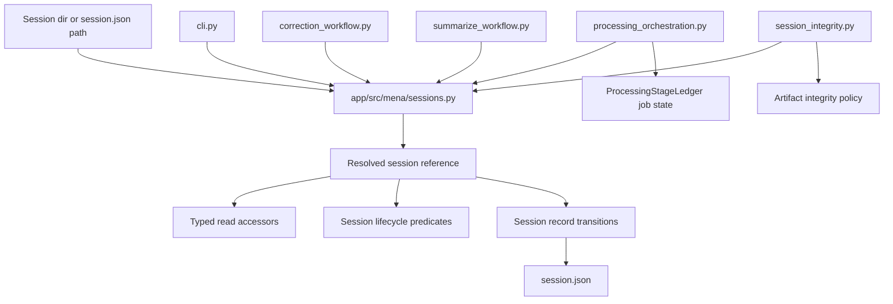
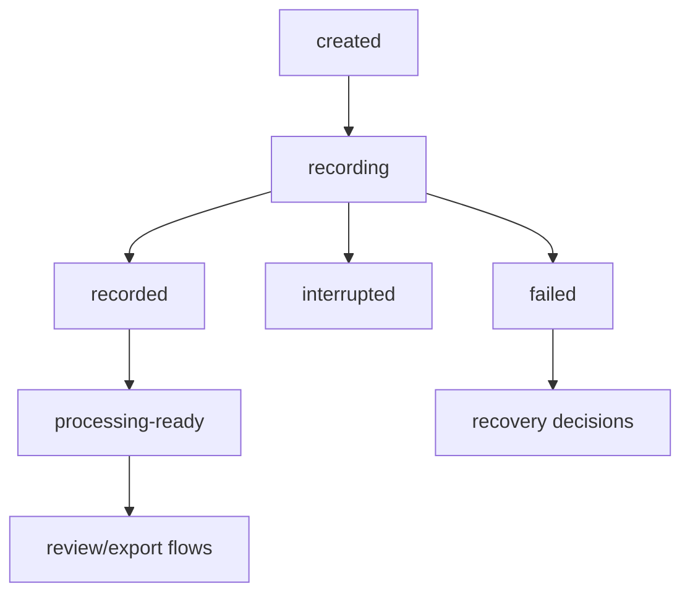

# Sessions Module Deepening - Plan

## Goal Capsule

| Field | Value |
|---|---|
| Objective | Deepen `app/src/mena/sessions.py` into the module that owns session resolution, typed session-record reads, session-level state predicates, and orchestrator-owned session-record transitions. |
| Authority | GitHub issue #121 defines the scope and behavior-preserving boundary; architecture references ADR-006, ADR-012, ADR-018, and `docs/architecture/architecture-overview.md` sections 6.9 and 8.3 constrain the design. |
| Execution profile | Behavior-preserving application refactor with no `session.json` schema change and no global index or runtime-path change. |
| Stop conditions | Stop if the refactor requires changing persisted `session.json` shape, moving processing-job state out of `ProcessingStageLedger`, folding integrity verification into `sessions.py`, or changing installed product runtime paths. |
| Tail ownership | Complete the branch through local validation, self-review, and PR readiness according to the repository issue workflow. |

---

## Product Contract

### Summary

Issue #121 makes `sessions.py` the session concept owner instead of leaving session identity, path resolution, language fallback, lifecycle facts, and shallow record transitions spread across workflow modules. The work is behavior-preserving: it consolidates existing logic behind a deeper module interface, keeps `session.json` schema stable, and leaves artifact integrity, index rebuild semantics, and processing-job state in their current owners.

Product Contract preservation: Product Contract unchanged from issue #121; this plan updates the affected consumer list to match the current branch, where duplicate session helpers now also exist in `processing_orchestration.py` and `summarize_workflow.py`.

### Problem Frame

`sessions.py` currently creates records and exposes thin read-modify-write helpers, but it does not answer the recurring application questions "which session is this?", "what is its language?", or "what state is it in?". Those answers are duplicated in `cli.py`, `correction_workflow.py`, `processing_orchestration.py`, `summarize_workflow.py`, and `session_integrity.py`, with consumers reading raw dictionaries and guarding ad hoc field access.

### Requirements

**Session ownership**

- R1. `sessions.py` owns resolving a user-supplied session directory or `session.json` path into a single typed session reference.
- R2. `sessions.py` owns required and optional typed accessors for session id, profile, language with fallback, recording lifecycle, capture metadata, discovery, degradations, and failures.
- R3. `sessions.py` owns session-level state predicates and lifecycle answers, while processing-job predicates remain beside `ProcessingStageLedger`.

**Transition boundary**

- R4. Existing shallow session-record update helpers become internal or transition-oriented APIs so orchestrator-owned writes pass through `sessions.py` without exposing generic raw-record mutation as the normal consumer path.
- R5. The refactor preserves the existing `session.json` schema, record version, persisted field names, artifact layout, and atomic-write behavior.
- R6. `session_integrity.py` remains a separate deep module for validity and consistency checks, consuming `sessions.py` for common resolution and typed record facts without moving integrity policy into the session module.

**Consumer cleanup**

- R7. `cli.py`, `correction_workflow.py`, `processing_orchestration.py`, `summarize_workflow.py`, and `session_integrity.py` stop defining duplicate session-resolution, session-id extraction, and language-default helpers.
- R8. Existing workflows keep their command behavior, exception types or user-visible error surfaces, and downstream language handling.
- R9. Tests prove the new `sessions.py` interface answers session-state questions without involving CLI code and prove duplicate helper ownership was removed.

### Scope Boundaries

#### In Scope

- Public session-resolution and typed read APIs in `app/src/mena/sessions.py`.
- Session-level lifecycle predicates derived from the persisted Session Record.
- Transition-oriented wrappers for discovery, capture plan, capture metadata, recording lifecycle, degradations, and failures.
- Migration of current duplicate helper consumers and their tests to the session module interface.

#### Deferred to Follow-Up Work

- Broader schema redesign of `session.json`.
- A new global session index or changes to index rebuild semantics.
- Locking, concurrency control, or multi-orchestrator coordination beyond preserving current behavior.
- A full state-machine framework for every processing, review, and export state.

#### Out of Scope

- Changing persisted `session.json` shape or version.
- Moving processing-job state predicates out of `ProcessingStageLedger`.
- Folding artifact integrity verification into `sessions.py`.
- Changing runtime data roots, installed product behavior, or UAT invocation paths.

---

## Planning Contract

### Key Technical Decisions

- KTD1. Use a typed session reference as the read boundary. A resolved session should carry the session directory, record path, and record data together so downstream workflows stop passing loosely related `(Path, dict)` tuples.
- KTD2. Keep raw record dictionaries as the persistence format, not the application interface. `read_session_record` may remain as a low-level compatibility primitive, but workflow code should prefer typed accessors and transition APIs.
- KTD3. Preserve consumer-specific error surfaces at consumer boundaries. Consolidating resolution must not turn correction workflow errors, CLI value errors, or integrity findings into a single generic exception path visible to users.
- KTD4. Transition APIs replace generic mutation at the call sites. The existing shallow wrappers can be retained as compatibility shims during migration, but the normal orchestrator path should name the session fact being changed rather than pass arbitrary updates.
- KTD5. Session lifecycle predicates stay broad and persisted-record-derived. Processing step status, retryability, provider failures, and artifact freshness remain with processing and integrity modules per the layered state model.

### High-Level Technical Design

The lifecycle diagram is a planning model for predicates over persisted record facts, not a new persisted enum list.

### Assumptions

- Current workflow modules can migrate incrementally by importing session helpers from `sessions.py` without changing their public command contracts.
- Existing tests already characterize most user-visible behavior; new `test_sessions.py` cases should cover the consolidated interface and migrated workflow tests should guard exception compatibility.
- No external research is needed because this is an internal Python module-boundary refactor with clear local patterns and accepted architecture guidance.

### Sequencing

Implement in contract-first slices: add the deeper `sessions.py` read/resolve interface with tests, add transition APIs and lifecycle predicates, migrate consumers, then remove duplicate helpers and run full gates.

---

## Implementation Units

### U1. Session Resolution and Typed Reference

- **Goal:** Add the public `sessions.py` interface that resolves a session directory or `session.json` path and returns a typed reference carrying the session directory, record path, and record facts.
- **Requirements:** R1, R5, R7, R8
- **Dependencies:** None
- **Files:** `app/src/mena/sessions.py`, `app/tests/test_sessions.py`
- **Approach:** Centralize the current directory/file resolution behavior in `sessions.py`. Preserve the existing accepted inputs, missing-path errors, and unreadable-record handling, while giving consumers a single importable owner instead of local `_resolve_session` copies. Keep low-level JSON loading strict: the record must remain a JSON object.
- **Patterns to follow:** Existing `_resolve_session` implementations in `app/src/mena/cli.py`, `app/src/mena/correction_workflow.py`, `app/src/mena/processing_orchestration.py`, and `app/src/mena/summarize_workflow.py`; existing `CreatedSession` dataclass style in `sessions.py`.
- **Test scenarios:** Given a session directory containing `session.json`, resolving returns that directory, the record path, and the same record data. Given an explicit `session.json` path, resolving dedupes to the parent directory and same record path. Given a path that is neither a directory nor an existing `session.json`, resolving raises the documented session-module error. Given unreadable JSON or non-object JSON, resolving reports that the session record cannot be read. Given a valid resolved reference, its path fields are `Path` objects and its record remains schema-compatible.
- **Verification:** `app/tests/test_sessions.py` proves the new owner handles all resolution variants before consumers are migrated.

### U2. Typed Session Reads and Lifecycle Predicates

- **Goal:** Move common session fact extraction and broad lifecycle answers into `sessions.py`.
- **Requirements:** R2, R3, R5, R8, R9
- **Dependencies:** U1
- **Files:** `app/src/mena/sessions.py`, `app/tests/test_sessions.py`, `app/tests/test_processing_orchestration.py`, `app/tests/test_summarize_workflow.py`
- **Approach:** Add typed accessors for required id, profile id, language with fallback, optional capture metadata, recording lifecycle, degradations, and failures. Add session-level predicates that answer broad lifecycle questions from persisted record fields without modeling processing-job state. Keep validation messages compatible where workflows expose them.
- **Patterns to follow:** `required_str` helpers in workflow modules, `DEFAULT_SESSION_LANGUAGE`, current summary-language fallback behavior, and `docs/architecture/architecture-overview.md` section 8.3 layered state model.
- **Test scenarios:** Given a record with a valid id, the accessor returns it. Given a missing or empty id, the accessor raises the same class or mapped error expected by the migrated consumer. Given a record with `language: "de-CH"`, language-with-fallback returns `de-CH`; given missing or empty language, it returns the provided default. Given recording finalization `not_started`, `completed`, and failed/interrupted shapes, lifecycle predicates return broad session-level answers without inspecting processing ledgers. Given malformed nested recording data, predicates fail closed or return the documented unknown state without mutating the record.
- **Verification:** Session tests prove state questions are answerable through `sessions.py`; focused workflow tests prove language and id behavior is unchanged.

### U3. Transition-Oriented Session Record Writes

- **Goal:** Convert shallow write wrappers into transition-oriented session APIs that keep orchestrator writes explicit and atomic.
- **Requirements:** R4, R5
- **Dependencies:** U1, U2
- **Files:** `app/src/mena/sessions.py`, `app/tests/test_sessions.py`, `app/src/mena/recording_control.py`, `app/tests/test_recording_control.py`
- **Approach:** Keep writes in `sessions.py` and name them by session fact: discovery persisted, capture plan persisted, capture metadata persisted, lifecycle advanced, degradation appended, and failure appended. Retain compatibility shims only where needed during migration, and prevent new consumers from reaching for generic `update_session_record` unless they are genuinely performing a low-level compatibility update.
- **Patterns to follow:** Existing atomic write behavior via `write_json_atomically`, session-record schema tests in `test_sessions.py`, and `recording_control.py` as the primary orchestrator writer after issue #117.
- **Test scenarios:** Given discovery, capture plan, and capture metadata payloads, transition APIs persist schema-valid records identical to current wrappers. Given degradation and failure facts, append APIs preserve existing list entries and append the new fact without mutating caller-owned mappings. Given an existing non-list degradation or failure field, append fails with the current validation behavior. Given a lifecycle transition from created to recording or finalized, the persisted record contains the same fields current workflow tests expect.
- **Verification:** Existing schema validation tests remain green, and new transition tests prove no record-shape drift.

### U4. Consumer Migration and Duplicate Helper Removal

- **Goal:** Replace duplicate session helper definitions and raw dictionary pokes in current consumers with the `sessions.py` interface.
- **Requirements:** R6, R7, R8, R9
- **Dependencies:** U1, U2, U3
- **Files:** `app/src/mena/cli.py`, `app/src/mena/correction_workflow.py`, `app/src/mena/processing_orchestration.py`, `app/src/mena/summarize_workflow.py`, `app/src/mena/session_integrity.py`, `app/tests/test_cli.py`, `app/tests/test_correction_workflow.py`, `app/tests/test_processing_orchestration.py`, `app/tests/test_summarize_workflow.py`, `app/tests/test_session_integrity.py`
- **Approach:** Migrate one consumer family at a time. `cli.py` should call the shared resolver for commands that accept session paths. Correction workflow should preserve `CorrectionWorkflowError` by mapping shared resolution and id errors at its boundary. Processing and summarize workflows should use shared id and language helpers. Session integrity should consume shared path resolution and typed record facts while retaining its own finding construction and artifact policy.
- **Patterns to follow:** Existing command behavior tests, `run_correction_workflow` boundary error handling, and `session_integrity.py` finding-code ownership.
- **Test scenarios:** Given a correction workflow session path, the workflow still resolves both directory and `session.json` inputs and still raises `CorrectionWorkflowError` for invalid paths or missing ids. Given processing orchestration with a session language, ASR language selection remains unchanged; given missing language, the previous default behavior remains unchanged. Given summarization with session language and configured fallback, session language still wins before config default. Given integrity verification over valid and invalid bundles, finding codes and messages remain stable while path resolution comes from `sessions.py`.
- **Verification:** Focused tests for each migrated consumer pass, and local helper definitions are removed from the consumer modules.

### U5. Ownership Proof, Gates, and Self-Review

- **Goal:** Prove `sessions.py` owns session concept helpers and the refactor stayed behavior-preserving.
- **Requirements:** R5, R7, R8, R9
- **Dependencies:** U1, U2, U3, U4
- **Files:** `app/tests/test_sessions.py`, `app/tests/test_cli.py`, `app/tests/test_correction_workflow.py`, `app/tests/test_processing_orchestration.py`, `app/tests/test_summarize_workflow.py`, `app/tests/test_session_integrity.py`, `docs/plans/2026-07-02-004-refactor-sessions-module-plan.md`
- **Approach:** Add or update tests only where they protect the new ownership boundary or consumer compatibility. Run focused tests first, then `make check` from `app/`. Use grep ownership checks as evidence that duplicate resolver/extractor helpers no longer live in consumers.
- **Patterns to follow:** Repository definition of done in `AGENTS.md` and `app/AGENTS.md`; prior plan verification contracts for issue work.
- **Test scenarios:** A grep for duplicate private helpers finds only the intended compatibility owner or no consumer-local definitions. `test_sessions.py` contains direct coverage for resolution, typed reads, lifecycle predicates, and transition writes. Existing CLI, correction, processing, summarize, and integrity tests pass without weakening assertions. `session.json` schema validation tests remain unchanged or stronger.
- **Verification:** `make check` passes from `app/`; the PR body records validation, known non-goals, and self-review results.

---

## Verification Contract

| Gate | Scope | Done Signal |
|---|---|---|
| Session module tests | `app/tests/test_sessions.py` | Resolution, typed reads, lifecycle predicates, transition writes, atomic persistence, and schema validity pass through `sessions.py`. |
| Consumer compatibility tests | Relevant tests in `app/tests/test_cli.py`, `app/tests/test_correction_workflow.py`, `app/tests/test_processing_orchestration.py`, `app/tests/test_summarize_workflow.py`, and `app/tests/test_session_integrity.py` | Commands and workflows preserve session path handling, language fallback, exception surfaces, finding codes, and persisted records. |
| Ownership grep | `app/src/mena` | Duplicate consumer-local `_resolve_session`, `_extract_session_id`, and `_session_language_or_default` owners are removed or justified as compatibility shims in `sessions.py`. |
| Full app gate | `make check` from `app/` | Formatting, linting, typing, tests, and coverage pass using repo/dev invocation. |

---

## Definition of Done

- `app/src/mena/sessions.py` owns session path resolution, typed session-record reads, session-level lifecycle predicates, and named session-record transitions.
- `session.json` schema, record version, persisted field names, and artifact layout are unchanged.
- `cli.py`, `correction_workflow.py`, `processing_orchestration.py`, `summarize_workflow.py`, and `session_integrity.py` no longer define duplicate session-resolution, id-extraction, or language-default helpers.
- `session_integrity.py` remains the integrity policy module and `ProcessingStageLedger` remains the processing-job state owner.
- Tests cover the new `sessions.py` interface and migrated consumers without weakening existing behavior assertions.
- Dead-end compatibility code and abandoned helper aliases are removed before handoff.
- `make check` passes from `app/`.
- The pull request is updated with scope, validation results, known non-goals, and a local self-review section before review readiness.

---

## Sources & Research

- GitHub issue #121: "Deepen sessions.py into the session module: resolution, typed reads, state predicates".
- Architecture references: `docs/decisions/ADR-006-per-invocation-orchestrator-as-canonical-session-record-writer.md`, `docs/decisions/ADR-012-runtime-data-outside-repository-preserve-session-data-on-uninstall.md`, `docs/decisions/ADR-018-narrow-rebuildable-global-index.md`, `docs/architecture/architecture-overview.md` sections 6.9 and 8.3.
- Code references: `app/src/mena/sessions.py`, `app/src/mena/recording_control.py`, `app/src/mena/cli.py`, `app/src/mena/correction_workflow.py`, `app/src/mena/processing_orchestration.py`, `app/src/mena/summarize_workflow.py`, `app/src/mena/session_integrity.py`.
- Test references: `app/tests/test_sessions.py`, `app/tests/test_cli.py`, `app/tests/test_correction_workflow.py`, `app/tests/test_processing_orchestration.py`, `app/tests/test_summarize_workflow.py`, `app/tests/test_session_integrity.py`.
