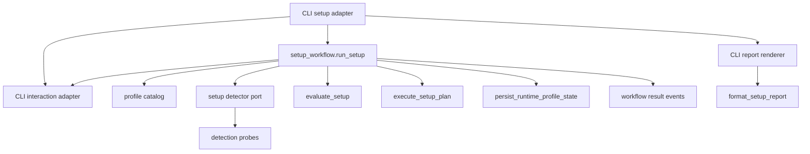

## Goal Capsule

| Field | Value |
|---|---|
| Objective | Split setup detection, catalog, evaluation, persistence, workflow orchestration, and CLI reporting so the `setup` CLI delegates to a setup workflow interface instead of owning fallback authorization and execution. |
| Authority | GitHub issue #122, `docs/decisions/ADR-028.md`, `docs/decisions/ADR-029.md`, `docs/decisions/ADR-031.md`, `docs/architecture/architecture-overview.md` §8.4, `CONTEXT.md` terms for application workflow module and interaction port. |
| Execution profile | Behavior-preserving refactor with characterization-first tests around current CLI output, persisted `setup-state.json`, and fallback authorization flows. |
| Stop conditions | Stop rather than change profile catalog contents, readiness policy, hardware thresholds, persisted runtime-profile-state schema, runtime fallback semantics, or capability resolver behavior. |
| Tail ownership | Any remaining `_stage_model` / `_stage_device` duplication with `runtime_profile.py` stays deferred to the capability-resolver issue unless a minimal import move is required to keep this split compiling. |

---

## Product Contract

### Summary

`app/src/mena/setup.py` currently contains profile catalog definitions, command and hardware detection, local-state probing, setup evaluation, runtime-profile-state persistence, setup action execution, and user-facing report formatting.
The setup command's workflow tail also lives in `app/src/mena/cli.py`: `_run_setup_command`, fallback authorization evaluation, fallback setup action prompting/execution, persistence timing, and fallback authorization notices.
This plan keeps user-visible setup behavior unchanged while moving workflow ownership behind an application workflow module interface and leaving the CLI as an adapter for arguments, terminal wording, rendering, and exit codes.

### Problem Frame

The current split violates the architecture boundary that setup must separate profile lookup, hardware and local-state evaluation, planned-change presentation, user confirmation, mutation, and post-setup verification.
It also makes fallback authorization hard to test without monkeypatching the CLI adapter; `app/tests/test_cli.py` currently patches `mena.cli.detect_local_installation_state` through many setup scenarios.
Issue #122 asks to reunite the setup workflow behind one interface: evaluate, plan, authorize fallback, execute, persist.

### Requirements

- R1. Preserve setup product behavior: readiness rules, action planning, profile catalog contents, hardware thresholds, fallback authorization semantics, exit codes, and persisted `setup-state.json` format do not change.
- R2. Move setup workflow orchestration out of `app/src/mena/cli.py` behind an application workflow interface that owns evaluate, primary setup action confirmation/execution, fallback authorization evaluation, fallback action confirmation/execution, post-action revalidation, and persistence timing.
- R3. Keep CLI setup handling thin: parse `setup` flags, adapt terminal input/output, delegate to the workflow interface, render existing reports/notices, and return the workflow exit code.
- R4. Make detection probes internal and substitutable by profile/OS-oriented adapters so workflow tests can inject fake detection without monkeypatching CLI globals.
- R5. Preserve the architecture separation from `ADR-028`: profile lookup, hardware/local-state evidence, evaluation, planned-change presentation, confirmation, mutation, and post-setup verification remain distinct concepts.
- R6. Keep fallback authorization prompts and setup mutation confirmations routed through the interaction port semantics, with CLI prompt text remaining adapter-owned.
- R7. Add or move tests so setup flows are exercised through the workflow interface with fake detection and interaction adapters, covering ready, setup declined, setup action execution, fallback authorized, fallback declined, fallback unavailable, interrupt/failure paths, and execution failure.
- R8. Keep `format_setup_report` output byte-identical for equivalent evaluations and action results; reporting may remain a pure setup formatter or be called by the CLI adapter, but report content must not drift.

### Acceptance Examples

- AE1. Given a ready primary profile and ready fallback profile, when `mena setup --yes --authorize-local-fallback` runs, then it persists the same `setup-state.json` authorization fields as before and prints the same fallback authorization notice.
- AE2. Given primary setup needs automated actions, when the user declines the primary setup confirmation, then no setup actions run, no state is persisted, the exit code remains `1`, and the existing decline message is printed.
- AE3. Given primary setup becomes ready after automated actions, when fallback setup is requested and needs automated fallback actions, then fallback actions are confirmed/executed through the setup workflow, fallback state is re-evaluated, and persisted authorization uses the refreshed fallback evaluation.
- AE4. Given the command is running from a repo/dev invocation, when setup sees `command:mena` failed, then mutation is not attempted and the existing "not the installed product command" output remains unchanged.
- AE5. Given `setup --check`, when evaluation is incomplete, then setup prints the existing report, does not prompt or mutate, and exits `1`.

### Scope Boundaries

In scope:

- Split modules under `app/src/mena/` using flat, doc-aligned names.
- Move fallback authorization/execution out of `app/src/mena/cli.py`.
- Add a setup workflow interface and tests that avoid CLI monkeypatching for workflow behavior.
- Introduce detection adapter seams for command identity, hardware, and local installation state.
- Keep report formatting pure and byte-compatible.

Out of scope:

- No profile catalog content changes.
- No readiness rule, hardware threshold, setup action, or provider policy changes.
- No persisted runtime-profile-state schema changes.
- No remote fallback expansion.
- No capability resolver work beyond avoiding new duplication with that planned issue.
- No broad doctor/re-setup UX.

---

## Planning Contract

### Key Technical Decisions

- KTD1. Add a setup workflow module instead of expanding `setup.py`.
  `app/src/mena/setup.py` is already a large domain module; the workflow should live in a new flat module such as `app/src/mena/setup_workflow.py` so profile/evaluation primitives can be imported without making `setup.py` own UI orchestration.
- KTD2. Keep detection and mutation protocols explicit.
  The workflow should depend on a detector interface that can gather `LocalInstallationState` for a selected `SetupProfile`, plus the existing `CommandRunner` for mutation. This gives tests a fake detector and keeps OS/profile substitution possible without changing evaluator code.
- KTD3. Use semantic interaction topics for workflow decisions.
  The workflow should ask for primary setup confirmation and fallback setup confirmation through `InteractionPort.confirm` topics such as `setup.primary_actions` and `setup.fallback_actions`. CLI prompt wording remains adapter-owned and should preserve current prompt strings.
- KTD4. Treat report formatting as adapter rendering.
  `format_setup_report` can stay as a pure function in setup-domain code, but the workflow should return report events or result data rather than call `print` directly. The CLI adapter renders reports/notices to preserve output and keep workflow tests semantic.
- KTD5. Characterize before deleting CLI orchestration.
  Add workflow tests for the current setup state machine before removing the CLI-owned fallback helpers. Then thin the CLI and keep only a small smoke layer in `app/tests/test_cli.py`.

### High-Level Technical Design

The workflow owns ordering and state transitions.
The setup domain still owns catalog, evaluation, execution primitives, persistence helpers, and report formatting.
The CLI owns terminal prompt text, printing, and argument-to-options adaptation.

### Assumptions

- The issue title and body are the authoritative product contract for this behavior-preserving refactor.
- There is no relevant `docs/solutions/` institutional learning in this checkout.
- External research is not needed because the plan follows accepted local architecture and no new external API or dependency is introduced.

### Sequencing

1. Add characterization workflow tests and the detector/interaction fakes.
2. Introduce the workflow and detector seams while leaving existing setup primitives intact.
3. Thin the CLI setup branch and delete migrated fallback helpers from `cli.py`.
4. Run focused tests after each slice and `make check` from `app/` before shipping.

### Sources & Research

- Issue #122: "Split setup.py responsibilities and move fallback authorization out of cli.py".
- `docs/decisions/ADR-028.md`: install/preflight flow separation and explicit confirmation before mutation.
- `docs/decisions/ADR-029.md`: accepted runtime profile state and revalidation contract.
- `docs/decisions/ADR-031.md`: setup-time fallback authorization and runtime fallback consumption.
- `docs/architecture/architecture-overview.md` §8.4: installation profile and setup policy.
- `CONTEXT.md`: application workflow module and interaction port definitions.
- Current code references: `app/src/mena/setup.py`, `app/src/mena/cli.py`, `app/src/mena/interaction.py`, `app/tests/test_setup.py`, `app/tests/test_cli.py`.

---

## Implementation Units

### U1. Add setup workflow contract and fakes

- **Goal:** Create the stable workflow-facing types and test seams before moving behavior.
- **Requirements:** R2, R4, R6, R7
- **Files:** `app/src/mena/setup_workflow.py`, `app/tests/test_setup_workflow.py`, possibly `app/src/mena/setup.py`
- **Approach:** Define workflow options for `check_only`, `assume_yes`, and `authorize_local_fallback`; a detector protocol that evaluates a requested `SetupProfile`; and a structured workflow result containing exit code, reports/action results/fallback notices/state path data for the CLI renderer.
  Add fake detector, fake interaction, and fake runner coverage in the new test file.
- **Test Scenarios:** Workflow can evaluate a ready state without mutation; workflow can evaluate an incomplete state without prompting in check-only mode; unscripted interaction fails tests through `ScriptedInteraction`.
- **Verification:** `cd app && uv run pytest app/tests/test_setup_workflow.py`

### U2. Move primary setup workflow out of CLI

- **Goal:** Move primary evaluate, prompt, execute, re-detect, re-evaluate, and persistence ordering into `setup_workflow`.
- **Requirements:** R1, R2, R3, R5, R6, R7, R8
- **Files:** `app/src/mena/setup_workflow.py`, `app/src/mena/cli.py`, `app/tests/test_setup_workflow.py`, `app/tests/test_cli.py`
- **Approach:** Port the primary branch of `_run_setup_command` into the workflow using semantic interaction confirmation.
  The workflow should return renderable report events instead of printing.
  The CLI adapter maps `setup.primary_actions` to the existing prompt `Proceed with automated setup actions? [y/N] ` and prints the existing decline/interruption messages.
- **Test Scenarios:** setup declined does not mutate or persist; repo/dev invocation does not mutate; manual-only actions do not prompt or execute; successful automated actions revalidate and persist only after final readiness; KeyboardInterrupt/EOF paths retain existing exit codes and messages.
- **Verification:** `cd app && uv run pytest app/tests/test_setup_workflow.py app/tests/test_cli.py -k setup`

### U3. Move fallback authorization and fallback action execution into setup workflow

- **Goal:** Remove `_evaluate_setup_fallback_authorization` and `_maybe_execute_setup_fallback_actions` from `cli.py` by making fallback evaluation/execution part of the workflow.
- **Requirements:** R1, R2, R3, R5, R6, R7
- **Files:** `app/src/mena/setup_workflow.py`, `app/src/mena/cli.py`, `app/tests/test_setup_workflow.py`, `app/tests/test_cli.py`
- **Approach:** Have the workflow evaluate the bundled fallback profile after primary readiness, optionally confirm and execute fallback actions when `authorize_local_fallback` is set and automated fallback actions are available, re-evaluate fallback state, then build persisted runtime profile state using the refreshed fallback evaluation.
  Keep fallback decline as a non-fatal workflow outcome that persists unavailable/configured unauthorized state exactly as today.
- **Test Scenarios:** ready fallback authorizes automatic local fallback; unavailable fallback records blockers; fallback automated actions run before persistence; fallback action decline leaves automatic fallback unavailable; fallback detection interrupt does not persist state.
- **Verification:** `cd app && uv run pytest app/tests/test_setup_workflow.py app/tests/test_cli.py -k "setup and fallback"`

### U4. Split detection probes behind a substitutable adapter

- **Goal:** Make command identity, hardware, and local-state probes internal implementation details behind a detector adapter, without changing probe behavior.
- **Requirements:** R4, R5, R7
- **Files:** `app/src/mena/setup.py`, `app/src/mena/setup_detection.py`, `app/src/mena/setup_workflow.py`, `app/tests/test_setup.py`, `app/tests/test_setup_workflow.py`
- **Approach:** Move detection-specific helpers and/or wrap them with a `SetupDetector` implementation in a flat module such as `setup_detection.py`.
  Keep public imports compatible where current runtime code imports `CommandIdentity`, `CommandRunner`, or `HardwareFacts`.
  Do not move catalog/evaluation/persistence in the same commit unless import cycles require a small compatibility shim.
- **Test Scenarios:** existing detection tests still pass; detector fake can supply different primary and fallback states without monkeypatching module globals; scoped fallback profile detection still skips unrelated probes.
- **Verification:** `cd app && uv run pytest app/tests/test_setup.py app/tests/test_setup_workflow.py`

### U5. Thin CLI adapter and preserve byte-level setup output

- **Goal:** Leave `cli.py` responsible only for parsing setup flags, adapting terminal interaction/rendering, and returning the workflow exit code.
- **Requirements:** R1, R3, R6, R8
- **Files:** `app/src/mena/cli.py`, `app/tests/test_cli.py`
- **Approach:** Replace `_run_setup_command` internals with construction of workflow options, real detector/runner/interaction adapters, workflow invocation, and rendering of returned reports/notices through `format_setup_report`.
  Keep `_print_runtime_fallback_authorization_notice` in CLI or convert it to adapter rendering, but remove workflow decision logic from CLI.
- **Test Scenarios:** `setup --check` output includes product paths and readiness; setup success output includes action results, final complete report, fallback notice, and accepted state path; existing smoke assertions continue to pass with minimal CLI monkeypatching.
- **Verification:** `cd app && uv run pytest app/tests/test_cli.py -k setup`

### U6. Cleanup and full validation

- **Goal:** Remove dead CLI helpers/imports and run the app gate.
- **Requirements:** R1, R7, R8
- **Files:** `app/src/mena/cli.py`, `app/src/mena/setup.py`, `app/src/mena/setup_detection.py`, `app/src/mena/setup_workflow.py`, `app/tests/test_cli.py`, `app/tests/test_setup.py`, `app/tests/test_setup_workflow.py`
- **Approach:** Remove unused imports and compatibility leftovers that are not needed by `runtime_profile.py` or tests.
  Compare representative `format_setup_report` strings in tests rather than relying only on loose substring assertions where behavior drift would be easy.
- **Test Scenarios:** focused setup tests pass; full suite passes; `make check` passes from `app/`.
- **Verification:** `cd app && make check`

---

## Verification Contract

| Command | Applies To | Done Signal |
|---|---|---|
| `cd app && uv run pytest app/tests/test_setup_workflow.py` | New workflow behavior | New interface covers ready, declined, fallback, failure, and persistence paths. |
| `cd app && uv run pytest app/tests/test_setup.py app/tests/test_cli.py -k setup` | Existing setup primitives and CLI smoke behavior | Existing setup report/output and persisted state expectations remain green. |
| `cd app && uv run pytest app/tests/test_runtime_stewardship.py app/tests/test_processing.py app/tests/test_summarize_workflow.py` | Runtime setup-state consumers touched indirectly by imports | Runtime profile selection and fallback consumers still load setup types correctly. |
| `cd app && make check` | Final app gate | Lint/type/test gate passes before PR handoff. |

Behavior-change protection requires characterization evidence for the current setup CLI before and after the refactor.
At least one test should compare complete rendered setup output for a representative ready or post-action setup path, not only substrings.

---

## Definition of Done

- U1-U6 are complete and committed in semantic slices.
- `app/src/mena/cli.py` no longer owns fallback authorization evaluation or fallback setup action execution.
- Setup workflow behavior can be tested through `app/src/mena/setup_workflow.py` with fake detection and scripted interaction.
- Existing setup CLI user-facing messages, exit codes, and report content are preserved for equivalent inputs.
- Persisted runtime-profile-state schema and fallback authorization fields are unchanged.
- No new product scope from `docs/ideas/` or future capability-resolver work is pulled into this issue.
- Dead-end migration code, unused helpers, and stale monkeypatch-only tests are removed or converted.
- `cd app && make check` passes.
