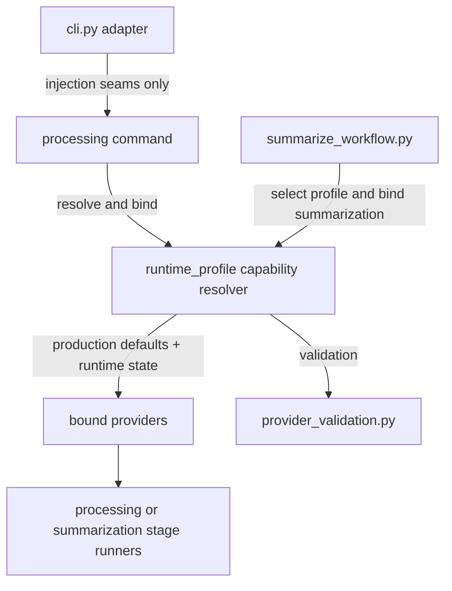

# Capability Resolver Completion - Plan

## Goal Capsule

| Field | Value |
|---|---|
| Objective | Finish the capability resolver follow-up from issue #131 by moving production provider wiring out of `cli.py`, routing summarization provider acquisition through the resolver surface, and removing the remaining provider duck-typing helper. |
| Authority | Issue #131, parent issue #120, `CONTEXT.md` definition of Capability resolver, ADR-010, ADR-019, and `docs/architecture/architecture-overview.md` section 8.4. |
| Execution profile | App code change under `app/`; use existing resolver, workflow, and provider validation patterns; preserve current user-facing behavior. |
| Stop conditions | Stop if implementation would add summarization or semantic CPU fallback behavior, persist new runtime contracts, or change stage policy beyond the resolver completion scope. |
| Tail ownership | Implementation owns code, tests, local validation, PR body validation notes, and closing issue #131; no separate documentation artifact is required unless code review finds architecture wording drift. |

---

## Product Contract

### Summary

Issue #131 closes the remaining capability resolver cleanup from #120.
The user-visible behavior should stay the same, but provider selection ownership should align with the architecture: workflow and CLI layers ask the resolver for bound providers instead of holding production concrete-provider defaults or bypassing resolver binding.

### Problem Frame

PR #129 centralized most runtime profile resolution, but three seams still leak provider-selection responsibility outside the capability resolver.
`cli.py` still imports and defaults production processing providers in `main`, summarization constructs its provider through a direct runtime helper call rather than a binding interface, and `provider_validation.py` still uses a private duck-typing helper even though protocols are the stated provider contract.

### Requirements

**Provider wiring**

- R1. Production processing provider defaults live in `mena.runtime_profile` resolver helpers, while `cli.py` keeps only injection seams needed by tests and embedders.
- R2. `cli.py` no longer imports concrete processing provider classes solely to wire default production factories.

**Summarization resolver symmetry**

- R3. Summarization provider acquisition goes through a resolver-owned binding interface that mirrors processing binding at the right level for a single route-bearing LLM text stage.
- R4. The change must not add summarization fallback retry behavior, semantic review fallback behavior, or new stage-policy decisions.

**Provider contract validation**

- R5. The remaining `_provider_implements` helper is deleted from provider validation, or a runtime-check rationale is documented in the PR if implementation proves deletion would weaken the contract.
- R6. Injected fake and test providers still fail with clear `ProviderValidationError` messages when they do not satisfy the expected provider contract.

### Scope Boundaries

- In scope: moving factory defaults to resolver-owned defaults, adding or renaming resolver binding helpers when needed, updating tests that assert import and injection behavior, and keeping validation errors stable.
- Deferred to follow-up work: #89 summarization or semantic CPU fallback behavior, any broader runtime profile catalog changes, and any persisted runtime provenance schema change.
- Out of scope: changing setup choices, changing model names, changing summarization output content, or adding new product-visible CLI flags.

### Acceptance Examples

- AE1. Given `mena.cli.main` is called without injected provider factories, when a processing command needs production providers, then the resolver supplies the default concrete factories and `cli.py` does not import the concrete processing provider classes for that default wiring.
- AE2. Given a test calls `mena.cli.main` with fake provider factories, when processing runs, then those injected factories are still honored through the resolver binding path.
- AE3. Given summarization resolves a runtime profile, when it builds the provider, then acquisition goes through a resolver binding helper and uses the selected summarization runtime state without adding a provider-failure retry.
- AE4. Given an invalid injected transcription, diarization, or semantic provider, when validation runs, then `ProviderValidationError` is raised without relying on `_provider_implements`.

---

## Planning Contract

### Key Technical Decisions

- KTD1. Resolver owns production factory defaults. Add resolver-level default factory arguments or default binding helpers in `app/src/mena/runtime_profile.py` so callers can omit production factories and test callers can still inject fakes.
- KTD2. CLI remains an adapter, not a provider factory registry. Keep `ProviderFactory` parameters on `main` only as injection seams if tests still need them, but set their defaults to resolver-owned sentinel/defaults rather than concrete provider classes imported into `cli.py`.
- KTD3. Summarization gets a resolver binding function, not fallback retry. Add a small resolver-owned binding surface such as `bind_summarization_runtime` that validates and returns the provider for `RuntimeProfileSelection.actual`; continue to perform one selection and one provenance write in `summarize_workflow.py`.
- KTD4. Provider validation should prefer runtime-checkable protocol semantics where possible. Mark provider protocols as `@runtime_checkable` if needed, use `isinstance(provider, ProtocolType)` for structural checks, and keep semantic metadata validation as explicit contract validation because it is narrower than protocol method presence.

### High-Level Technical Design

### Assumptions

- The current branch starts from `develop` at `f4e77ad`, matching issue #131's verification note.
- `make check` from `app/` is the required local gate for app changes.
- The implementation can update tests that currently import concrete providers from `cli.py` if those tests were asserting old wiring rather than product behavior.

### Sources And Research

- `CONTEXT.md` defines Capability resolver as the module that turns stage plus accepted runtime profile state into a bound, authorized provider.
- `app/src/mena/runtime_profile.py` already owns `resolve_processing_runtime`, `bind_processing_runtime`, `run_processing_with_runtime_fallback`, runtime factory wrappers, and `runtime_summarization_provider`.
- `app/src/mena/cli.py` still imports `FasterWhisperTranscriptionProvider`, `PyannoteCommunityDiarizationProvider`, and `OllamaSemanticCoherenceProvider` to default `main` provider factories.
- `app/src/mena/summarize_workflow.py` currently selects a runtime profile and calls `runtime_summarization_provider_fn` directly.
- `app/src/mena/provider_validation.py` centralizes injected-provider validation but still uses `_provider_implements`.
- `app/tests/test_runtime_profile.py`, `app/tests/test_cli.py`, and `app/tests/test_summarize_workflow.py` cover the affected resolver, adapter, and workflow seams.

---

## Implementation Units

### U1. Move Production Processing Factory Defaults Into The Resolver

- **Goal:** Make `runtime_profile` the owner of production processing provider defaults while preserving fake factory injection.
- **Requirements:** R1, R2, AE1, AE2.
- **Dependencies:** None.
- **Files:** `app/src/mena/runtime_profile.py`, `app/src/mena/cli.py`, `app/src/mena/processing_orchestration.py`, `app/tests/test_runtime_profile.py`, `app/tests/test_cli.py`.
- **Approach:** Introduce resolver-owned default factories or defaulted resolver parameters so `resolve_processing_runtime` and `bind_processing_runtime` know the production provider classes. Remove concrete processing provider imports from `cli.py` unless the class is still used for non-default behavior. Keep the existing `main` keyword injection surface if tests and embedders rely on it, but route `None` or omitted values to resolver defaults.
- **Patterns to follow:** Existing `runtime_transcription_factory`, `runtime_diarization_factory`, `runtime_semantic_factory`, and `production_runtime_required` in `app/src/mena/runtime_profile.py`.
- **Test scenarios:** Covers AE1. Add or update a grep-like unit assertion that `mena.cli` no longer exposes production concrete-provider imports for default wiring. Covers AE2. Update CLI processing tests that inject fake factories to prove injected factories still reach the processing stage. Add resolver tests proving omitted production factories produce the same bound provider types or factory wrappers as before.
- **Verification:** Processing command tests still pass with fake factories, resolver tests prove default binding, and `rg -n "FasterWhisperTranscriptionProvider|PyannoteCommunityDiarizationProvider|OllamaSemanticCoherenceProvider" app/src/mena/cli.py` has no production-default wiring hits.

### U2. Bind Summarization Providers Through The Resolver Surface

- **Goal:** Replace direct summarization provider helper calls in `summarize_workflow.py` with a resolver-owned binding interface.
- **Requirements:** R3, R4, AE3.
- **Dependencies:** U1 only if shared resolver default/factory conventions are introduced there.
- **Files:** `app/src/mena/runtime_profile.py`, `app/src/mena/summarize_workflow.py`, `app/src/mena/cli.py`, `app/tests/test_runtime_profile.py`, `app/tests/test_summarize_workflow.py`, `app/tests/test_cli.py`.
- **Approach:** Add a summarization binding helper in `runtime_profile.py` that accepts a `RuntimeProfileSelection`, `AppSettings`, and optional provider factory injection seam, then returns a validated summarization provider built from `selection.actual`. Keep `select_runtime_profile(... required_stages=SUMMARIZATION_RUNTIME_STAGES)` and provenance storage in the workflow. Do not catch `SummarizationProviderUnavailable` for fallback retry in this unit.
- **Patterns to follow:** `bind_processing_runtime` for binding ownership, `runtime_summarization_provider` for the concrete Ollama provider construction, and `run_summarization_command` tests for injectable workflow collaborators.
- **Test scenarios:** Covers AE3. Add workflow tests proving `run_summarization_command` calls the resolver binding seam with the selected runtime and passes the returned provider to `run_summarization_stage_fn`. Add a negative or characterization test proving summarization provider unavailability is not retried through `select_runtime_profile_after_stage_failure`. Add resolver tests proving the selected summarization model and endpoint are used.
- **Verification:** Summarization tests show a single runtime selection, one provenance write, resolver-bound provider acquisition, and unchanged terminal runtime release behavior.

### U3. Replace Duck-Typed Provider Validation With Protocol Runtime Checks

- **Goal:** Delete `_provider_implements` while preserving clear validation failures for injected providers.
- **Requirements:** R5, R6, AE4.
- **Dependencies:** None.
- **Files:** `app/src/mena/provider_validation.py`, `app/src/mena/transcription.py`, `app/src/mena/diarization.py`, `app/src/mena/semantic_coherence.py`, `app/tests/test_runtime_profile.py`, `app/tests/test_cli.py`, and any focused provider validation tests added during implementation.
- **Approach:** Mark the relevant provider protocols as `@runtime_checkable` and use `isinstance(provider, provider_type)` in `require_provider_instance`. Keep the semantic metadata `config_id` and `to_dict` checks after the protocol check because metadata shape is part of Mena's runtime contract. If Python protocol limitations make a direct runtime check unsuitable for one provider type, document the reason in the PR and replace `_provider_implements` with a smaller named validation primitive that makes the runtime contract explicit.
- **Patterns to follow:** Existing `ProviderValidationError` messages and runtime validation tests in `app/tests/test_runtime_profile.py` and `app/tests/test_cli.py`.
- **Test scenarios:** Covers AE4. Keep invalid non-callable method tests red before the replacement and green after. Add coverage for missing required protocol members for transcription, diarization, and semantic providers. Add semantic metadata negative tests for missing `config_id` and missing `to_dict`.
- **Verification:** `rg -n "_provider_implements" app/src/mena app/tests` returns no hits, invalid provider tests still raise `ProviderValidationError`, and valid fake providers continue to pass.

### U4. Self-Review, Validation, And PR-Ready Notes

- **Goal:** Prove the branch satisfies issue #131 and repository handoff expectations.
- **Requirements:** R1, R2, R3, R4, R5, R6.
- **Dependencies:** U1, U2, U3.
- **Files:** `app/Makefile`, `app/tests/test_runtime_profile.py`, `app/tests/test_summarize_workflow.py`, `app/tests/test_cli.py`, PR body.
- **Approach:** Run targeted tests after each behavioral unit when practical, then run `make check` from `app/`. Inspect the final diff against issue #131's three bullets and update the PR body with scope, validation, non-goals, and self-review notes.
- **Patterns to follow:** Root `AGENTS.md` and `app/AGENTS.md` definition of done for app issue work.
- **Test scenarios:** Test expectation: none -- this unit validates the completed implementation rather than adding product behavior.
- **Verification:** `make check` passes from `app/`, issue-specific grep checks pass, and PR body records validation plus non-goals.

---

## Verification Contract

| Gate | Applies To | Done Signal |
|---|---|---|
| Targeted resolver tests | U1, U2, U3 | `uv run pytest tests/test_runtime_profile.py` passes from `app/`. |
| Targeted workflow and adapter tests | U1, U2 | Relevant `uv run pytest tests/test_summarize_workflow.py tests/test_cli.py` selections pass from `app/`. |
| Full app gate | U1-U4 | `make check` passes from `app/`. |
| Issue grep checks | U1, U3 | `cli.py` has no concrete provider imports for production default wiring, and `_provider_implements` has no hits under `app/src/mena` or `app/tests`. |
| PR self-review | U4 | Diff is checked against issue #131, #120 non-goals, ADR-010, ADR-019, and the capability resolver definition in `CONTEXT.md`. |

---

## Definition of Done

- R1-R6 are implemented or explicitly documented in the PR body if a runtime protocol limitation forces the narrow validation exception allowed by R5.
- `cli.py` is no longer the production provider-default registry for processing.
- Summarization provider acquisition goes through a resolver-owned binding interface without adding summarization fallback retry behavior.
- `_provider_implements` is gone, or the PR body records why the remaining runtime validation primitive is not duck-typing drift.
- New or updated tests cover production defaults, fake injection seams, summarization binding, and invalid provider validation.
- `make check` passes from `app/`.
- Dead-end implementation code and unused imports are removed before handoff.
- A draft PR targets `develop`, references issue #131, includes validation results, and calls out the non-goals around #89 and semantic fallback.
