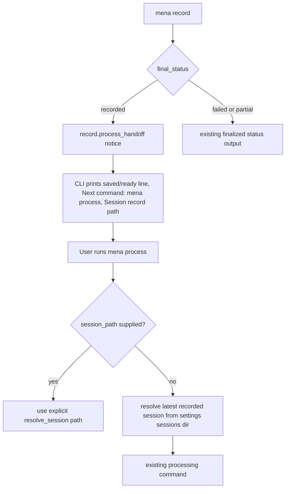

# feat: Guide record completion to processing

## Goal Capsule

| Field | Value |
|---|---|
| Objective | Make the end of `mena record` clearly tell a non-technical user that the recording was saved and can be processed with `mena process`, while preserving the exact session record path for technical provenance. |
| Authority | GitHub issue #97, `docs/architecture/architecture-overview.md`, `docs/architecture/implementation-guardrails.md`, and `app/AGENTS.md`. |
| Execution profile | Standard software change in the app CLI adapter and adjacent session-resolution helpers. |
| Stop conditions | Stop if the implementation requires changing persisted session schema, changing capture finalization semantics, or silently selecting anything other than an unambiguous latest recorded session for pathless processing. |
| Tail ownership | Open a PR against `develop`; app validation must include `make check` from `app/` and a note that installed-product end-to-end recording remains hardware-dependent unless actually exercised. |

---

## Product Contract

### Summary

Issue #97 comes from personal UAT on `0.1.0rc7`: `mena record` showed a microphone as `[inactive]`, which looked like a possible recording problem, then instructed the user to run `mena process <full session path>`.
This slice should make the record-to-process transition obvious and non-alarming without hiding technical provenance.

### Problem Frame

The CLI is the PoC interface adapter.
At record time, users need enough device feedback to trust capture, but an available idle device should not be presented with failure-like wording.
At finalization, a successful recording should feel like the next step in one meeting workflow, not like a file-system operation that requires understanding `session.json` paths.

### Requirements

- R1. Available but idle audio routes must not be labeled with wording that implies recording failure or device unavailability.
- R2. After successful recording finalization, `mena record` must state that the recording was saved and is ready to process.
- R3. After successful recording finalization, the primary next command must be the easy path `mena process`.
- R4. The session record path must remain visible in successful recording output for technical provenance and manual session targeting.
- R5. `mena process` without an explicit path must process the latest unambiguous successfully recorded session from the configured runtime sessions directory.
- R6. Failed, not-started, or interrupted-partial recordings must not receive the successful process handoff.

### Acceptance Examples

- AE1. Given a microphone is available but not currently streaming, when `mena record` lists it, then the status wording does not imply a recording problem.
- AE2. Given recording finalizes successfully, when `mena record` exits, then the CLI states that the recording was saved and is ready to process.
- AE3. Given recording finalizes successfully, when `mena record` prints the next command, then the easy path is `mena process` rather than a required full session path.
- AE4. Given technical users need exact provenance, when recording finalizes, then the session record path remains available in the output.
- AE5. Given a user follows only the command guidance shown after a successful recording, when they run `mena process`, then the command targets the just-recorded session.

### Scope Boundaries

- In scope: CLI output wording for discovery and successful record finalization, parser support for pathless `mena process`, deterministic latest recorded session resolution, and focused tests.
- Out of scope: changing capture worker protocol, session record schema, artifact manifests, processing stage behavior, setup readiness policy, `resume` semantics, `correct`/`summarize`/`export` path requirements, or deferred desktop/mobile interfaces.
- Deferred to Follow-Up Work: richer session disambiguation UX, aliases such as `mena process latest`, and installed-product UAT automation around real PipeWire hardware.

---

## Planning Contract

### Key Technical Decisions

- KTD1. Keep device-status wording in `mena.discovery.format_discovery`.
  The `[inactive]` text originates in `_format_routes()` and `_format_streams()`, so changing that formatter protects every discovery rendering without threading CLI-specific copy through capture planning.
- KTD2. Keep record-finalization copy in `ConsoleRecordInteraction`.
  `recording_control.run_recording_control_workflow()` already emits a `record.process_handoff` notice only for `final_status == "recorded"`, which is the right behavioral gate.
- KTD3. Make only `process` accept an optional session path.
  Issue #97 asks for the easy next command after recording; `resume`, `correct`, `summarize`, `export`, and `inspect` still need explicit session targeting to avoid accidental mutation or review/export of the wrong bundle.
- KTD4. Resolve pathless `mena process` from the latest successfully recorded session in `settings.paths.sessions_dir`.
  This matches the printed handoff after a just-completed recording and keeps the default scoped to normal runtime sessions rather than arbitrary paths.
- KTD5. Preserve explicit session paths as the technical escape hatch.
  If a user passes `mena process <session_path>`, existing `resolve_session()` behavior remains authoritative.

### High-Level Technical Design

### Assumptions

- The "easy path" in issue #97 requires `mena process` itself to work without an argument, not merely printing an abbreviated command that would fail.
- The latest recorded session is a safe default immediately after `mena record` because that command just created and finalized a session in the configured runtime sessions directory.
- A pathless process command should fail clearly when there is no recorded session instead of falling back to a partial or failed recording.

### System-Wide Impact

This changes the exported CLI contract for `process` by making `session_path` optional.
It does not change persisted contracts, provider policy, processing stages, artifact lifecycles, or capture finalization semantics.

### Sources & Research

- Issue #97 defines the UAT problem and acceptance criteria.
- `app/src/mena/cli.py` owns the parser and console rendering for `record.process_handoff`.
- `app/src/mena/recording_control.py` already gates the process handoff on `final_status == "recorded"`.
- `app/src/mena/discovery.py` formats routes and playback streams with `[active]` / `[inactive]`.
- `app/src/mena/session_integrity.py` already rebuilds a narrow session index with created time, status, path, and integrity information.
- `docs/architecture/architecture-overview.md` says `record` should finalize source artifacts and print the processing handoff, while downstream processing should reconstruct authority from the session bundle.
- `docs/architecture/implementation-guardrails.md` says to preserve boundaries and implement the smallest useful PoC slice.

---

## Implementation Units

### U1. Replace alarming idle-device wording

- **Goal:** Change discovery output so idle but available routes are not displayed as `[inactive]`.
- **Requirements:** R1, AE1.
- **Dependencies:** None.
- **Files:** `app/src/mena/discovery.py`, `app/tests/test_cli.py`.
- **Approach:** Replace the route and stream status labels with neutral wording such as `[idle]` for `active == False` while preserving `[active]` for active routes.
  Do not alter `DiscoveryStatus.UNAVAILABLE`; unavailable discovery should still be clearly unavailable.
- **Patterns to follow:** Existing `format_discovery()` output tests around dry-run discovery and route prompts.
- **Test scenarios:** Given an available discovery result containing an inactive microphone route, formatting includes the route and a neutral idle status but not `[inactive]`.
  Given unavailable discovery, formatting still reports `Audio discovery: unavailable` and the discovery error.
- **Verification:** Discovery text distinguishes available idle devices from unavailable discovery without changing route selection behavior.

### U2. Render successful record completion as saved and ready to process

- **Goal:** Update successful record handoff output to state the recording was saved, show `mena process` as the next command, and keep the session record path visible.
- **Requirements:** R2, R3, R4, R6, AE2, AE3, AE4.
- **Dependencies:** None.
- **Files:** `app/src/mena/cli.py`, `app/tests/test_cli.py`.
- **Approach:** Change the `record.process_handoff` notice rendering in `ConsoleRecordInteraction`.
  Keep the existing `record.session_record` output and also include the record path in the handoff block so technical users can still copy it.
  Leave `recording_control`'s success-only emission gate intact.
- **Patterns to follow:** Existing assertions in `test_record_creates_session_bundle_and_record`, `test_record_does_not_offer_process_handoff_for_empty_partial_capture`, and source-independence failure tests.
- **Test scenarios:** Covers AE2/AE3/AE4.
  Given a fake successful record command, output contains a saved/ready message, contains `Next command: mena process`, and contains the exact `session.json` path.
  Given an interrupted-partial recording, output does not contain `Next command: mena process`.
  Given a failed finalization, output does not contain `Next command: mena process`.
- **Verification:** Successful recording output is actionable for non-technical users and failure/partial output remains guarded.

### U3. Resolve pathless process command to the latest recorded session

- **Goal:** Let `mena process` without `session_path` target the latest successfully recorded session under the configured runtime sessions directory.
- **Requirements:** R3, R5, AE5.
- **Dependencies:** U2.
- **Files:** `app/src/mena/cli.py`, `app/src/mena/sessions.py` or `app/src/mena/session_integrity.py`, `app/tests/test_cli.py`.
- **Approach:** Make only the `process` parser's `session_path` positional optional.
  Add a small helper that rebuilds or scans the runtime sessions directory, filters to sessions whose record status is `recorded`, orders by `created_at` with a stable path tie-breaker, and returns the corresponding session directory or `session.json` path.
  Use that helper only when `args.command == "process"` and no path was supplied.
  Explicit paths must continue through existing `resolve_session()` and integrity behavior.
- **Execution note:** Start with failing CLI tests for the no-argument `process` contract before changing the parser.
- **Patterns to follow:** `session_integrity.rebuild_session_index()` for session discovery fields; `sessions.resolve_session()` for explicit path validation; existing `_run_processing_command()` monkeypatch-style CLI tests for command routing.
- **Test scenarios:** Covers AE5.
  Given two runtime sessions where only the newest has status `recorded`, `mena process` without a path calls the existing processing command with that session.
  Given no recorded sessions, `mena process` without a path prints a clear error and exits non-zero.
  Given an explicit `session_path`, `mena process <path>` still uses the explicit path even when a newer recorded session exists.
  Given the latest directory is failed or interrupted_partial and an older recorded session exists, pathless `mena process` chooses the latest recorded session, not the latest directory.
- **Verification:** The printed `Next command: mena process` from U2 is executable in the common just-recorded case without weakening explicit path support.

### U4. Document validation and installed-product smoke posture in PR notes

- **Goal:** Make review expectations explicit without adding repo docs for a small CLI slice.
- **Requirements:** R2, R3, R5, AE5.
- **Dependencies:** U1, U2, U3.
- **Files:** Pull request body only unless implementation reveals a needed docs correction.
- **Approach:** In the PR body, state local validation results, whether installed-product end-to-end recording was run, and any limitation if real PipeWire hardware UAT was not exercised.
- **Test expectation:** none -- this is PR metadata, not product behavior.
- **Verification:** PR notes let reviewers distinguish repo/dev validation from installed-product UAT, per `AGENTS.md`.

---

## Verification Contract

| Gate | Applies to | Expected signal |
|---|---|---|
| Focused tests | U1, U2, U3 | `uv run pytest app/tests/test_cli.py` from repo root or equivalent app-scoped invocation passes. |
| App gate | All app changes | `make check` from `app/` passes. |
| Manual CLI smoke | U2, U3 | Using repo/dev invocation with a temporary data root, a successful fake or short real recording prints `Next command: mena process`, and pathless `process` resolves the recorded session. |
| Installed-product UAT | Issue acceptance | If feasible on the machine, run a short installed-product recording and follow only the printed command guidance; if not feasible, record the hardware/runtime limitation in the PR body. |

---

## Definition of Done

- R1-R6 are implemented and covered by focused tests where behavior changed.
- `mena record` successful output states that the recording was saved and ready to process, prints `Next command: mena process`, and still exposes the session record path.
- `mena process` without a path resolves the latest successfully recorded runtime session and fails clearly when none exists.
- Existing explicit-path processing behavior remains intact.
- Partial and failed recordings do not print the successful process handoff.
- No persisted session schema, artifact schema, provider policy, or processing stage behavior changes are introduced.
- `make check` passes from `app/`, or any failure is root-caused and recorded before handoff.
- The PR targets `develop`, includes validation results, and states whether installed-product UAT was run.
