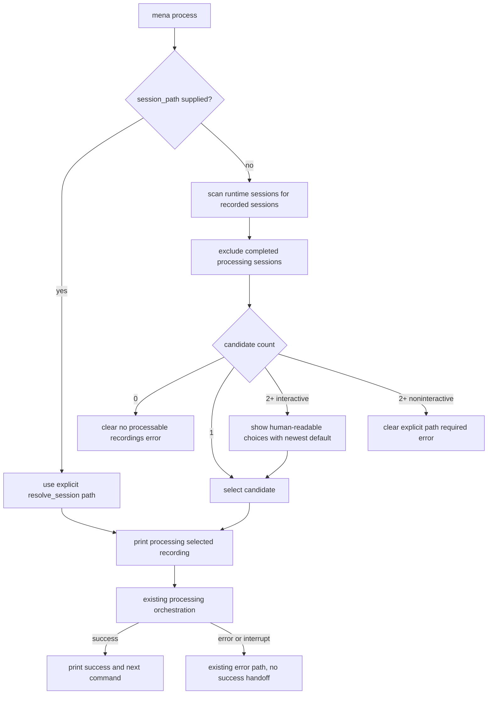

# Process Newest Recording Progress - Plan

## Goal Capsule

| Field | Value |
|---|---|
| Objective | Make `mena process` work as the normal continuation after recording by selecting or recommending the newest processable recording, showing visible progress, and ending with a clear result plus next command. |
| Authority | GitHub issue #95, parent issue #14, `docs/architecture/architecture-overview.md`, `docs/architecture/implementation-guardrails.md`, `AGENTS.md`, and `app/AGENTS.md`. |
| Execution profile | Standard app CLI and session-selection change with behavior covered through focused CLI tests and `app` validation. |
| Stop conditions | Stop if implementation requires changing persisted session schema, changing processing stage contracts, or widening pathless defaults beyond the `process` command. |
| Tail ownership | Open a pull request against `develop`; keep it draft until local validation and self-review are complete. |

---

## Product Contract

### Summary

Issue #95 comes from personal UAT on `0.1.0rc7`.
After recording, `mena process` without a path failed with argparse usage, while `mena process <session_path>` surfaced dependency warnings and ended with a technical completion line.
The user should be guided through processing the newest processable recording without needing to inspect artifacts manually.

### Problem Frame

`mena process` is the second step of the PoC meeting-notes workflow.
For a non-technical user, the command should make clear which recording is being processed, that work has started, whether it succeeded, and what command usually follows.
Technical users must still be able to pass an explicit session path and see enough provenance to understand what ran.

### Requirements

**Session selection**

- R1. `mena process` without a session path must select the newest unprocessed processable recording when exactly one unambiguous candidate exists.
- R2. `mena process` without a session path must ask the user to choose from human-readable session options when multiple plausible candidates exist and must recommend the newest unprocessed option.
- R3. Explicit `mena process <session_path>` must continue to process the requested session instead of applying newest-session selection.

**User-visible process feedback**

- R4. Processing must print a visible start message before stage work begins.
- R5. Successful processing must print a clear success message that remains visible even when third-party warnings were emitted.
- R6. Successful processing must name the next likely command after processing.
- R7. Processing failure or interruption must not print the successful next-step guidance.

**Verification**

- R8. The behavior must be verifiable from a fresh recording through completed processing using repo/dev invocation and without manual artifact inspection.

### Acceptance Examples

- AE1. Given there is exactly one newest unprocessed recording, when the user runs `mena process`, then Mena selects that session as the recommended default.
- AE2. Given multiple plausible sessions exist, when the user runs `mena process`, then Mena asks the user to choose from human-readable session options and recommends the newest unprocessed session.
- AE3. Given processing starts, when the command begins work, then the CLI prints that Mena is processing the selected recording.
- AE4. Given processing succeeds, when the command exits, then the CLI states processing completed successfully and names the next likely command.
- AE5. Given processing emits third-party warnings, when the command completes successfully, then the success and next-step message remain clearly visible.
- AE6. Given a technical user passes `session_path`, when the command runs, then direct session selection still works.
- AE7. Given a tester starts from a fresh recording, when they follow the printed commands through processing, then they can verify completion without inspecting artifacts manually.

### Scope Boundaries

- In scope: pathless `process` selection, interactive process-session choice, start/success/failure CLI copy, focused tests, and PR validation notes.
- Out of scope: changing capture finalization, processing stage internals, session record schema, artifact schema, provider setup policy, `resume` semantics, or pathless defaults for `correct`, `summarize`, `export`, and `inspect`.
- Deferred to Follow-Up Work: richer session history browsing, named aliases such as `mena process latest`, graphical selection, and installed-product automation around real PipeWire capture.

---

## Planning Contract

### Key Technical Decisions

- KTD1. Build on the current `process` parser contract.
  `app/src/mena/cli.py` already makes only `process` accept an optional `session_path`, preserving explicit paths and avoiding accidental pathless behavior on mutating downstream commands.
- KTD2. Replace the single-record helper with a candidate resolver that can choose or prompt.
  `app/src/mena/sessions.py` currently returns the latest recorded session or raises on ambiguity; issue #95 needs candidate metadata so the CLI can present human-readable options instead of failing.
- KTD3. Treat "processable" as successfully recorded and not already completed by the processing pipeline.
  The acceptance criteria say "newest unprocessed recording"; recorded sessions whose final processing stage already completed should not outrank recordings that still need processing.
- KTD4. Keep user interaction in the CLI adapter.
  Session scanning belongs in `sessions`, while prompt wording and terminal input belong in `app/src/mena/cli.py`, matching the existing `ConsoleRecordInteraction` and `_prompt_choice` pattern.
- KTD5. Print start and success guidance around the existing orchestration call.
  `processing_orchestration.run_processing_command()` owns processing behavior; CLI-facing feedback can be added without changing stage contracts or artifact lifecycle.

### High-Level Technical Design

### Assumptions

- "Unprocessed" means no completed final processing output for the session, using the existing processing ledger rather than adding a session-level processed flag.
- Human-readable session options can be composed from existing `session.json` fields such as `name`, `created_at`, `recording.finalization.completed_at`, `profile`, and the session id prefix.
- In non-interactive execution, multiple plausible pathless candidates should fail with a clear message instead of blocking on stdin or picking silently.

### System-Wide Impact

This changes the exported CLI behavior of `mena process` when no path is supplied and improves processing output wording.
It does not change persisted contracts, provider selection, processing stage semantics, or artifact validation.

### Sources & Research

- Issue #95 defines the UAT problem and acceptance criteria.
- `docs/plans/2026-07-03-002-feat-record-to-process-handoff-plan.md` already established pathless `mena process` as the post-recording handoff for issue #97.
- `app/src/mena/cli.py` owns parser behavior, process command routing, terminal prompts, and processing error handling.
- `app/src/mena/sessions.py` owns session record scanning and currently has `latest_recorded_session_record_path()`.
- `app/src/mena/processing_orchestration.py` owns processing execution and currently prints `Processing completed for run ...`.
- `app/tests/test_cli.py` already covers pathless process selection, explicit-path override, process execution, runtime fallback, and processing completion output.

---

## Implementation Units

### U1. Model processable session candidates

- **Goal:** Replace the latest-only recorded-session helper with a small candidate API that exposes processable runtime sessions in recommendation order.
- **Requirements:** R1, R2, R8, AE1, AE2.
- **Dependencies:** None.
- **Files:** `app/src/mena/sessions.py`, `app/tests/test_cli.py`.
- **Approach:** Add a typed return object for process candidates containing `record_path`, `session_dir`, `session_id`, `name`, ordering timestamp, and display fields.
  Scan `settings.paths.sessions_dir`, include only valid `status == "recorded"` sessions, and filter out sessions whose processing ledger indicates the final processing step already completed.
  Order candidates by recording completion time descending with deterministic path tie-breakers.
  Keep explicit path resolution on `resolve_session()` unchanged.
- **Execution note:** Start with failing tests for multiple plausible pathless candidates and already-processed sessions before replacing the helper.
- **Patterns to follow:** Existing tolerant scanning behavior in `latest_recorded_session_record_path()`; processing-state inspection helpers in `app/src/mena/processing.py`; existing runtime-session fixture helpers in `app/tests/test_cli.py`.
- **Test scenarios:** Covers AE1.
  Given one recorded unprocessed session and one failed session, the candidate resolver returns the recorded session.
  Given a newer recorded session whose final processing stage is complete and an older recorded unprocessed session, the resolver recommends the older unprocessed session.
  Given two candidates with equal completion timestamps, ordering is deterministic and does not depend on filesystem iteration order.
  Given malformed session records among valid candidates, malformed records are skipped consistently with the existing latest-recorded scan.
- **Verification:** Session candidate selection is deterministic and distinguishes processable unprocessed recordings from completed or failed sessions.

### U2. Prompt for ambiguous pathless process sessions

- **Goal:** Make `mena process` choose automatically when one candidate exists and prompt with human-readable choices when multiple plausible candidates exist.
- **Requirements:** R1, R2, R3, AE1, AE2, AE6.
- **Dependencies:** U1.
- **Files:** `app/src/mena/cli.py`, `app/tests/test_cli.py`.
- **Approach:** Replace `_resolve_process_session_path()` with a resolver that accepts `input_fn`.
  If `session_path` is supplied, return `Path(session_path)`.
  If no path is supplied and one candidate exists, return its record path.
  If multiple candidates exist and an input reader is available, reuse `_prompt_choice()` with a title such as `Processable recordings` and a default index of 1.
  If multiple candidates exist without an input reader, raise a clear error telling the user to pass an explicit session path.
- **Patterns to follow:** `_prompt_choice()` and `_record_input()` in `app/src/mena/cli.py`; current `test_main_process_without_session_path_*` tests.
- **Test scenarios:** Covers AE1, AE2, AE6.
  Given exactly one candidate, `main(["process"])` calls `_run_processing_command()` with that record path and does not prompt.
  Given two candidates and input accepting the default, the CLI prints both options, recommends the newest candidate, and processes it.
  Given two candidates and input selecting the older option, the CLI processes the selected option.
  Given two candidates in non-interactive mode, `main(["process"])` exits non-zero with an explicit-session-path message.
  Given `mena process <session_path>`, explicit path routing ignores candidate scanning and preserves existing behavior.
- **Verification:** Pathless process is ergonomic for the common case and deterministic for ambiguous cases without breaking explicit paths.

### U3. Print process start and successful next-step guidance

- **Goal:** Make the processing command show visible start feedback and a plain-language success handoff after existing stage orchestration succeeds.
- **Requirements:** R4, R5, R6, R7, AE3, AE4, AE5.
- **Dependencies:** U2.
- **Files:** `app/src/mena/cli.py`, `app/src/mena/processing_orchestration.py`, `app/tests/test_cli.py`.
- **Approach:** Print a start message after resolving the session and before invoking `_run_processing_command()`, naming the selected session with a human-readable label and preserving the record path.
  After `processing_orchestration.run_processing_command()` succeeds, print a clear success line and `Next command: mena correct <session_path>` or the repo's existing next workflow command if implementation discovers a better established handoff.
  Keep third-party warning output untouched, but make the success handoff occur after orchestration so it remains visible at the end.
  Do not print the success handoff from exception paths.
- **Patterns to follow:** `record.process_handoff` rendering in `ConsoleRecordInteraction`; existing processing completion assertions around `_run_processing_command()` and `main(["process", ...])`.
- **Test scenarios:** Covers AE3, AE4, AE5.
  Given processing starts, captured output includes a message that Mena is processing the selected recording before the fake processing command returns.
  Given processing succeeds, captured output includes a plain-language success message and a next command after technical completion output.
  Given a fake processing command emits warning-like output before returning success, the final captured output still ends with or visibly includes the success and next-step guidance.
  Given `_run_processing_command()` raises a processing error, the CLI prints the existing failure prefix and does not print next-step guidance.
  Given `KeyboardInterrupt`, the CLI prints the existing interrupted message and does not print next-step guidance.
- **Verification:** Users can tell processing started, succeeded, and what to run next without reading artifacts or interpreting provider warnings.

### U4. Add fresh-recording process smoke coverage

- **Goal:** Cover the issue-level workflow from a freshly recorded session through pathless processing with stubbed stages.
- **Requirements:** R8, AE7.
- **Dependencies:** U1, U2, U3.
- **Files:** `app/tests/test_cli.py`.
- **Approach:** Add or extend a CLI integration-style test that creates a runtime recorded session in the configured data root, invokes `main(["process"])` with stubbed providers/stages, and asserts the selected session, start output, success output, and next command.
  Use repo/dev fixtures and temporary settings only; do not rely on installed-product data paths.
- **Patterns to follow:** `_build_processing_session()`, `_create_runtime_session()`, `_patch_processing_stages()`, and `test_main_process_executes_full_pipeline_with_stubbed_stages()`.
- **Test scenarios:** Covers AE7.
  Given a freshly recorded runtime session, `main(["process"])` with stubbed stages processes that session and prints start, success, and next command output.
  Given the same command is invoked with a configured temporary data root, output and assertions do not depend on default product runtime paths.
- **Verification:** The issue can be validated end-to-end in repo/dev mode without real PipeWire hardware or manual artifact inspection.

### U5. Update PR validation notes

- **Goal:** Make reviewer-facing validation and UAT limits explicit in the pull request.
- **Requirements:** R8, AE7.
- **Dependencies:** U1, U2, U3, U4.
- **Files:** Pull request body only unless implementation reveals a necessary docs correction.
- **Approach:** In the PR body, summarize local validation, name whether validation used repo/dev invocation or installed-product invocation, and state whether real fresh-recording UAT was performed.
  If installed-product or real hardware UAT is not run, record that as a limitation rather than implying full UAT coverage.
- **Test expectation:** none -- this is PR metadata, not product behavior.
- **Verification:** Reviewers can distinguish automated repo coverage from hardware-dependent UAT.

---

## Verification Contract

| Gate | Applies to | Expected signal |
|---|---|---|
| Focused CLI tests | U1, U2, U3, U4 | `uv run pytest tests/test_cli.py` passes from `app/` or an equivalent targeted invocation passes from the repo root. |
| App gate | All app code changes | `make check` passes from `app/`. |
| Repo/dev smoke | U4 | A temporary-data-root invocation of pathless `process` with stubbed or controlled stages shows start, success, and next command output. |
| PR self-review | U5 | PR body records issue scope, validation results, known UAT limitations, and local self-review notes before being marked ready. |

---

## Definition of Done

- R1-R8 are implemented or explicitly covered by existing behavior preserved in tests.
- `mena process` without a path selects one unambiguous newest unprocessed processable recording or prompts for a human-readable choice when multiple plausible candidates exist.
- `mena process <session_path>` still processes the explicit session path.
- Processing prints visible start feedback before stage work and clear success plus next command guidance after successful completion.
- Failure and interruption paths do not print successful next-step guidance.
- Third-party warnings do not obscure the final success and next-step output.
- Focused CLI tests and `make check` pass, or any failure is root-caused and recorded before handoff.
- The pull request targets `develop`, includes validation results, and states whether validation used repo/dev invocation, installed-product invocation, or both.
