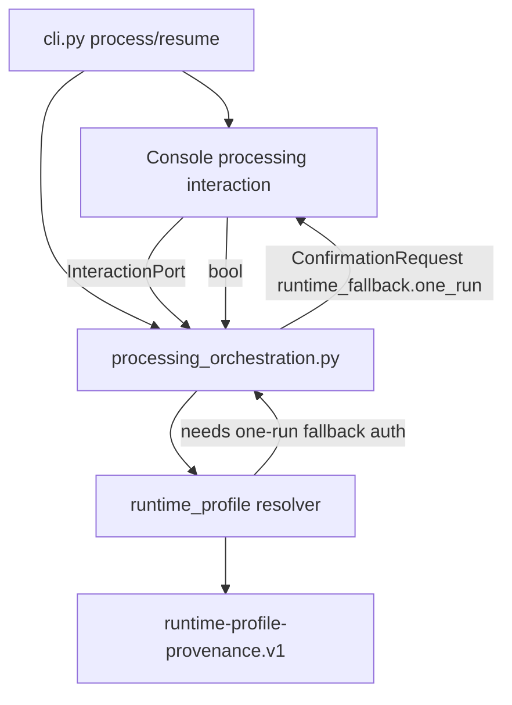
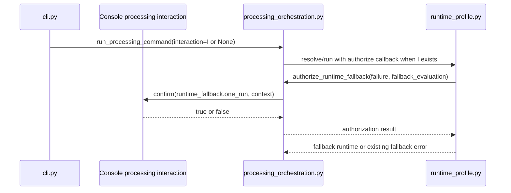

# Runtime Fallback Interaction Port - Plan

## Goal Capsule

| Field | Value |
|---|---|
| Objective | Route one-run runtime fallback authorization through the interaction port while preserving current CLI prompt text, accepted answers, exit codes, and runtime-profile provenance shape. |
| Authority | GitHub issue #137, `CONTEXT.md` Interaction port and Capability resolver entries, ADR-031, and the existing runtime resolver contract in `app/src/mena/runtime_profile.py`. |
| Execution profile | Behavior-preserving refactor with characterization tests for CLI wording and workflow-level scripted interaction before deleting prompt callbacks from workflow modules. |
| Stop conditions | Stop if preserving prompt bytes conflicts with semantic interaction requests, if runtime-profile provenance shape would change, or if summarization needs new fallback behavior rather than only deleting its dead callback parameter. |
| Tail ownership | Branch work should open a pull request against `develop`; keep it draft until local gates, self-review, and PR body validation notes are complete. |

---

## Product Contract

### Summary

Issue #137 completes the interaction-port gap left by runtime fallback authorization: workflow modules should ask for a semantic one-run fallback confirmation, while the CLI owns prompt wording and input mechanics.
The visible command behavior remains unchanged for processing: the same explanatory lines print, the same `Use local runtime fallback for this run? [y/N] ` prompt is shown, `y` and `yes` authorize fallback, all other answers decline, exit codes remain stable, and provenance stays byte-compatible.

Product Contract preservation: Product Contract unchanged from GitHub issue #137; this plan adds implementation structure and verification detail only.

### Problem Frame

`app/src/mena/processing_orchestration.py` currently accepts `runtime_fallback_input_fn`, prints the fallback authorization copy, and calls a raw prompt callback.
That violates the repository's Interaction port definition because an application workflow module owns adapter wording and input mechanics.
`app/src/mena/summarize_workflow.py` accepts the same callback but discards it, which leaves a misleading workflow signature and keeps the anti-pattern alive without behavior.

### Requirements

**Interaction boundary**

- R1. `app/src/mena/processing_orchestration.py` asks for one-run runtime fallback authorization through `InteractionPort.confirm` using the stable topic `runtime_fallback.one_run`.
- R2. The confirmation request carries the accepted-profile failure reason and fallback evaluation context so adapters can render the current explanatory output.
- R3. The processing and summarization workflow modules do not accept, call, or retain `input_fn` or `runtime_fallback_input_fn` prompt callbacks.
- R4. The CLI adapter owns all runtime fallback prompt wording, explanatory prints, input mechanics, and non-interactive input availability checks.

**Behavior preservation**

- R5. CLI prompt bytes remain unchanged: `Use local runtime fallback for this run? [y/N] ` appears only from `app/src/mena/cli.py`.
- R6. Accepted answers remain unchanged: `y` and `yes` authorize; empty input, `n`, `no`, and any other value decline without retry.
- R7. Processing exit codes remain unchanged, including exit code `3` for unauthorized runtime fallback and exit code `0` when authorized fallback completes.
- R8. Runtime-profile provenance remains shape-compatible with existing `runtime-profile-provenance.v1` primary and stage-fallback payloads.

**Test and scope control**

- R9. Workflow tests cover authorized and declined runtime fallback through `ScriptedInteraction`, not monkeypatching or raw input callbacks.
- R10. A CLI-level test proves the rendered prompt string and y/N handling are byte-identical to current behavior.
- R11. Existing runtime profile and provenance tests continue to pass without modification to persisted contract expectations.

### Scope Boundaries

#### In Scope

- Processing runtime fallback authorization wiring in `app/src/mena/processing_orchestration.py`.
- A CLI-owned processing/runtime fallback interaction adapter in `app/src/mena/cli.py`.
- Removal of the dead `runtime_fallback_input_fn` parameter from `app/src/mena/summarize_workflow.py` and its CLI wrapper.
- Focused workflow and CLI tests plus static boundary checks for prompt ownership.

#### Deferred to Follow-Up Work

- A shared adapter module for all CLI interaction adapters if `cli.py` grows too large.
- New desktop, GUI, or agent-facing fallback authorization surfaces.
- Remote fallback authorization UX beyond existing stage-focused policy.

#### Out of Scope

- Runtime profile selection policy, fallback eligibility, setup authorization state, profile catalog contents, and provider construction.
- Runtime-profile provenance schema changes or migrations.
- Changing summarization fallback behavior; summarize only loses a discarded parameter.
- New retry semantics, new accepted answers, or new prompt wording.

### Acceptance Examples

- AE1. Given processing needs unauthorized one-run local fallback and the scripted workflow interaction answers `True`, when the resolver requests authorization, then processing uses fallback and records the existing interactive authorization source.
- AE2. Given processing needs unauthorized one-run local fallback and the scripted workflow interaction answers `False`, when the resolver requests authorization, then processing raises the existing fallback-declined path and does not run the fallback providers.
- AE3. Given the CLI receives `yes` at the one-run fallback prompt, when processing completes through fallback, then the prompt list contains exactly `Use local runtime fallback for this run? [y/N] ` and the command exits `0`.
- AE4. Given the CLI has no interactive input and no explicit one-run fallback flag, when fallback authorization is required, then processing exits `3` with the existing actionable runtime fallback message.
- AE5. Given summarization is invoked with runtime fallback options, when the workflow signature is inspected, then no dead prompt callback parameter remains and existing summarization runtime profile behavior is otherwise unchanged.

---

## Planning Contract

### Key Technical Decisions

- KTD1. Processing workflow receives an `InteractionPort | None`, not a prompt callback. `None` preserves the current non-interactive behavior by withholding the resolver authorization callback.
- KTD2. The semantic confirmation topic remains `runtime_fallback.one_run`. It already exists in `ScriptedInteraction` tests and matches `app/src/mena/interaction.py` topic guidance.
- KTD3. The confirmation request context carries `accepted_failure` and `fallback_evaluation` as domain context. The workflow owns the need for the decision; the CLI adapter formats `SetupEvaluation.profile.id`, selected ASR checkpoint, and device into the current copy.
- KTD4. CLI interactive availability stays adapter-owned. `_resolve_runtime_fallback_input` or a replacement helper should still return `None` for non-TTY stdin unless tests or embeddings pass an explicit `input_fn`.
- KTD5. Summarization deletes only the unused callback surface. It should continue to call `select_runtime_profile` without interactive authorization until a separate issue defines summarization fallback prompts.

### High-Level Technical Design

### Assumptions

- The CLI can keep `input_fn` for adapter-level testing and other command adapters; the issue forbids raw prompt callbacks in application workflow modules, not all CLI adapter internals.
- Passing the `SetupEvaluation` object through `ConfirmationRequest.context` is acceptable because context values are domain data and the adapter is in-process.
- Existing runtime profile tests already protect most provenance shape expectations; this issue should add characterization only where the interaction-port migration changes routing.

### System-Wide Impact

This change tightens the application workflow boundary without changing provider policy.
Future non-CLI interfaces can satisfy fallback authorization by implementing `InteractionPort.confirm` for `runtime_fallback.one_run`, and workflow tests can script the same semantic request without terminal prompt knowledge.

### Risks & Dependencies

- The CLI wrapper and workflow signatures must change together or tests will keep passing a dead parameter through one layer.
- A too-small adapter could accidentally move explanatory print lines into the workflow again; static grep checks should prove prompt copy is CLI-owned.
- If workflow tests assert the concrete `SetupEvaluation` type too strongly, they will become brittle; assert the request topic and context keys, then use lightweight fake fallback evaluation objects for prompt rendering tests.

### Sources & Research

- GitHub issue #137: "Route runtime-fallback authorization through the interaction port".
- `CONTEXT.md`: "Application workflow module", "Interaction port", and "Capability resolver".
- `docs/decisions/ADR-031-runtime-fallback-authorization-and-setup-state.md`.
- `docs/architecture/implementation-guardrails.md`.
- Existing implementation anchors: `app/src/mena/processing_orchestration.py`, `app/src/mena/summarize_workflow.py`, `app/src/mena/cli.py`, `app/src/mena/interaction.py`, `app/src/mena/runtime_profile.py`.
- Existing tests: `app/tests/test_processing_orchestration.py`, `app/tests/test_cli.py`, `app/tests/test_interaction.py`, `app/tests/test_runtime_profile.py`.

---

## Implementation Units

### U1. Processing Interaction Port Contract

- **Goal:** Replace `runtime_fallback_input_fn` in processing orchestration with an optional `InteractionPort` dependency and semantic confirmation request.
- **Requirements:** R1, R2, R3, R8, R9, AE1, AE2
- **Dependencies:** Existing `app/src/mena/interaction.py`
- **Files:** `app/src/mena/processing_orchestration.py`, `app/tests/test_processing_orchestration.py`, `app/tests/test_interaction.py`
- **Approach:** Import `ConfirmationRequest` and `InteractionPort` in processing orchestration. Build `runtime_fallback_authorizer` only when `interaction` is present. The authorizer should call `interaction.confirm(ConfirmationRequest(topic="runtime_fallback.one_run", default=False, context={...}))` and return the boolean result to the resolver. Delete the workflow-owned `_confirm_one_run_runtime_fallback` helper and update imports/tests accordingly.
- **Execution note:** Start with a workflow test that fails because `run_processing_command` cannot yet accept a scripted interaction for runtime fallback authorization.
- **Patterns to follow:** `recording_control.py` and `correction_workflow.py` use of `InteractionPort`, `ScriptedInteraction` request recording, and `runtime_profile.py` `authorize_runtime_fallback` callback shape.
- **Test scenarios:** Given a fake runtime selector invokes `authorize_runtime_fallback` with `accepted_failure="gpu missing"` and a fake fallback evaluation, scripted `True` returns authorization and records one `runtime_fallback.one_run` request with default false. Given scripted `False`, the fake selector observes a declined authorization and the workflow surfaces the same fallback-declined failure path. Given no interaction is passed, `authorize_runtime_fallback` remains `None` and the resolver keeps the existing unauthorized fallback behavior. Given the recorded request, its context contains `accepted_failure` and `fallback_evaluation`.
- **Verification:** Workflow tests prove runtime fallback authorization is scripted through the interaction port with no `monkeypatch` increase in touched workflow tests.

### U2. CLI Runtime Fallback Adapter

- **Goal:** Move runtime fallback explanatory output, prompt bytes, and y/N parsing into a CLI-owned interaction adapter.
- **Requirements:** R4, R5, R6, R7, R10, AE3, AE4
- **Dependencies:** U1
- **Files:** `app/src/mena/cli.py`, `app/tests/test_cli.py`
- **Approach:** Add a small processing interaction adapter near the existing console adapters or add a helper that returns `ConsoleProcessingInteraction | None`. It should use `_resolve_runtime_fallback_input(input_fn)` for input availability, handle only `ConfirmationRequest(topic="runtime_fallback.one_run")`, print the same two explanatory lines, prompt with the same bytes, and parse answers exactly as the old helper did. The `process` and `resume` branches should pass this adapter to processing only when one-run fallback input is available.
- **Execution note:** Characterize the existing prompt test before deleting the old callback path, then update it to prove the adapter path produces the same captured output and prompt list.
- **Patterns to follow:** `ConsoleRecordInteraction`, `ConsoleCorrectionInteraction`, `_CliSetupInteraction`, and the current `test_main_process_prompts_for_ready_one_run_runtime_fallback`.
- **Test scenarios:** Given CLI input `yes`, the adapter returns true, records the same prompt bytes, prints `Accepted runtime profile is unavailable:` and `One-run local runtime fallback is ready:` with the same fallback details, and the command exits `0` when fallback succeeds. Given CLI input `""`, `n`, `no`, or another string, adapter confirmation returns false without retry. Given non-interactive stdin and no explicit `input_fn`, the CLI passes no interaction and the existing exit-code `3` path remains unchanged. Given an unsupported confirmation topic, the adapter raises a clear adapter error.
- **Verification:** CLI tests prove byte-equivalent prompt wording and unchanged exit-code behavior.

### U3. Summarization Dead Parameter Removal

- **Goal:** Delete the unused runtime fallback prompt callback from summarization workflow and all call sites.
- **Requirements:** R3, R4, R11, AE5
- **Dependencies:** None
- **Files:** `app/src/mena/summarize_workflow.py`, `app/src/mena/cli.py`, `app/tests/test_cli.py`, `app/tests/test_summarize_workflow.py`
- **Approach:** Remove `runtime_fallback_input_fn` from `run_summarization_command` and `_run_summarize_command`. Delete the discard assignment. Keep `allow_runtime_fallback`, runtime profile selector injection, provenance storage, and binder behavior unchanged. Update any tests or helper calls that still pass the dead parameter.
- **Patterns to follow:** Current `summarize_workflow.py` dependency-injection style and issue #96 extraction plan's behavior-preservation posture.
- **Test scenarios:** Existing summarization tests still pass without passing a prompt callback. Static search for `runtime_fallback_input_fn` under `app/src/mena/` returns zero matches. Processing still owns interactive fallback through the interaction adapter; summarization behavior is otherwise unchanged.
- **Verification:** Summarization workflow signature has no discarded prompt hook and existing summarization runtime profile tests pass.

### U4. Static Boundary and Provenance Verification

- **Goal:** Prove the interaction-port boundary, prompt ownership, and persisted contract preservation after implementation.
- **Requirements:** R3, R5, R7, R8, R9, R10, R11
- **Dependencies:** U1, U2, U3
- **Files:** `app/tests/test_processing_orchestration.py`, `app/tests/test_cli.py`, `app/tests/test_runtime_profile.py`
- **Approach:** Add or update focused tests rather than broad snapshots. Keep provenance tests in `test_runtime_profile.py` unchanged unless imports move. Use static grep gates during verification to catch boundary regressions called out by the issue.
- **Patterns to follow:** Existing runtime fallback tests in `app/tests/test_cli.py` and resolver tests in `app/tests/test_runtime_profile.py`.
- **Test scenarios:** `grep -rn 'input_fn' app/src/mena/processing_orchestration.py app/src/mena/summarize_workflow.py` returns zero matches. `grep -rn 'Use local runtime fallback' app/src/mena/ --include='*.py'` matches only `app/src/mena/cli.py`. `grep -rn 'runtime_fallback_input_fn' app/src/mena/` returns zero matches. Touched workflow tests cover both authorized and declined fallback with `ScriptedInteraction` and do not add monkeypatch usage. Existing runtime profile provenance tests pass unchanged.
- **Verification:** Static boundary checks plus targeted tests and `make check` from `app/` are green.

---

## Verification Contract

| Gate | Scope | Done signal |
|---|---|---|
| Processing workflow tests | U1, U4 | `app/tests/test_processing_orchestration.py` covers authorized and declined fallback through `ScriptedInteraction`. |
| CLI behavior tests | U2, U4 | `app/tests/test_cli.py` proves prompt bytes, y/N parsing, and process exit-code behavior remain unchanged. |
| Summarization tests | U3 | Existing summarize workflow and CLI tests pass after the dead parameter is removed. |
| Runtime profile tests | U1, U4 | Existing provenance and resolver tests pass without persisted payload expectation changes. |
| Static boundary checks | U1-U4 | Issue-specified grep checks prove workflow modules do not own raw input callbacks or prompt wording. |
| App gate | U1-U4 | `make check` from `app/` is green. |

---

## Definition of Done

- `processing_orchestration.py` depends on `InteractionPort` for one-run runtime fallback authorization and contains no runtime fallback prompt wording.
- `summarize_workflow.py` no longer accepts or discards `runtime_fallback_input_fn`.
- `cli.py` owns the fallback prompt text, explanatory output, input availability check, and y/N parsing.
- Workflow tests script authorized and declined fallback through `ScriptedInteraction`.
- CLI tests prove byte-equivalent prompt wording and unchanged exit codes.
- Runtime-profile provenance tests remain green without schema expectation changes.
- Static grep checks and `make check` from `app/` pass.
- The final diff contains no abandoned prompt-callback compatibility code outside the CLI adapter layer.
