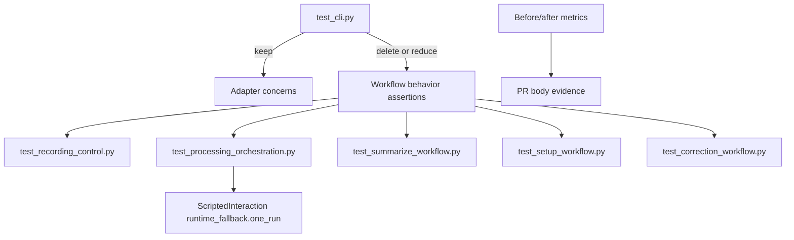

# Retire Duplicated CLI Workflow Coverage - Plan

## Goal Capsule

| Field | Value |
|---|---|
| Objective | Retire `app/tests/test_cli.py` tests that duplicate application workflow seam coverage, migrating any missing assertions to workflow test modules first, while preserving CLI adapter coverage and reporting traceable deletion and coverage metrics. |
| Authority | GitHub issue #138, `CONTEXT.md` Application workflow module and Interaction port entries, `docs/plans/2026-07-03-003-refactor-runtime-fallback-interaction-port-plan.md`, and existing workflow tests under `app/tests/`. |
| Execution profile | Test-only refactor. No files under `app/src/mena/` may change; protect behavior by moving assertions before deleting CLI tests and by comparing coverage/collection metrics before and after. |
| Stop conditions | Stop if a required behavior has no workflow seam to test without changing production code, if line coverage drops without a clear duplicate-removal justification, or if satisfying the issue appears to require edits under `app/src/mena/`. |
| Tail ownership | Branch work should open a pull request against `develop`; the PR body must include the deleted-test mapping table, before/after metrics, coverage delta notes, validation, and local self-review notes. |

---

## Product Contract

### Summary

Issue #138 closes the loop on the architecture realignment work by removing CLI-level tests that still exercise record, process, summarize, setup, and correction workflow behavior through monkeypatched internals and printed output.
After this change, `test_cli.py` should assert interface-adapter concerns only: argument parsing, prompt wording, rendering, exit codes, and adapter wiring.
Workflow behavior should live in the workflow modules' tests, especially the runtime-fallback authorization cases unlocked by issue #137's interaction port.

Product Contract preservation: Product Contract unchanged from GitHub issue #138; this plan adds implementation sequencing, verification, and reporting structure only.

### Problem Frame

`app/tests/test_cli.py` currently has 7,075 lines and 217 `monkeypatch` mentions on the issue #138 base, above the issue's stated baseline of 6,682 lines and 207 monkeypatches.
The growth reflects the same architectural symptom: workflow behavior remains double-covered through CLI tests even after workflow seam tests were introduced.
The desired end state is not fewer tests for its own sake; it is clearer ownership, where workflow modules are tested directly and CLI tests stay focused on adapter behavior.

### Requirements

**Coverage ownership**

- R1. Every `test_cli.py` test that remains after the refactor asserts an adapter concern: command parsing, prompt wording, rendering, exit codes, or wiring into workflow modules.
- R2. CLI tests that drive record, process, summarize, setup, or correction behavior through monkeypatched workflow internals are deleted only after equivalent behavior is confirmed in the corresponding workflow test module or migrated there.
- R3. Runtime-fallback authorization tests that currently rely on broad runtime-profile/setup monkeypatching in `test_cli.py` are represented at the workflow seam using `ScriptedInteraction` and the `runtime_fallback.one_run` interaction topic.
- R4. Workflow modules' tests become the canonical home for workflow behavior in `app/tests/test_recording_control.py`, `app/tests/test_processing_orchestration.py`, `app/tests/test_summarize_workflow.py`, `app/tests/test_setup_workflow.py`, and `app/tests/test_correction_workflow.py`.

**Scope control**

- R5. The implementation is test-only; `git diff --stat develop -- app/src/mena/` must be empty.
- R6. No product behavior, runtime behavior, CLI prompt wording, exit code, or persisted artifact contract changes are introduced.
- R7. Any test deleted as a pure duplicate is traceable to a workflow test module or an explicit duplicate-removal justification.

**Evidence and reporting**

- R8. The PR description contains a table mapping each group of deleted CLI tests to the workflow module and representative test names that cover the same behavior, or to an explicit pure-duplicate justification.
- R9. The PR description reports before/after metrics for `test_cli.py` line count, `monkeypatch` usages in `test_cli.py`, total collected test count, and `app/src/mena/` coverage percentage.
- R10. Any `app/src/mena/` line coverage decrease is listed per module in the PR description with justification.
- R11. `make check` from `app/` is green.

### Scope Boundaries

#### In Scope

- Tests under `app/tests/` only.
- Deleting duplicated CLI tests after confirming or moving coverage to workflow tests.
- Adding focused workflow tests when a CLI test contains a behavior assertion that is still missing at the workflow seam.
- Updating PR-facing documentation with deletion mapping and before/after metrics.

#### Deferred to Follow-Up Work

- Further production refactors that would make remaining CLI wiring tests smaller.
- Splitting `test_cli.py` into adapter-focused test files if the surviving adapter tests still feel too large after this cleanup.
- Removing helper code in `test_cli.py` that becomes unused only if it would require broad unrelated churn to prove safely.

#### Out of Scope

- Any edits under `app/src/mena/`.
- Changes to CLI command behavior, prompt text, exit codes, runtime fallback policy, provider selection, persisted artifact schemas, or workflow signatures.
- Rewriting unrelated tests that already live at the right seam.
- Improving global coverage thresholds or changing project test tooling.

### Acceptance Examples

- AE1. Given a CLI test asserts processing fallback authorization by patching runtime setup/provider internals, when the behavior is covered in `test_processing_orchestration.py` through `ScriptedInteraction`, then the CLI test is deleted or reduced to prompt/exit-code adapter assertions only.
- AE2. Given a CLI test asserts setup authorization persistence through printed output and patched internals, when the same workflow behavior exists in `test_setup_workflow.py`, then the CLI duplicate is deleted and the PR mapping names the workflow test.
- AE3. Given a CLI test asserts record route selection behavior that is already covered in `test_recording_control.py`, when the cleanup runs, then the CLI test keeps only argument/prompt rendering coverage or is removed as duplicated workflow behavior.
- AE4. Given a deleted CLI test was the only assertion for a meaningful workflow edge case, when implementation starts, then the assertion is migrated to the matching workflow test module before the CLI test is removed.
- AE5. Given the final diff is reviewed, when `git diff --stat develop -- app/src/mena/` is run, then it reports no production source changes.
- AE6. Given the PR body is opened, when the reviewer checks issue #138's metric and traceability criteria, then the before/after metrics, coverage delta notes, and deleted-test mapping are present.

---

## Planning Contract

### Key Technical Decisions

- KTD1. Treat `test_cli.py` as an adapter contract, not a workflow regression suite. Keep tests there only when they prove CLI parsing, prompt wording, rendering, exit-code mapping, or that the adapter calls the expected workflow boundary.
- KTD2. Move missing behavior coverage before deletion. If a CLI test is the only proof of a workflow branch, first add the narrow workflow test with direct dependencies or `ScriptedInteraction`, then remove the CLI duplicate.
- KTD3. Group deletions by workflow area for reviewability. The PR table should use groups such as setup fallback authorization, record capture/route behavior, processing runtime fallback and checkpointing, summarization runtime binding, and correction workflow invocation rather than one row per deleted test when rows would be noisy.
- KTD4. Keep runtime-fallback authorization coverage at the interaction port. Issue #137 added `test_run_processing_command_authorizes_runtime_fallback_through_interaction` and `test_run_processing_command_declines_runtime_fallback_through_interaction`; new or adjusted tests should build on that seam instead of reintroducing provider-factory and setup-detection monkeypatch clusters in CLI tests.
- KTD5. Use metrics as reporting evidence, not as a hidden numeric gate beyond the issue criteria. The cleanup should substantially reduce `test_cli.py` line count and monkeypatch usage, but the hard correctness gate is ownership and traceability.

### High-Level Technical Design

### Assumptions

- The issue #137 runtime-fallback interaction-port work is available on this branch because it was merged into `origin/develop` at `5293d84`.
- Coverage may move within `app/src/mena/` modules as duplicate CLI paths are removed; any decrease must be explained, but a small justified decrease is acceptable under the issue wording.
- Some `test_cli.py` tests near helper functions such as capture segment collection or provider requirement validation may remain if they directly test CLI-owned helper behavior and not workflow orchestration.

### System-Wide Impact

This change does not alter runtime behavior, but it changes the test ownership model reviewers rely on.
Future workflow changes should add or update workflow seam tests first and reserve CLI tests for adapter wiring, prompt rendering, and exit-code translation.

### Risks & Dependencies

- Over-deleting can silently remove behavior coverage if workflow seam tests are assumed rather than checked.
- Under-deleting can satisfy local test gates while failing the issue's architectural intent; remaining CLI tests need a spot-checkable adapter rationale.
- `test_cli.py` helpers are shared across many tests, so deleting one group may expose unused fixtures or helpers that should be removed only when obviously isolated.
- Coverage measurement must use the same command before and after, or the PR's coverage delta will be meaningless.

### Sources & Research

- GitHub issue #138: "Retire test_cli.py coverage now duplicated at the workflow seams".
- GitHub issue #137 plan: `docs/plans/2026-07-03-003-refactor-runtime-fallback-interaction-port-plan.md`.
- `CONTEXT.md`: "Application workflow module", "Interaction port", and "Capability resolver".
- Repo guidance: `AGENTS.md` and `app/AGENTS.md`.
- Current local baseline on this branch before implementation: `app/tests/test_cli.py` has 7,075 lines and 217 `monkeypatch` mentions.
- Existing workflow seam anchors: `app/tests/test_processing_orchestration.py`, `app/tests/test_recording_control.py`, `app/tests/test_setup_workflow.py`, `app/tests/test_summarize_workflow.py`, and `app/tests/test_correction_workflow.py`.

---

## Implementation Units

### U1. Baseline Inventory and Metrics

- **Goal:** Capture the before state and classify `test_cli.py` tests by adapter concern, duplicate workflow behavior, or missing workflow seam coverage.
- **Requirements:** R1, R2, R7, R8, R9, R10
- **Dependencies:** None
- **Files:** `app/tests/test_cli.py`, `app/tests/test_processing_orchestration.py`, `app/tests/test_recording_control.py`, `app/tests/test_setup_workflow.py`, `app/tests/test_summarize_workflow.py`, `app/tests/test_correction_workflow.py`
- **Approach:** Build a local inventory of candidate deletion groups from `test_cli.py`, prioritizing tests whose names begin with `test_main_process`, `test_run_processing_command`, `test_main_resume`, `test_main_summarize`, `test_setup`, `test_record`, and `test_main_correct` and that monkeypatch production internals. For each group, identify existing workflow tests that cover the behavior or mark the missing assertion to migrate in U2-U6. Capture baseline line count, monkeypatch count, total collected tests, and `app/src/mena/` coverage using one consistent command set for before/after comparison.
- **Execution note:** Treat this as characterization work. Do not delete a group until the inventory names the workflow test or migration target that protects it.
- **Patterns to follow:** Issue #138 acceptance criteria and the current workflow test names discovered in the Sources & Research section.
- **Test scenarios:** The inventory identifies runtime-fallback authorization tests that can move to `test_processing_orchestration.py` via `ScriptedInteraction`. The inventory identifies setup fallback authorization tests already represented in `test_setup_workflow.py` or needing a focused addition. The inventory distinguishes CLI prompt/rendering tests that must remain from workflow-behavior tests that should move.
- **Verification:** A working deletion-mapping draft exists for the PR body before large deletions begin, and baseline metrics are recorded using repeatable commands.

### U2. Processing and Runtime Fallback Coverage Cleanup

- **Goal:** Remove duplicated CLI processing/runtime fallback workflow tests while preserving adapter assertions and workflow seam coverage.
- **Requirements:** R1, R2, R3, R4, R5, R6, R7, AE1, AE4, AE5
- **Dependencies:** U1
- **Files:** `app/tests/test_cli.py`, `app/tests/test_processing_orchestration.py`
- **Approach:** Compare CLI processing tests around runtime profile selection, runtime fallback authorization, processing stage sequencing, checkpoint/resume handling, source audio validation, and provider-prep reuse against `test_processing_orchestration.py`. Keep CLI tests that prove argument handling, prompt bytes, exit-code mapping, or workflow adapter calls. Delete CLI tests that duplicate workflow behavior now covered by direct orchestration tests. Add focused orchestration tests only for behavior that would otherwise be lost.
- **Execution note:** Start with the runtime-fallback authorization cluster because it is explicitly called out by issue #138 and issue #137 provides the intended interaction seam.
- **Patterns to follow:** `test_run_processing_command_authorizes_runtime_fallback_through_interaction`, `test_run_processing_command_declines_runtime_fallback_through_interaction`, and processing orchestration helper tests in `app/tests/test_processing_orchestration.py`.
- **Test scenarios:** Authorized one-run runtime fallback is covered through `ScriptedInteraction` and not through CLI provider-factory/setup-detection patch chains. Declined runtime fallback is covered through `ScriptedInteraction` and still maps to CLI exit-code coverage where adapter behavior matters. Processing stage sequencing and capture segment validation either remain in direct orchestration tests or keep only CLI path/wiring checks. Resume/checkpoint behavior is retained only where CLI-specific command routing or exit-code rendering is under test.
- **Verification:** Targeted processing-related tests pass, `test_cli.py` no longer contains duplicated runtime-fallback workflow coverage, and no `app/src/mena/` files change.

### U3. Setup Workflow Coverage Cleanup

- **Goal:** Retire CLI setup tests that duplicate setup workflow behavior while retaining CLI setup prompt/rendering and command wiring tests.
- **Requirements:** R1, R2, R4, R5, R6, R7, AE2, AE4, AE5
- **Dependencies:** U1
- **Files:** `app/tests/test_cli.py`, `app/tests/test_setup_workflow.py`
- **Approach:** Map CLI setup tests for decline, action execution, fallback authorization, fallback action ordering, interruption, and persistence to `test_setup_workflow.py`. Add missing workflow seam tests if a CLI test is the sole assertion for workflow state mutation. Keep CLI tests that prove CLI flags, printed wording, config error reporting, and adapter wiring.
- **Patterns to follow:** `test_setup_workflow_decline_does_not_mutate_or_persist`, `test_setup_workflow_executes_primary_actions_then_persists_ready_state`, `test_setup_workflow_executes_fallback_actions_before_authorizing`, and `test_setup_workflow_fallback_decline_persists_unavailable_authorization`.
- **Test scenarios:** Setup decline is covered at the workflow seam. Fallback authorization persistence and unavailable fallback behavior are covered without CLI-level setup-detection patch chains. CLI tests still cover user-facing setup output and flag behavior where that is adapter-owned.
- **Verification:** Setup workflow tests pass, remaining setup CLI tests have adapter-specific assertions, and the PR mapping lists deleted setup groups with representative workflow tests.

### U4. Record and Correction Coverage Cleanup

- **Goal:** Remove duplicated CLI tests for record and correction workflow behavior after confirming the workflow seam tests own those behaviors.
- **Requirements:** R1, R2, R4, R5, R6, R7, AE3, AE4, AE5
- **Dependencies:** U1
- **Files:** `app/tests/test_cli.py`, `app/tests/test_recording_control.py`, `app/tests/test_correction_workflow.py`
- **Approach:** For record, keep CLI tests for help text, profile argument validation, route prompt wording, dry-run rendering, and worker exit-code mapping when adapter-specific; move or delete tests whose real assertion is session bundle creation, route resolution, capture monitor behavior, or process handoff notices already covered in `test_recording_control.py`. For correction, keep console interaction rendering/prompt tests and CLI path/error mapping; delete or migrate workflow behavior such as overlay persistence, skip actions, playback failure handling, and cancellation when covered by `test_correction_workflow.py`.
- **Patterns to follow:** `test_recording_control_creates_recorded_session_with_scripted_stop`, `test_recording_control_uses_interaction_for_ambiguous_routes`, `test_run_correction_workflow_persists_overlay_and_keeps_source_transcript_immutable`, and correction interaction tests in `app/tests/test_correction_workflow.py`.
- **Test scenarios:** Record route ambiguity is covered through `ScriptedInteraction` in recording control tests. Record process handoff behavior is covered in workflow tests, while CLI tests keep rendering/prompt expectations only. Correction overlay persistence and playback failure behavior remain in correction workflow tests, while CLI tests keep command argument and console-interaction behavior.
- **Verification:** Record and correction workflow tests pass, deleted CLI groups are traceable, and remaining CLI tests are spot-checkable as adapter concerns.

### U5. Summarize and Export-Adjacent Coverage Cleanup

- **Goal:** Retire CLI summarization workflow duplicates while keeping CLI-specific summarization/export adapter tests.
- **Requirements:** R1, R2, R4, R5, R6, R7, AE4, AE5
- **Dependencies:** U1
- **Files:** `app/tests/test_cli.py`, `app/tests/test_summarize_workflow.py`
- **Approach:** Review summarization CLI tests for runtime profile binding, language selection, merged transcript resolution, overlay/manual-notes application, stage failure reporting, and runtime stewardship. Migrate missing workflow behavior to `test_summarize_workflow.py` when currently only asserted through CLI. Keep CLI tests for command-line flag precedence, user-facing error rendering, exit codes, and export command behavior that truly belongs to the adapter.
- **Patterns to follow:** Existing `test_summarize_workflow.py` session resolution and invalid merged transcript tests, plus CLI tests that explicitly assert adapter-owned language flag behavior.
- **Test scenarios:** Summarization session resolution and invalid transcript filtering are workflow tests. Runtime profile binding behavior is covered directly at the workflow seam if missing. CLI tests remain for CLI language override parsing, explicit invalid language output, export command rendering, and adapter exit-code translation.
- **Verification:** Summarize workflow and surviving CLI summarization/export-adjacent tests pass, with deleted groups listed in the PR mapping.

### U6. Final Metrics, Coverage Delta, and PR Evidence

- **Goal:** Produce the evidence issue #138 requires and validate the final branch.
- **Requirements:** R5, R8, R9, R10, R11, AE5, AE6
- **Dependencies:** U2, U3, U4, U5
- **Files:** `app/tests/test_cli.py`, `app/tests/test_processing_orchestration.py`, `app/tests/test_recording_control.py`, `app/tests/test_setup_workflow.py`, `app/tests/test_summarize_workflow.py`, `app/tests/test_correction_workflow.py`
- **Approach:** Re-run the same metric commands from U1 and compare before/after results. Produce the deleted-test mapping table for the PR body, grouped by workflow area with representative test names. Confirm `git diff --stat develop -- app/src/mena/` is empty. Run the focused tests after each group and the full app gate at the end.
- **Patterns to follow:** Repository Definition of Done in `AGENTS.md` and `app/AGENTS.md`.
- **Test scenarios:** Total collected test count is reported before and after. `test_cli.py` line count and monkeypatch count are reported before and after. `app/src/mena/` coverage percentage is reported before and after with any module-level decreases justified. `make check` is green.
- **Verification:** PR body contains the mapping table, metrics, validation commands and outcomes, coverage delta notes, and local self-review summary.

---

## Verification Contract

| Gate | Scope | Done signal |
|---|---|---|
| Source diff guard | U1-U6 | `git diff --stat develop -- app/src/mena/` is empty. |
| CLI ownership audit | U2-U5 | Remaining `app/tests/test_cli.py` tests are spot-checkable as adapter concerns, not workflow behavior through patched internals. |
| Workflow tests | U2-U5 | The affected workflow modules' tests pass after any migrated assertions are added. |
| Metrics comparison | U1, U6 | Before/after `test_cli.py` line count, `test_cli.py` monkeypatch count, total collected test count, and `app/src/mena/` coverage percentage are recorded. |
| Coverage delta | U6 | Any `app/src/mena/` module coverage decrease is documented with justification. |
| App gate | U1-U6 | `make check` from `app/` is green. |
| PR evidence | U6 | PR description contains the deleted-test group mapping table and validation results required by issue #138. |

---

## Definition of Done

- `app/src/mena/` has no diff against `develop`.
- `test_cli.py` no longer contains workflow-behavior duplicates for record, process, summarize, setup, or correction where direct workflow seam tests cover the same behavior.
- Runtime-fallback authorization coverage uses the workflow interaction seam, with CLI tests limited to prompt bytes, y/N parsing, non-interactive behavior, and exit-code translation.
- Any behavior assertion missing from workflow tests was migrated before its CLI duplicate was removed.
- The PR body includes the deleted-test mapping table, before/after metrics, coverage delta notes, `make check` result, and local self-review.
- The final diff contains no abandoned helper or fixture code made obviously unused by the deleted tests.
