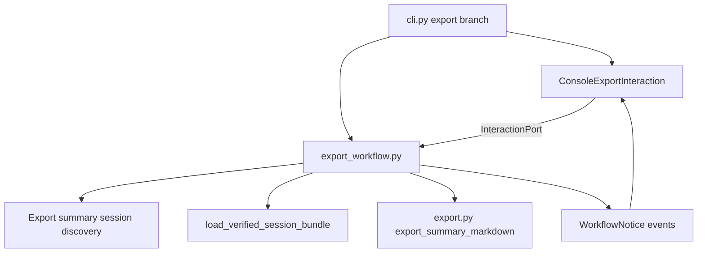
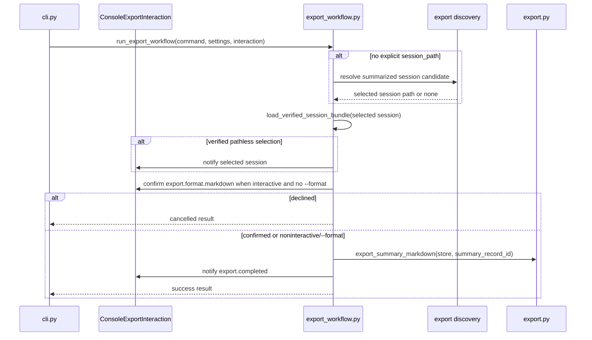
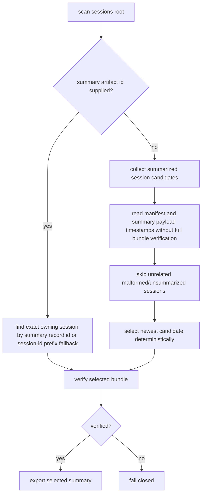

# Export Command UX Confirmation and Workflow Boundary - Plan

## Goal Capsule

| Field | Value |
|---|---|
| Objective | Correct PR #143 structurally by moving export session discovery, format confirmation, cancellation, and export orchestration behind an export workflow that uses the interaction port, while preserving issue #98 user-facing behavior. |
| Authority | GitHub issue #98, the 2026-07-02 sequencing note on issue #98, ADR-002, `CONTEXT.md` Interaction port vocabulary, and `docs/architecture/architecture-overview.md` CLI adapter guidance. |
| Execution profile | Structural refactor with behavior preservation: characterize current export UX, move behavior to workflow/discovery modules, keep CLI tests focused on adapter wording, and run `make check` from `app/`. |
| Stop conditions | Stop if moving behavior out of `cli.py` would change export artifact contracts, weaken selected-session integrity failures, or require solving unrelated export-format/product-scope work. |
| Tail ownership | Update PR #143 against `develop`; keep the PR body current with structural scope, validation, known non-goals, and local self-review. |

---

## Product Contract

### Summary

Issue #98 makes `mena export` feel like an intentional user action even while Markdown is the only PoC export format.
The user can run `mena export` without a path to export the newest summarized session, see Markdown as the available format, confirm it when interactive, and receive a concise path to the readable notes.
Technical users can still provide an explicit `session_path`, and current `--summary-artifact-id` support is retained as technical selection mode because PR #143 already exposed and tested it.

Product Contract preservation: Product Contract unchanged from GitHub issue #98; this plan changes only the implementation boundary and verification structure.

### Problem Frame

The current PR implemented issue #98 mostly inside `app/src/mena/cli.py`: private helpers scan session manifests, rank summaries, ask for Markdown confirmation, print workflow notices, and invoke export.
That direction contradicts the issue sequencing note and ADR-002 because `cli.py` becomes the workflow module instead of a CLI adapter.
It also made review feedback cluster around discovery edge cases, because behavior tests live at the CLI layer instead of a workflow/discovery test surface.

### Requirements

**User-facing export behavior**

- R1. `mena export` with no `session_path` selects the session containing the newest exportable sealed summary under `settings.paths.sessions_dir`.
- R2. `mena export <session_path>` keeps explicit technical session selection and still accepts a session directory or `session.json`.
- R3. `--summary-artifact-id` remains technical selection mode and can locate the containing session when no `session_path` is provided.
- R4. Interactive export without `--format markdown` shows Markdown as the available PoC format and asks the user to confirm it.
- R5. Noninteractive export without `--format markdown` proceeds with Markdown automatically because there is no terminal prompt to answer.
- R6. `--format markdown` skips the confirmation prompt.
- R7. Successful export prints a concise readable path and does not print the verbose contract/provenance dump in normal output.
- R8. Declined, EOF, or keyboard-interrupted confirmation cancels cleanly without traceback, without a `Cannot export...` error wrapper, and without creating an export artifact.

**Architecture boundary**

- R9. Export orchestration lives in a workflow module rather than private `cli.py` helpers.
- R10. The workflow asks for user decisions through `InteractionPort` using stable semantic topics; CLI code owns prompt wording, input parsing, and terminal rendering.
- R11. Export-specific pathless summarized-session discovery is outside `cli.py` and exposes a typed, testable surface.
- R12. `app/src/mena/export.py` remains the deterministic Markdown export service and does not learn terminal interaction or CLI formatting.

**Discovery correctness and safety**

- R13. Pathless discovery is read-only and does not create `artifacts/` directories for unsummarized sessions.
- R14. Discovery avoids full bundle verification until after it selects or identifies a candidate session.
- R15. Discovery tolerates malformed, unreadable, or unsummarized unrelated sessions where safe.
- R16. Once a session or requested artifact is selected, export fails closed through existing integrity/export errors if that selected bundle or summary is corrupt.
- R17. Session ranking uses the newest summary payload timestamp when available and does not blindly trust stale or corrupted manifest metadata.
- R18. Tie-breaking is deterministic by summary timestamp, summary path/id, and session path so repeated pathless export resolves consistently.

**Verification and PR readiness**

- R19. Workflow tests use `ScriptedInteraction` and assert semantic topics for confirmation, notices, cancellation, and completion.
- R20. CLI tests assert parser wiring, prompt bytes, accepted answers including `1`, adapter notices, and error/exit-code mapping only.
- R21. Static boundary checks prove export prompt strings and manifest-scanning workflow helpers no longer live in `cli.py`.

### Scope Boundaries

#### In Scope

- A new export workflow boundary for issue #98 behavior.
- A typed export summarized-session discovery surface.
- Moving current PR #143 pathless export edge-case coverage from CLI-heavy tests to workflow/discovery tests.
- A CLI export interaction adapter that renders Markdown format confirmation and workflow notices.
- PR body refresh and local self-review after validation.

#### Deferred to Follow-Up Work

- Additional export formats beyond Markdown.
- A shared module for all CLI interaction adapters if `cli.py` remains large after this correction.
- A global session index or migration machinery for export discovery.
- Retiring `--summary-artifact-id` if the team later decides it is not part of the public CLI surface.
- Note-package export changes from ADR-034 unless that contract has already landed on the target base branch.

#### Out of Scope

- Changing the Markdown export artifact schema, artifact type, or metadata contract.
- Changing summary generation, summary schema, correction overlay selection, or artifact integrity rules.
- Adding GUI, desktop, web, or agent adapters.
- Rewriting unrelated `process`, `summarize`, `correct`, or runtime fallback workflow boundaries.

### Acceptance Examples

- AE1. Given exactly one summarized session under the configured sessions root, when the user runs `mena export` interactively and confirms Markdown, then Mena announces that selected session, exports Markdown, and prints `Markdown notes exported to: <absolute readable path>`.
- AE2. Given multiple summarized sessions, when the user runs `mena export`, then Mena selects the session containing the newest summary payload timestamp and exports that session.
- AE3. Given a technical user passes `mena export <session_path> --format markdown`, when export succeeds, then no format prompt is shown and the readable Markdown path is printed.
- AE4. Given a technical user passes `--summary-artifact-id` without `session_path`, when the artifact exists in an older session, then Mena selects that containing session rather than the latest summarized session.
- AE5. Given the user declines, sends EOF, or interrupts at Markdown confirmation, when the command exits, then it reports cancellation cleanly and no export artifact is created.
- AE6. Given unrelated malformed sessions exist in the sessions root, when a valid summarized session is available, then pathless discovery skips unrelated malformed candidates and exports the valid selected session.
- AE7. Given the selected newest session has a corrupt summary or failing integrity report, when export runs, then it fails closed with the existing session/export error rather than silently falling back to older notes.

---

## Planning Contract

### Key Technical Decisions

- KTD1. Add `app/src/mena/export_workflow.py` as the application workflow module for the export command. The workflow owns session selection, confirmation timing, cancellation result, integrity verification of the selected session, and invocation of `export_summary_markdown`.
- KTD2. Keep `app/src/mena/export.py` focused on deterministic artifact behavior. Existing `export_summary_markdown` and `resolve_summary_markdown_input` remain service functions; any pure read-only summary-candidate projection may live there only if it is format/service logic rather than workflow sequencing.
- KTD3. Extract export-specific pathless summarized-session discovery from `cli.py` into a typed module surface. Prefer `app/src/mena/export_workflow.py` for workflow-private discovery if the projection is only used by export; use a small `app/src/mena/export_discovery.py` only if it materially improves testability or avoids bloating the workflow file.
- KTD4. Use `InteractionPort.confirm` for Markdown confirmation with topic `export.format.markdown`. The workflow decides that a confirmation is needed; the CLI adapter renders `Available export format:`, the numbered Markdown option, and `Export as Markdown notes? [Y/n]: `.
- KTD5. Use `WorkflowNotice` for user-facing export status with topics such as `export.session_selected.latest`, `export.session_selected.summary_artifact`, and `export.completed`. The workflow emits semantic context; the CLI adapter formats lines like `Using latest summarized session: ...` and `Markdown notes exported to: ...`.
- KTD6. Represent cancellation as a normal workflow result, not an export exception. A declined confirmation returns a cancelled result; EOF/KeyboardInterrupt raised by the CLI adapter is mapped by `main()` to the same clean cancellation output.
- KTD7. Preserve tolerant-scan versus fail-closed-export semantics. Discovery may skip unrelated malformed sessions, but after a candidate is selected the workflow calls `load_verified_session_bundle` before export and lets selected-session integrity/export errors surface.
- KTD8. Rank sessions by validated summary payload `created_at` when available, with deterministic path/id tie-breakers. Manifest metadata can be a cheap hint, but it must not override a readable payload timestamp during final ordering.

### High-Level Technical Design

### Assumptions

- Current `--summary-artifact-id` behavior is retained for PR stability and treated as technical mode, even though issue #98 emphasizes user-facing pathless export.
- Noninteractive `mena export` may proceed with Markdown without prompt because Markdown is the only supported PoC format.
- The workflow may return an absolute exported path for CLI display, while the export artifact record remains session-relative.
- The current PR's broad export edge-case tests are valuable; the structural correction should move or split them, not delete the coverage.

### System-Wide Impact

This correction makes export match the repository's named application workflow boundary.
Future GUI, desktop, or agent adapters can run export by implementing `InteractionPort`, while tests can exercise export behavior without driving terminal prompt strings through `main()`.

### Risks & Dependencies

- Discovery logic is the riskiest part because it must be tolerant during scanning but strict after selection.
- Moving tests out of `test_cli.py` can accidentally drop public-output coverage; keep thin CLI adapter tests for prompt bytes and final lines.
- Over-extracting generic session helpers would expand scope; keep generic session changes minimal unless needed to remove a direct `cli.py` dependency.
- `origin/develop` and local `develop` may differ; compare and validate against the PR base before final review.

### Sources & Research

- GitHub issue #98: "Let users confirm Markdown export and find the readable notes".
- Issue #98 sequencing note from 2026-07-02: implement prompting through the interaction port from #117; if before #117, keep changes wording-only.
- ADR-002: `docs/decisions/ADR-002-cli-as-an-adapter.md`.
- Architecture overview: `docs/architecture/architecture-overview.md` sections on CLI adapter, export, artifact lifecycle, and workflow modules.
- Context vocabulary: `CONTEXT.md` entries for Application workflow module and Interaction port.
- Prior plans: `docs/plans/2026-07-02-004-refactor-correction-interaction-port-plan.md`, `docs/plans/2026-07-03-003-refactor-runtime-fallback-interaction-port-plan.md`, `docs/plans/2026-07-02-004-refactor-sessions-module-plan.md`.
- Current code anchors: `app/src/mena/cli.py`, `app/src/mena/export.py`, `app/src/mena/interaction.py`, `app/src/mena/sessions.py`, `app/src/mena/session_integrity.py`, `app/src/mena/recording_control.py`.

---

## Implementation Units

### U1. Export Workflow Contract

- **Goal:** Introduce the export workflow module and typed result/input contract so export behavior can be tested without the CLI adapter.
- **Requirements:** R1, R2, R3, R4, R5, R6, R8, R9, R10, AE1, AE3, AE4, AE5
- **Dependencies:** Existing `app/src/mena/interaction.py`, `app/src/mena/export.py`, and `app/src/mena/session_integrity.py`.
- **Files:** `app/src/mena/export_workflow.py`, `app/tests/test_export_workflow.py`, `app/src/mena/cli.py`, `app/tests/test_cli.py`
- **Approach:** Add an `ExportCommandInput` dataclass carrying optional `session_path`, optional `summary_artifact_id`, and optional `export_format`. Add an `ExportWorkflowResult` that distinguishes `success` and `cancelled`, with exported path and selected session context on success. Implement `run_export_workflow(..., settings, interaction)` to select the session, ask for Markdown confirmation only when needed, verify the selected bundle, call `export_summary_markdown`, and emit semantic notices.
- **Execution note:** Start with a failing workflow test that scripts `export.format.markdown` through `ScriptedInteraction` and asserts no CLI prompt text is needed to export.
- **Patterns to follow:** `run_recording_control_workflow`, correction workflow interaction-port tests, and runtime fallback `InteractionPort.confirm` usage.
- **Test scenarios:** Given explicit `session_path` and scripted Markdown confirmation `True`, the workflow exports and records a `confirm` request for `export.format.markdown`. Given `--format markdown`, the workflow exports without consuming any scripted interaction. Given no explicit session path, the workflow emits an `export.session_selected.latest` notice before confirmation. Given `--summary-artifact-id`, the workflow emits an `export.session_selected.summary_artifact` notice and exports the containing session. Given scripted confirmation `False`, the workflow returns `cancelled` and no export artifact exists. Given noninteractive/no interaction, the workflow proceeds with Markdown and emits completion.
- **Verification:** `app/tests/test_export_workflow.py` proves the workflow contract, interaction topics, cancellation result, and export invocation independent of `main()`.

### U2. Read-Only Export Session Discovery

- **Goal:** Move pathless summarized-session selection out of `cli.py` into a typed, read-only discovery surface with deterministic ranking.
- **Requirements:** R1, R3, R11, R13, R14, R15, R16, R17, R18, AE2, AE4, AE6, AE7
- **Dependencies:** U1 for workflow integration; existing artifact manifest and summary contracts.
- **Files:** `app/src/mena/export_workflow.py`, optional `app/src/mena/export_discovery.py`, `app/tests/test_export_workflow.py`, optional `app/tests/test_export_discovery.py`
- **Approach:** Extract the current manifest scanning helpers into a module-level discovery function that returns a candidate with `session_dir`, selected summary id/path, payload timestamp, and deterministic sort key. Keep scanning read-only by using `Path` and JSON reads rather than constructing `FileSystemArtifactStore` for every candidate. For requested summary ids, prefer exact manifest record matches and retain a guarded session-id-prefix fallback only for malformed manifests where that is needed to preserve selected-session integrity errors.
- **Execution note:** Preserve the current review-driven edge-case matrix before deleting the private CLI helpers.
- **Patterns to follow:** `ProcessableSessionCandidate` in `app/src/mena/sessions.py`, `resolve_summary_markdown_input` ranking within a single session, and current PR #143 tests around malformed sessions.
- **Test scenarios:** Given two summarized sessions with payload timestamps `2026-05-20T10:00:00Z` and `2026-06-15T10:00:00Z`, discovery selects the latter. Given invalid manifest metadata but a readable payload timestamp, payload timestamp wins. Given an unsummarized session, discovery does not create an `artifacts/` directory. Given malformed unrelated `session.json` or manifest JSON, discovery skips it when a valid summarized session exists. Given the newest selected session has a malformed summary record or corrupt payload, discovery selects it and the workflow fails closed during verification/export. Given `--summary-artifact-id` and an unrelated malformed session with missing id, discovery continues to the owning session rather than aborting early. Given no summarized sessions, workflow raises a user-actionable "Run `mena summarize` first" error before confirmation.
- **Verification:** Discovery tests prove read-only scanning, deterministic ordering, tolerant unrelated scanning, and fail-closed selected-session behavior.

### U3. CLI Export Interaction Adapter

- **Goal:** Reduce the export branch in `cli.py` to parser wiring, adapter rendering, and exit-code/error mapping.
- **Requirements:** R4, R5, R6, R7, R8, R10, R20, R21, AE1, AE3, AE5
- **Dependencies:** U1
- **Files:** `app/src/mena/cli.py`, `app/tests/test_cli.py`
- **Approach:** Add `ConsoleExportInteraction` near the existing console adapters. Implement `confirm` for `export.format.markdown` by printing the available format line and numbered Markdown option, then accepting blank, `1`, `y`, and `yes`. Implement `notify` for selected-session and completed-export topics. Let EOF/KeyboardInterrupt propagate to `main()` so it can print `Export cancelled.` and return `1`. Replace `_run_export_command` internals with a thin call to `export_workflow.run_export_workflow`.
- **Patterns to follow:** `ConsoleRecordInteraction`, `ConsoleCorrectionInteraction`, `_CliSetupInteraction`, and `_resolve_runtime_fallback_interaction`.
- **Test scenarios:** Given CLI input `1`, `y`, `yes`, and blank, the adapter confirms Markdown. Given `n` or another string, the command returns `1`, prints `Export cancelled.`, and does not print the export path. Given EOF/KeyboardInterrupt during confirmation, `main()` returns `1` with `Export cancelled.` and no traceback. Given `--format markdown`, no format prompt text is printed. Given a successful export, CLI output includes selected-session notice when pathless and final `Markdown notes exported to:` line, but not `Export contract:` or `Export provenance:`.
- **Verification:** CLI tests cover prompt bytes, accepted answers, cancellation, concise output, and exception mapping with no duplicate discovery behavior assertions.

### U4. Test Migration and Static Boundary Cleanup

- **Goal:** Delete CLI-owned workflow helpers and move broad behavior tests to the workflow/discovery surface without losing coverage.
- **Requirements:** R9, R10, R11, R19, R20, R21
- **Dependencies:** U1, U2, U3
- **Files:** `app/src/mena/cli.py`, `app/src/mena/export_workflow.py`, optional `app/src/mena/export_discovery.py`, `app/tests/test_cli.py`, `app/tests/test_export_workflow.py`, optional `app/tests/test_export_discovery.py`
- **Approach:** Remove private export helpers from `cli.py`: `_resolve_export_format`, `_resolve_export_session_path`, `_resolve_default_export_session`, summary manifest record dataclasses/constants that are no longer adapter concerns, and any helper only used by discovery. Keep only adapter methods and parser arguments in CLI. Move or rewrite current export tests so `test_cli.py` no longer contains the full discovery matrix. Add static assertions or verification commands that catch prompt/discovery ownership regressions.
- **Patterns to follow:** Prior interaction-port plans' static boundary checks and `ScriptedInteraction` tests.
- **Test scenarios:** Static search for `Available export format:` and `Export as Markdown notes?` matches only `app/src/mena/cli.py`. Static search for `_resolve_default_export_session`, `_session_summary_records`, and `_SummaryManifestRecord` finds no definitions in `app/src/mena/cli.py`. Workflow tests assert `ScriptedInteraction` request and notice topics. Existing `app/tests/test_export.py` continues to prove deterministic Markdown artifact creation unchanged. `test_cli.py` remains materially smaller in export workflow behavior coverage after migration.
- **Verification:** Boundary cleanup removes dead imports/helpers from `cli.py`, preserves focused coverage, and passes ruff/mypy.

### U5. PR Validation and Review Readiness

- **Goal:** Finish the structural correction with local gates, self-review, PR body refresh, and conflict/base awareness.
- **Requirements:** R19, R20, R21
- **Dependencies:** U1, U2, U3, U4
- **Files:** `docs/plans/2026-07-03-issue-98-export-confirmation-plan.md`, `.github` PR body through GitHub, changed app files and tests
- **Approach:** Run focused tests while iterating, then `make check` from `app/`. Compare branch diff against `origin/develop` because local `develop` may include unrelated merged commits. Update PR #143 body to explain that the branch now corrects the workflow boundary, list validation, note retained `--summary-artifact-id` as technical mode, and summarize self-review. Resolve merge conflicts if GitHub still reports `DIRTY`.
- **Patterns to follow:** `app/AGENTS.md` Definition of Done for app issue work and `.github/PULL_REQUEST_TEMPLATE.md`.
- **Test scenarios:** Local self-review checks issue #98 acceptance criteria, the sequencing note, ADR-002 boundary, non-goals, cancellation, malformed-session edge cases, and static prompt ownership. PR body includes validation results and known non-goals.
- **Verification:** `make check` from `app/` passes, PR body is current, and no unrelated local `develop` diff is presented as issue #98 work.

---

## Verification Contract

| Gate | Scope | Done signal |
|---|---|---|
| Workflow tests | U1, U2 | `app/tests/test_export_workflow.py` covers explicit path, pathless latest session, requested summary artifact, confirmation accepted/declined, noninteractive Markdown, selected corrupt session failure, and semantic interaction topics. |
| Discovery tests | U2 | Workflow/discovery tests cover read-only scanning, deterministic ranking, malformed unrelated session skip, payload timestamp authority, requested artifact lookup, no summarized sessions, and fail-closed selected corruption. |
| CLI adapter tests | U3, U4 | `app/tests/test_cli.py` covers parser flags, prompt bytes, `1`/blank/yes/no handling, clean interrupt cancellation, selected-session notices, concise output, and error mapping. |
| Export service tests | U1-U4 | Existing `app/tests/test_export.py` remains green without changing Markdown artifact schema expectations. |
| Static boundary checks | U4 | Export prompt strings and raw input mechanics are CLI-only; export discovery/workflow helpers are not private `cli.py` helpers. |
| App gate | U1-U5 | `make check` from `app/` passes using repo/dev invocation. |
| PR readiness | U5 | PR #143 body reflects current scope, validation, non-goals, and self-review; branch targets `develop`. |

---

## Definition of Done

- `app/src/mena/export_workflow.py` or an equivalent workflow module owns export orchestration and can be tested without `main()`.
- Export format confirmation uses `InteractionPort` with semantic topic `export.format.markdown`.
- CLI owns Markdown prompt wording, accepted answer parsing, workflow notice rendering, and exit-code/error mapping only.
- Pathless summarized-session discovery is outside `cli.py`, read-only, deterministic, tolerant of unrelated malformed sessions, and strict after selecting a candidate.
- `export.py` still owns deterministic Markdown artifact creation and does not depend on terminal behavior.
- Existing concise export output and cancellation behavior remain user-compatible.
- Current PR #143 discovery edge-case coverage is preserved at workflow/discovery level and thinned at CLI level.
- Static boundary checks, focused tests, and `make check` from `app/` pass.
- PR #143 is updated with structural scope, validation results, retained technical-mode notes, and local self-review.
