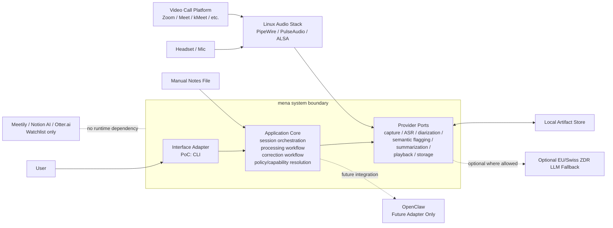
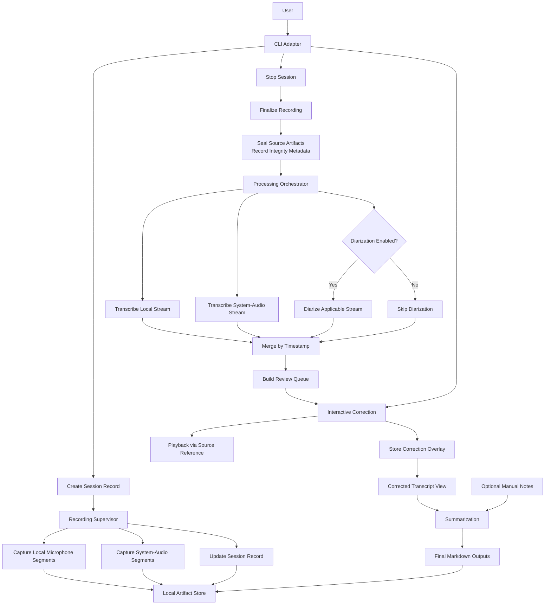
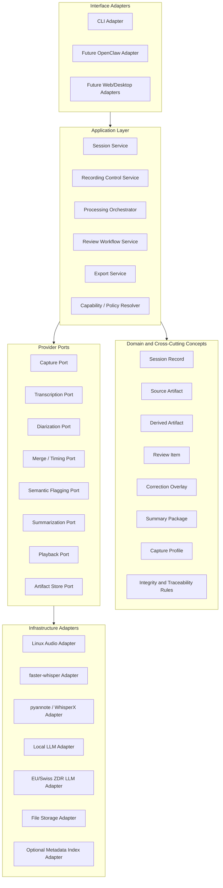

# mena Architecture Working Draft

Status: working draft for interactive architecture decisions

This document captures architecture decisions incrementally while they are being discussed.
Sections may be revised as later decisions sharpen earlier wording.

## 1. Introduction and Goals

### 1.1 Purpose

This document records the current architecture baseline for `mena` using an `arc42`-style structure.
It is deliberately iterative. The goal is to preserve decisions early without pretending that all details are final.

### 1.2 Scope of This Draft

This draft currently covers:

- current system context
- current runtime pipeline
- initial glossary

Later sections will be added as decisions are made.

### 1.3 Decision Status Convention

- `Confirmed`: accepted as current architecture baseline
- `Provisional`: accepted for now, but likely to be refined later
- `Deferred`: intentionally not decided yet

## 2. Glossary

- `CLI`: Command-Line Interface
- `ASR`: Automatic Speech Recognition, meaning speech-to-text transcription
- `ALSA`: Advanced Linux Sound Architecture, a Linux audio subsystem
- `Artifact`: a persisted file or data object produced by the pipeline
- `Diarization`: identifying who spoke when
- `Manifest` / `Session Record`: persisted metadata and checkpoints for a meeting session and its processing lifecycle
- `System audio`: audio captured from the operating system output path
- `ZDR`: Zero Data Retention

## 3. System Context

Status: Confirmed

### 3.1 Context Statement

`mena` is a standalone privacy-first meeting notes system.
For the PoC, the primary scenario is an online meeting on Linux using dual-stream capture:

- local microphone input
- system-audio capture, typically carrying remote participants from a conference tool

The core pipeline must remain independent from:

- the first user interface (`CLI`)
- future interfaces (`OpenClaw`, web UI, desktop UI, mobile UI)
- specific model providers
- specific execution backends

Existing products such as `Meetily`, `Notion AI Meeting Notes`, and `Otter.ai` are reference products to watch, not runtime dependencies and not part of the system boundary.

### 3.2 Context Diagram

### 3.3 Current Clarifications

- `OpenClaw` remains outside the PoC system boundary, even though its current integration path is expected to overlap heavily with the `CLI` command surface.
- `Local artifact storage` is a first-class subsystem from day one.
- `System audio` is a convenient PoC term, but architecturally the broader concern is controlled capture-source routing. This matters because future scenarios include both conference-tool output capture and in-person microphone capture.

## 4. Runtime Pipeline

Status: Provisional

### 4.1 Runtime Narrative

#### Phase 0: Session Start

The user starts a session through the current interface adapter, which is the `CLI` for the PoC.
The system creates a `session record`.

The session record is primarily system-managed, not user-authored.
User input should remain minimal.
Likely user-supplied fields include:

- meeting language
- capture mode where needed
- diarization enabled or disabled
- optional path to manual notes

Most other fields are generated by the system, for example:

- session identifier
- timestamps
- selected audio devices or routes
- list of source artifacts
- processing checkpoints
- integrity metadata

#### Phase 1: Recording

Recording is the most critical runtime path.
The recording subsystem captures:

- local microphone segments
- system-audio segments

For the current PoC, `system-audio segments` usually represent audio coming from a remote conference tool such as `Zoom`, `Google Meet`, or `kMeet`.

The system continuously flushes recorded segments to local storage and updates the session record with capture state and checkpoints.

Architectural rule:

- recording is isolated from downstream processing

#### Phase 2: Session Finalization

When the user stops the session, the recording phase is finalized.
Source artifacts become immutable inputs for later steps.
The system records integrity metadata so that later processing can verify that raw recorded input has not changed.

Architectural rule:

- source artifact integrity must be verifiable

The concrete hashing algorithm is an implementation decision unless stronger requirements emerge later.

#### Phase 3: Automated Post-Meeting Processing

The processing orchestrator reads persisted source artifacts and performs:

- local stream transcription
- system-audio stream transcription
- optional diarization where enabled
- timestamp-based transcript merging
- flagging of low-confidence, overlap, or incoherent segments

Derived artifacts are written separately from source artifacts.

#### Phase 4: Human Correction

The correction adapter presents flagged segments only.
The user may:

- correct speaker attribution
- correct transcript text
- play back the related source audio
- skip a flag

Corrections are stored as an overlay rather than rewriting the source transcript.

Architectural rule:

- each review item must carry a stable source reference so that playback and traceability remain reliable

#### Phase 5: Finalization

The finalization step combines:

- corrected transcript view
- optional manual notes

It then performs summarization and export generation.

### 4.2 Runtime Diagram

### 4.3 Clarifications and Open Precision Work

- `System-audio capture` is the current PoC expression for online meetings. The broader architectural concern is `capture source routing`, which must allow future scenarios such as in-person microphone-based meetings without rewriting the core pipeline.
- `Audio playback during correction` is treated as mandatory, not optional.

### 4.4 Process Topology Decision

Status: Confirmed

The current process topology decision is:

- one dedicated `Recorder Process`
- one separate `Main App Process`

The `Recorder Process` owns:

- capture-source routing
- audio capture
- segment flushing
- source-artifact updates
- recording-related session-state updates

The `Main App Process` owns:

- session control
- post-meeting orchestration
- correction workflow
- export generation
- capability and policy resolution

Reasoning:

- recording robustness is the highest-priority quality attribute
- recording must be isolated from downstream processing failures
- this topology is still small enough for a PoC
- it creates cleaner work boundaries for later coding-agent implementation

Deferred:

- further subdivision into additional supervised workers

Revisit trigger:

- new input topologies, such as richer in-person meeting capture
- processing concurrency requirements
- operational complexity that justifies more worker isolation

## 5. Building Block View

Status: Provisional

### 5.1 Layered Decomposition

The current architectural decomposition is:

- interface adapters
- application layer
- domain and cross-cutting concepts
- provider ports
- infrastructure adapters

The intent is to keep:

- user interaction separate from core workflow logic
- workflow logic separate from concrete model and audio tooling
- domain artifacts separate from interface-specific state

### 5.2 Layer Diagram

### 5.3 Current Building Blocks

#### Interface Adapters

- `CLI Adapter`
- future adapters such as `OpenClaw`, web UI, or desktop UI

#### Application Layer

- `Session Service`
- `Recording Control Service`
- `Processing Orchestrator`
- `Review Workflow Service`
- `Export Service`
- `Capability / Policy Resolver`

#### Domain and Cross-Cutting Concepts

- `Session Record`
- `Source Artifact`
- `Derived Artifact`
- `Review Item`
- `Correction Overlay`
- `Summary Package`
- `Capture Profile`
- `Integrity and Traceability Rules`

#### Provider Ports

- `Capture Port`
- `Transcription Port`
- `Diarization Port`
- `Merge / Timing Port`
- `Semantic Flagging Port`
- `Summarization Port`
- `Playback Port`
- `Artifact Store Port`

#### Infrastructure Adapters

- Linux audio integration
- ASR provider integration
- diarization provider integration
- local LLM integration
- EU/Swiss jurisdiction-safe fallback integration where allowed
- file storage and optional metadata indexing

### 5.4 Capture Port Decision

Status: Confirmed

The architecture uses:

- one generic `Capture Port`
- different explicit `Capture Profiles`

This means the core pipeline depends on a stable capture contract rather than on a meeting-type-specific implementation split.

Current reasoning:

- the PoC should move fast
- online dual-stream is the first active profile
- future in-person support should reuse the same core pipeline rather than fork it

Current failure mode to watch:

- if the generic capture contract becomes vague, it may hide meaningful differences between capture topologies

Architectural mitigation:

- `Capture Profile` must be explicit and strongly modeled
- routing metadata must be persisted in the `Session Record`
- downstream processing must consume artifacts plus capture metadata, not make hidden assumptions about source topology

## 6. Variability and Substitution Points

Status: Provisional

### 6.1 Purpose

This section identifies which parts of the system are:

- fixed architectural baseline
- replaceable behind stable contracts
- intentionally deferred pending research

The goal is to prevent early implementation convenience from hard-coding the PoC to one interface, one laptop profile, or one provider stack.

### 6.2 Variability Map

| Area | Current Baseline | Replaceable? | Notes |
|---|---|---|---|
| User interface | `CLI` | Yes | First adapter only; future adapters include `OpenClaw`, web UI, desktop UI |
| Capture topology | Online dual-stream | Yes | Future capture profiles include in-person microphone-based sessions |
| Capture implementation | Linux audio stack | Partly | PoC is Linux-only, but capture stays behind `Capture Port` |
| ASR provider | Not fixed yet | Yes | Must remain behind `Transcription Port` |
| Diarization provider | Not fixed yet | Yes | Must remain behind `Diarization Port` |
| Summarization provider | Not fixed yet | Yes | Local-first, EU/Swiss fallback where allowed |
| Semantic flagging provider | Not fixed yet | Yes | Same policy constraints as summarization |
| Artifact persistence pattern | Local artifact store | Partly | First-class subsystem; exact implementation still open |
| Metadata/index store | Not fixed yet | Yes | May begin minimal and grow later |
| Process topology | Not fixed yet | Yes | One process vs supervised workers remains open |
| Output format | Markdown | Partly | Markdown is current baseline; additional exports may come later |

### 6.3 Fixed Architectural Baseline

The following are currently treated as fixed unless later architecture work explicitly changes them:

- standalone PoC product
- Linux-only PoC scope
- online dual-stream PoC scenario
- local artifact store as first-class subsystem
- correction overlay instead of source transcript rewrite
- mandatory playback during correction
- provider access through ports rather than direct tool coupling
- capture variation handled through explicit `Capture Profiles`

### 6.4 Replaceable by Design

The following must be easy to swap without rewriting the core pipeline:

- interface adapter
- model/provider implementation
- local vs jurisdiction-safe fallback backend where allowed
- exact storage/indexing technology
- exact packaging/runtime strategy for different tester hardware profiles

### 6.5 Research-Driven Decisions

The following should not be guessed during implementation and should instead become explicit research tasks later:

- best Linux capture approach for reliable dual-stream routing
- realistic OS compatibility implications of the chosen capture approach
- ASR provider selection and tradeoffs
- diarization provider selection and tradeoffs
- persistence approach for artifacts, metadata, and resumable processing
- runtime strategy for lower-capability tester machines
- fallback-provider options that satisfy sovereignty constraints

### 6.6 Architectural Guardrail

If an implementation choice affects:

- replaceability
- failure isolation
- sovereignty policy enforcement
- resumability
- future interface independence

then it is not a mere implementation detail and must either appear in this architecture draft or be tracked as an open architecture question.

## 7. Deployment and Runtime Data Boundaries

Status: Provisional

### 7.1 Why This Matters Early

For the PoC, the developer machine and the first customer machine are the same machine.
This increases the risk of mixing:

- source code
- architecture and research documents
- runtime session artifacts
- model caches
- logs
- exported meeting notes

If these concerns are not separated early, the PoC will become hard to operate, hard to clean up, and easy to corrupt through normal development work.

### 7.2 Current Boundary Rule

The repository root must not be treated as the product's runtime home.

The architecture assumes a separation between:

- repository contents
- runtime working data
- long-lived user data
- generated exports

### 7.3 Architectural Consequences

- runtime artifacts must not be written into arbitrary source-code directories
- session outputs must not rely on git-tracked paths as their canonical storage location
- integrity and reconciliation logic must work independently from the repository layout
- local development convenience must not define the production data model

### 7.4 Current Direction

The exact directory layout is still open, but the architecture already assumes:

- source code and documentation live in the repository
- runtime data lives outside normal source directories
- the application can be run locally by a developer without making the repository itself the canonical data store

This decision supports both:

- local PoC development on the same machine as day-to-day use
- later packaging into a more product-like local application
